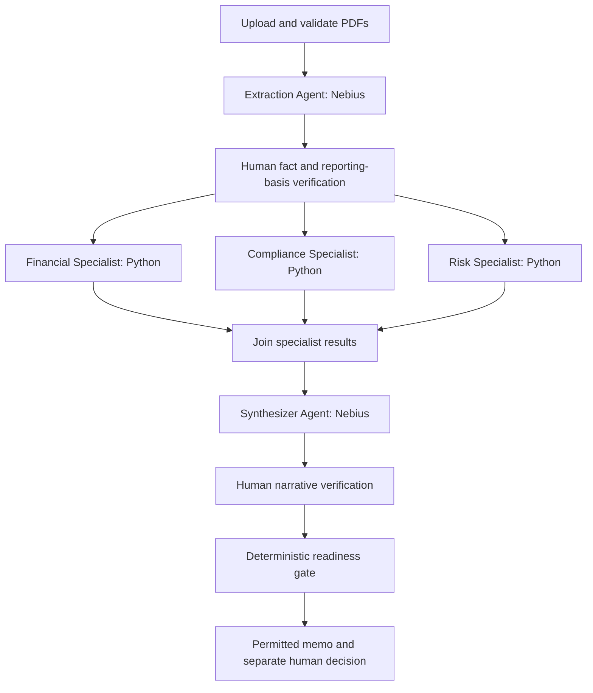

# Deal or No Deal AI

*Every deal has a story. Our agents find the plot holes.*

**A multi-agent financial deal review assistant built with LangGraph.** Upload a fictional commercial-loan package, inspect financial and policy findings, and prepare a source-linked credit memo. Reviewers can see what the documents support and what still needs attention.

**Project 3B · Mastering Agentic AI · Week 3**

[Project report](docs/weekly-project-report.md) · [Submission summary](docs/github-submission-summary.md) · [Synthetic upload package](demo-documents/cedar-vale-packaging/README.md)

## Why it exists

Commercial-loan reviews combine agreements, financial statements, collateral evidence and lending policies. Analysts must reconcile dates, calculate ratios, identify exceptions and explain their conclusions. Scattered documents make unsupported assumptions difficult to spot.

Deal or No Deal AI connects these activities in one workspace. AI extracts information and explains findings; Python performs reproducible calculations and configured policy checks. Reviewers inspect evidence and record separate human decisions. The goal is less repetitive preparation with clear accountability; productivity gains have not been measured.

## The working experience

1. **Upload and inspect:** In New Deal, choose a sample or upload one synthetic package: up to three text PDFs, ten combined pages and 10 MB (10,000,000 bytes). Validate the files and confirm suggested reporting information.
2. **Run AI Deal Review:** Explicitly start live extraction of structured terms and citations from retained documents.
3. **Verify facts:** For new general uploads, permitted reviewers inspect facts and reporting basis before continuing.
4. **Analyze and synthesize:** Financial, Compliance and Risk branches analyze the same verified inputs, join, then feed AI synthesis.
5. **Verify conclusions:** Review narrative evidence. The readiness gate identifies unresolved requirements and permitted next actions.
6. **Use the results:** Inspect activity, download a permitted partial or complete memo, and record authorized simulated decisions.

One Deal ID links documents, results, memo and history. Preliminary upload calculations are explicitly unverified; their display does not mean specialist execution or human verification has completed.

### Six connected screens

- **Deal Dashboard:** Prioritize deals needing attention.
- **New Deal:** Upload, inspect and start analysis.
- **Review Workspace:** Explore terms, calculations, policy findings, risks and sources.
- **Agent Activity:** Inspect recorded execution and handoffs.
- **Credit Memo:** Read and download the report.
- **Decision History:** Inspect decisions, comments and audit events.

These actual captures show retained fictional reviews, not a newly executed upload journey. Counts reflect local demonstration history.


## How the agents coordinate

This diagram shows the **new general-upload workflow**. LangGraph coordinates typed shared state, conditional routing, persisted checkpoints and explicit continuation. Components communicate through source-linked artifacts, not simulated conversations.



The **Extraction Agent** identifies terms, figures and citations. The **Financial Specialist** calculates metrics; **Compliance** evaluates sample policies; **Risk** aggregates flags and available factor assessments. The **Synthesizer Agent** explains the combined findings. The **LangGraph Orchestrator** manages dependencies and checkpoints without a planning-model call.

This hybrid design has **two normal LLM stages and three deterministic specialist nodes**. Calculations and rules benefit from explicit, testable behavior. The branches join through `specialist_join` before synthesis; only the parent persists their outputs. Sample demo drafts and historical reviews retain their own execution policies; unverified drafts are labeled.

## Illustrative deal: low risk, still pending

The registered **Example Equipment LLC** case concerns a fictional **$1.2 million, 48-month equipment loan**.

| Finding | Sample result |
|---|---|
| Debt-service coverage: annual cash available / annual debt payments | 1.50x |
| Loan-to-value: loan amount / collateral value | 60% |
| Debt / EBITDA: debt relative to operating earnings | 3.00x |
| Illustrative risk assessment | 21/100 — Low |
| Effective readiness | **Pending Review** |
| Human credit decision | **Not recorded** |

The annual financial-reporting covenant remains unevaluated. Favorable ratios and a Low score cannot clear that requirement. Future obligations are evaluated according to timing, not automatically treated as breaches.

The score uses supplied educational assessments, not a default-probability model. Other uploads never inherit it: absent assessments yield **Insufficient Data**. AI proposals, readiness and human decisions stay separate. Any permitted educational approval override is labeled and audited; it does not resolve outstanding checks.

## Technology

Python 3.12 powers the application; Streamlit provides the interface. LangGraph and LangChain Core support orchestration, Pydantic validates structured data, pypdf parses PDFs, and SQLite persists reviews and checkpoints. pytest supports automated verification.

Nebius generation uses `Qwen/Qwen3-30B-A3B-Instruct-2507`. Runtime grounding uses supplied cited documents; hosted embeddings are a separate selection, not a completed semantic-search benchmark.

## Getting started

Install Python 3.12 and [uv](https://docs.astral.sh/uv/). Replace both repository placeholders:

```powershell
git clone <YOUR_GITHUB_REPOSITORY_URL>
cd <YOUR_REPOSITORY_FOLDER>
uv sync --frozen --python 3.12 --group dev --extra evaluation
Copy-Item .env.example .env
```

The evaluation extra includes tokenizer support for live request sizing; installation does not run evaluations. Populate `NEBIUS_API_KEY` in local `.env`. Never commit it. For live sizing, explicitly download tokenizer files only, then launch:

```powershell
uv run --frozen --extra evaluation python tools/setup_live_tokenizer.py
uv run --frozen --extra evaluation streamlit run app.py --server.address 127.0.0.1
```

Open the displayed URL. Check **Live AI demo: setup and readiness** in the sidebar before explicit Run or Continue. A key alone does not establish provider access, request fit or spending readiness. Ignored runtime evidence is not included in a fresh checkout.

`config/app.toml` currently selects `LIVE`; `FIXTURE` selects saved sample responses without model calls. One Run action serves both paths. Live calls incur charges within the shared allowance. Navigation starts no model call; failures never substitute saved answers.

Run offline application tests:

```powershell
uv run --frozen --extra evaluation pytest
```

## Evidence and next steps

[Phase 1 evidence](docs/evaluation/phase1-demo-results.md) documents completed live Standard Deal extraction, synthesis and a downloadable draft, plus **67 functional tests and 63 subtests** at that checkpoint. These historical checks are not a current full-suite count or accuracy guarantee.

Saved-answer/RAGAS experiments and mocked integration tests are separate from live-model evidence. The newest general-upload workflow still needs a complete fresh live walkthrough with genuine human checkpoints. Broader live-answer evaluation remains deferred.

Scanned/encrypted PDFs, production authentication, real banking integrations and calibrated credit predictions are outside scope. See the [report](docs/weekly-project-report.md), [upload contract](docs/specs/general-upload-acceptance.md) and [publication checklist](docs/github-publication-checklist.md) for details.

**Submission links:** GitHub repository — pending; demo recording — pending. No public deployment is claimed. A project license remains unselected.

**Educational use only:** Deals are fictional and roles simulated. AI recommendations and demo decisions do not authorize real loans.
