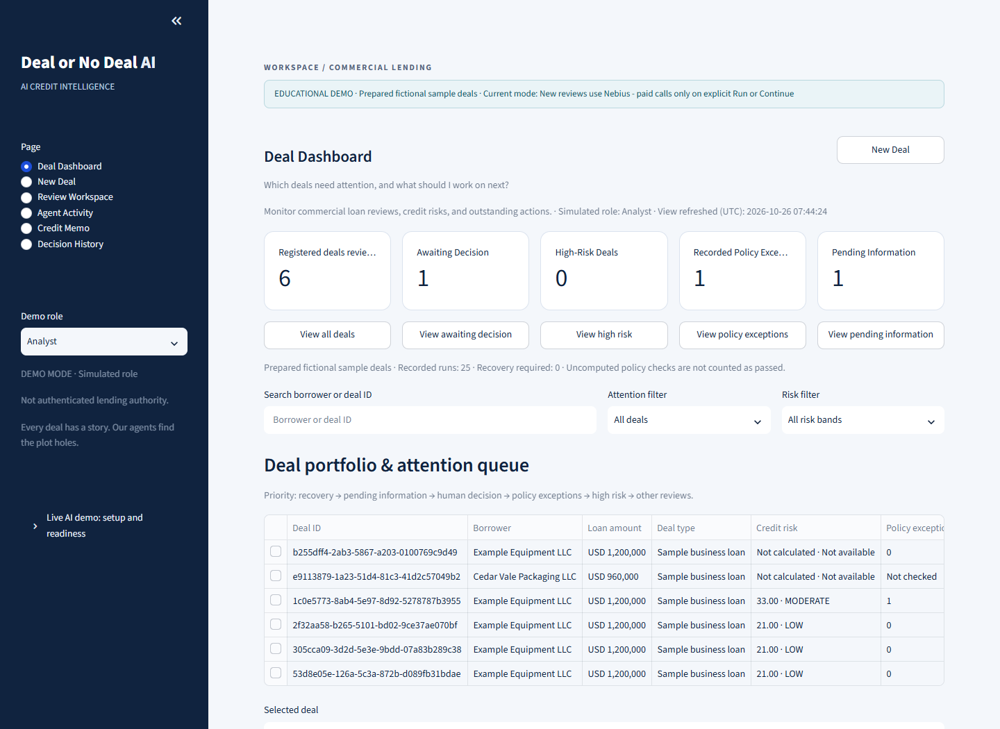
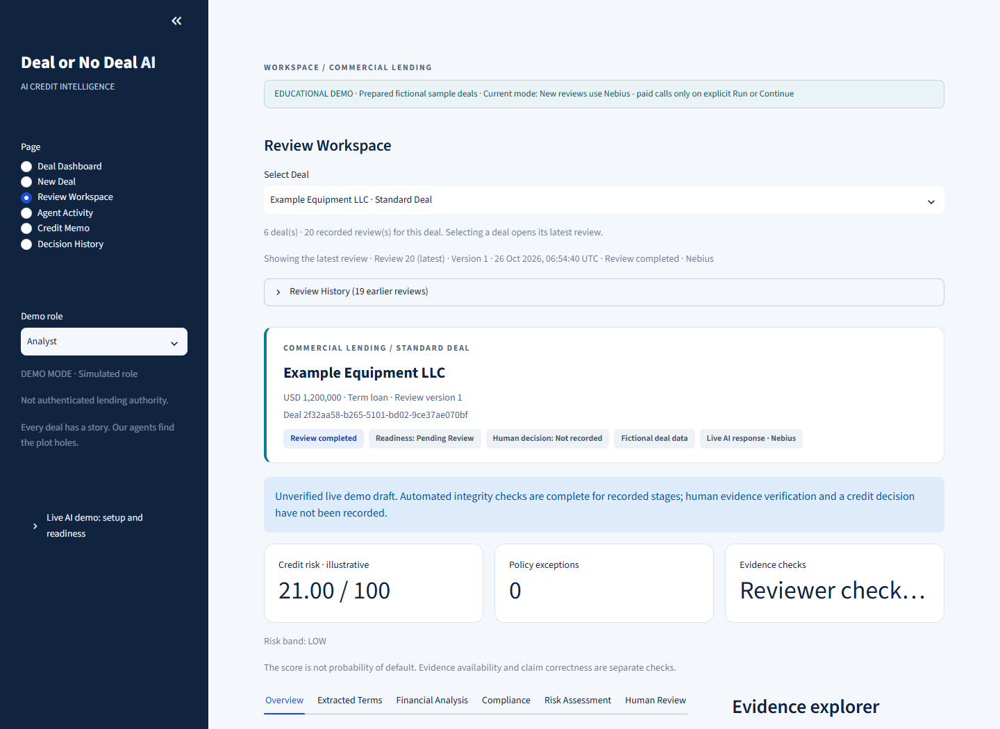
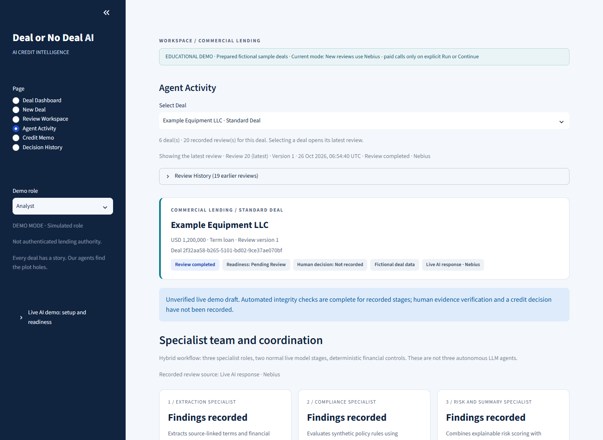

# Deal or No Deal AI

### Every deal has a story. Our agents find the plot holes.

**Understand the deal. Check the numbers. See what still needs attention.**

A loan can look attractive on paper and still be unready for approval. Deal or No Deal AI brings document extraction, financial analysis, policy checks and human review into one connected experience—so reviewers can understand the evidence behind a recommendation.

Built for **Project 3B: Multi-Agent Deal Review Pipeline**, this educational application uses fictional commercial loans and simulated roles. It supports human judgment; it does not authorize real lending.

[Explore the architecture](docs/architecture/hld.md) · [Read the project report](docs/weekly-project-report_submission.pdf) · [Try the synthetic upload package](demo-documents/cedar-vale-packaging/README.md)

## Why we built it

A credit analyst receives a loan agreement, financial statements and collateral documents. The borrower looks promising—but do the figures cover the same period? Is the collateral sufficient? Does a reporting covenant still need review?

Reviewers must connect evidence, calculate ratios and explain unresolved concerns. One confident AI response can hide unsupported assumptions.

## One connected review experience

| Traditional review | Deal or No Deal AI |
|---|---|
| Read documents and copy important figures | Extract structured terms with source references |
| Calculate ratios in a separate worksheet | Apply reproducible Python calculations |
| Reconcile policy requirements manually | Surface configured policy findings and unknowns |
| Assemble a written credit review | Combine findings into a source-linked draft memo |
| Track review actions across files | Keep comments, decisions and timestamps together |

## From documents to a reviewable recommendation

1. **Start in New Deal.** Select a sample or upload one fictional package: up to three text PDFs, ten combined pages and 10 MB. Inspect parsed pages and confirm suggested reporting information.
2. **Run AI Deal Review.** Explicitly start live extraction of borrower details, terms, figures and source references.
3. **Check the facts.** New general uploads pause for permitted reviewers to verify facts and reporting basis.
4. **Inspect the analysis.** Financial, Compliance and Risk specialists run in parallel on verified inputs, then join before synthesis.
5. **Review the explanation.** Verify the generated narrative against its evidence. The readiness gate identifies unresolved requirements.
6. **Use the findings.** Download a permitted partial or complete memo and record authorized simulated review actions.

One Deal ID connects the documents and downstream screens. Preliminary upload calculations are labeled unverified; viewing them does not complete a graph stage or a human checkpoint.

### See the application

**Deal Dashboard — what needs attention next?** View the deal queue, status and recorded findings.



**Review Workspace — why does this deal need review?** Explore extracted terms, financial analysis, compliance, risks and supporting pages.



**Agent Activity — how was the review produced?** Inspect specialist responsibilities, recorded execution and handoffs.



The other screens are **New Deal**, **Credit Memo** and **Decision History**. Together, they support intake, downloadable reporting and recorded human actions. Screenshots show retained fictional reviews, not proof of a fresh general-upload walkthrough.

## Multi-agent flow: how data becomes analysis

LangGraph acts as the **Orchestrator Agent**: it passes structured, source-linked information between specialists, records progress and pauses when human checks are required. The workflow has two normal LLM stages and three deterministic Python specialist nodes.

| Stage | Data processing and reviewer value |
|---|---|
| Document intake | Parses PDF text, retains page references and checks upload limits. Parsing does not verify financial facts. |
| Extraction Agent ? Nebius | Turns document text into structured borrower details, loan terms and financial inputs with citations. Pydantic checks the output structure, not factual truth. |
| Human fact verification | Reviewers compare values, units, reporting periods and applicability with the cited pages. AI-assisted checks never count as human verification. |
| Financial Specialist ? Python | Applies reproducible formulas to supported inputs: debt coverage, collateral coverage and leverage. Missing operands remain unresolved. |
| Compliance Specialist ? Python | Applies configured sample-policy rules; unknown applicability and incomplete covenant checks remain visible. |
| Risk Specialist ? Python | Aggregates available risk factors and flags. Missing factor assessments produce Insufficient Data, not an assumed Low score. |
| Synthesizer Agent ? Nebius | Combines joined findings into a rationale, outstanding concerns, conditions and next actions. |
| Readiness and reporting | After narrative verification, deterministic checks set decision readiness. Permitted reports preserve findings and evidence; human decisions are recorded separately. |

### Parallel analysis, coordinated handoffs

The diagram shows the **general-upload path**. Financial, Compliance and Risk receive the same verified input snapshot and execute in parallel. LangGraph joins all three outputs before synthesis. Sample drafts and historical reviews retain their own checkpoint policies; unverified drafts are labeled.

```text
Upload deal documents
        |
        v
Parse PDFs and retain page references
        |
        v
Extraction Agent reads terms, figures and supporting sources
        |
        v
Human reviewer checks extracted facts and reporting periods
        |
        v
Orchestrator sends the same verified information to three specialists
        |
        +-- Financial Specialist: calculate financial ratios --+
        |                                                     |
        +-- Compliance Specialist: check applicable policies --+  Run in parallel
        |                                                     |
        +-- Risk Specialist: identify risk factors and flags --+
                                                              |
                                                              v
Orchestrator combines all three specialist results
        |
        v
Synthesizer Agent explains findings, concerns and next actions
        |
        v
Human reviewer checks the explanation against source evidence
        |
        v
Readiness Gate identifies unresolved requirements
        |
        +--> Credit Memo: permitted report with findings and sources
        |
        +--> Separate Human Decision: approve, reject or request information
             Only when the user's role and required checks permit the action
```

One Deal ID and source map connect results across screens. SQLite retains checkpoints and review history so permitted continuation uses the recorded state. Viewing a page starts no AI analysis. A memo can be generated while approval remains blocked.

### How recommendations support a decision

The recommendation explains **what supports the deal, what remains unresolved and what to do next**. Reviewers trace claims to source pages, compare calculations with inputs and inspect policy findings. They can identify missing evidence, request information or escalate exceptions instead of accepting a score alone.

The deterministic readiness gate determines the effective outcome; an AI-generated approval proposal cannot override mandatory blockers. Authorized users separately record simulated Approve, Reject or Pending actions with required comments and timestamps, subject to backend permissions and readiness checks.

## The demo story: Low Risk → Pending Review → Human Decision

**Example Equipment LLC requests a fictional $1.2 million equipment loan over 48 months.**

| Finding | Registered sample result |
|---|---|
| Debt-service coverage: annual cash available / annual debt payments | 1.50x |
| Loan-to-value: loan amount / collateral value | 60% |
| Debt / EBITDA: debt relative to operating earnings | 3.00x |
| Illustrative risk score | 21/100 — Low |
| Approval readiness | **Pending Review** |
| Human decision | **Not recorded** |

The annual financial-reporting covenant still needs evaluation. Favorable ratios and a Low rating cannot clear it. Future obligations are evaluated according to contractual timing, not automatically marked breached.

**A financially attractive deal is not necessarily ready for approval.**

The sample score depends on supplied educational factor assessments, not a calibrated default-probability model. New uploads never inherit those ratings. Any permitted educational approval override is explicitly labeled and audited; outstanding checks remain unchanged.

## What makes this project stand out?

**Specialized responsibilities, reproducible calculations, visible evidence and separate human accountability.** Reviewers see both the findings and how the system reached them.

## Technology, simply explained

Streamlit provides the interface; LangGraph and LangChain Core support orchestration. Python 3.12 handles calculations and rules, Pydantic validates structured outputs, pypdf extracts PDF text, SQLite stores local reviews and checkpoints, and pytest supports verification.

Nebius uses `Qwen/Qwen3-30B-A3B-Instruct-2507` for extraction and synthesis. Runtime grounding uses supplied cited documents; a completed semantic-retrieval benchmark is not claimed.

## Run locally

Install Python 3.12 and [uv](https://docs.astral.sh/uv/). From PowerShell:

```powershell
git clone https://github.com/akanshk-cmyk/deal-or-no-deal-ai.git
cd deal-or-no-deal-ai
uv sync --frozen --python 3.12 --group dev --extra evaluation
Copy-Item .env.example .env
```

Populate `NEBIUS_API_KEY` in local `.env`; never commit it. The evaluation extra supplies tokenizer support for live sizing; installation does not run evaluations. Explicitly download tokenizer files only, then start Streamlit:

```powershell
uv run --frozen --extra evaluation python tools/setup_live_tokenizer.py
uv run --frozen --extra evaluation streamlit run app.py --server.address 127.0.0.1
```

Check **Live AI demo: setup and readiness** in the sidebar. A key alone does not establish request fit, provider access or spending readiness. Fresh clones do not inherit ignored runtime evidence or completed reviews.

`config/app.toml` currently selects `LIVE`; `FIXTURE` uses saved sample answers without model calls. One Run action serves both. Live calls incur charges within the shared allowance; navigation starts no model call, and failures never substitute saved answers.

Run offline application tests:

```powershell
uv run --frozen --extra evaluation pytest
```

## Evidence and boundaries

[Recorded Phase 1 results](docs/evaluation/phase1-demo-results.md) document live Standard Deal extraction, synthesis and draft-memo generation, with **67 functional tests and 63 subtests** at that checkpoint. Historical results do not establish current full-suite success or general accuracy.

Saved-answer evaluations and mocked tests are separate from live-model evidence. The newest general-upload path still needs a complete fresh live walkthrough with genuine human checkpoints. AI-assisted evidence checks do not count as human verification.

Scanned/encrypted PDFs, real banking integrations, production authentication and calibrated credit predictions are outside scope. A project license has not been selected.

## Next milestones and submission

Priorities are the fresh upload walkthrough, broader live-answer evaluation and improved retrieval validation. Additional formats, configurable institutional policies and enterprise security are future enhancements.

[GitHub repository](https://github.com/akanshk-cmyk/deal-or-no-deal-ai) · [Project report](docs/weekly-project-report_submission.pdf) · [Architecture](docs/architecture/hld.md) · [Synthetic documents](demo-documents/cedar-vale-packaging/README.md)

**Demo recording:** pending. **Public application:** not deployed.

**Deal or No Deal AI helps explain the evidence, calculations, risks and unresolved questions behind a recommendation.**

*Educational use only. All demonstration deals are fictional and roles simulated. AI recommendations and demo decisions do not authorize real loans.*
