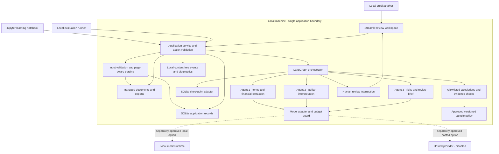

# Deal or No Deal AI — High-Level Design

Tagline: Every deal has a story. Our agents find the plot holes.

Status: On hold — draft v0.1 requires reconciliation with the revised PRD  
Date: 2026-10-22  
Original design baseline: [Archived approved PRD v0.1](../../product/archive/prd-v0.1-approved.md)  
Pending requirements: [Revised PRD v1.4 draft](../../product/prd.md)  
Authority: design only; no implementation, service activation, or deployment

Revision notice (2026-10-22): The user supplied a replacement PRD covering commercial lending, six specialist responsibilities, additional financial metrics, authenticated reviewer roles, a different parser, hosted inference assumptions, and revised limits; the current revision is v1.4 with the user-selected stack and required Jupyter workflow-graph notebook, five-day target, reduced token/cost budget proposals, and Nebius Token Factory as the inference provider. This HLD has not been updated to implement those requirements and must not be treated as the current architecture or approved for implementation. Preserve it as a prior design proposal until the revised PRD's open choices are resolved and approved. See the PRD's editorial revision review notes for affected decisions.

## 1. Design summary and boundaries

Build one local Python application for one credit analyst reviewing one synthetic small-business loan package. The same evidence supports both credit review and a debt-investment view. Use a Streamlit interface, an ordinary Python application-service layer, a LangGraph workflow with LangChain model/tool primitives, Pydantic validation, one SQLite database, and application-managed local files.

In simple terms: the interface collects the analyst's actions; the service checks whether they are allowed; the graph coordinates specialists; tools calculate and check facts; saved state lets the analyst continue later. The model never owns the review decision or the filesystem.

The Orchestrator Agent is a constrained coordinator implemented through graph state, routing, and task delegation. Its decisions come from validated state and allowlisted transitions, rather than an extra free-form planning model. Three specialists interpret documents and prepare findings. This preserves the project roles without adding a model call merely to choose the next known stage.

The approved sample policies POL-01–07, limits, severity rubric, and metrics remain unchanged. No equity workflow, voice, OCR, web retrieval, external business integration, vector database, or predictive credit score is added.

### 1.1 Repository inspection

Observed on 2026-10-22: the workspace contains only `docs/product/prd.md`; no existing application, package configuration, database, Git repository, shared components, or AGENTS.md instructions were found. There are no existing schemas or integrations to reuse. No Git initialization or implementation scaffolding is authorized in this phase.

Read-only environment checks found Windows, Python 3.14.8, uv 0.12.23, Git, and 12 logical processors. Installed RAM/GPU capacity was not established. These observations do not prove compatibility or local-model feasibility.

## 2. System context and architecture diagram

The local operator and operating-system account form the trust boundary. The browser connects only to the local application. A configured model adapter is the only potential inference connection; it is disabled until separately approved. LangSmith is not connected.

The local-model runtime, if selected, must also be loopback-bound with its own downloads/telemetry behavior checked. This diagram shows proposed responsibilities; arrows do not represent approved external connections.

## 3. Components and responsibilities

| Component | Responsibility | Explicit boundary |
| --- | --- | --- |
| Streamlit UI | Upload/select a deal and policy; show progress, terms, findings, evidence, corrections, review controls, and diagnostics | No direct database mutation or model calls from widget/rendering code |
| Application service | Validate actions, resolve review ownership/version, acquire run ownership, request graph work, finalize/export/delete | All write operations and authorization checks pass through this layer |
| Ingestion | Validate limits/type, parse text PDFs and UTF-8 text, preserve source positions, create manifest | No OCR, document script execution, external links, or model-based parser |
| LangGraph orchestrator | Route known states, delegate, validate handoffs, pause/resume, stop on limits | No unbounded planning, autonomous role creation, or hidden agent loops |
| Agent 1 | Extract cited terms, borrower financials, and clauses with units/periods | No policy thresholds, derived credit ratings, or guessed facts |
| Agent 2 | Interpret guarantee/covenant clauses against approved policy concepts and request supported checks | Cannot change formula outcomes, policy versions, or rule definitions |
| Deterministic tools | Compute DSCR, collateral coverage, leverage, and explicit thresholds; check reference integrity and supported formats | Accept typed inputs and return typed results; never accept executable model code |
| Agent 3 | Draft supported risks, missing-information questions, and loan/debt-investment sections | Cannot finalize, trade, contact an applicant, or invent investment returns |
| Model adapter/budget guard | Enforce model configuration, output strategy, call limits, deadlines, usage reservation, and tool boundaries | No implicit provider fallback, downloads, tracing, or paid escalation |
| Storage adapters | Review records, versioned snapshots, checkpoints, cache, audit history, local files | No second business database or cross-deal memory |
| Diagnostics/evaluation | Local allowlisted metrics, reproducible run metadata, deterministic tests and AI scoring | Raw prompts/documents never flow into ordinary analytics |

Graph state and specialist outputs use Pydantic-validated structures. The later LLD will define field-level contracts; no API payload or database schema is established here.

## 4. Proposed stack and rationale

| Choice | Rationale | Verification/approval boundary |
| --- | --- | --- |
| Python, isolated uv project | Reuse one language for app, workflow, notebooks, and evaluations | Prefer the installed Python 3.14 if all chosen packages resolve and smoke checks pass; evaluate Python 3.12 as a fallback. Do not install another runtime without approval where required |
| Streamlit | Small local review UI without a JavaScript build or separate API service | UI reruns require action idempotency; verify source navigation and keyboard behavior during implementation |
| LangChain + LangGraph | Requested agent/tool abstractions with explicit state and human checkpoints | Pin mutually compatible releases after design approval; do not rely on unverified example APIs |
| Pydantic | Typed models and validation at handoffs | Type validity is distinct from evidence correctness |
| pypdf + Python text decoding | Page-aware text PDF extraction and UTF-8 text support | Scanned/encrypted/malformed files are rejected clearly; validate extraction on the synthetic tables |
| SQLite via standard sqlite3 plus the LangGraph SQLite checkpoint package | Local persistent state and restart/resume without a database service | Verify adapter schema/deletion behavior and runtime SQLite version; share a single database file using separate table ownership |
| Python Decimal for financial arithmetic | Explicit numeric precision and comparisons | Threshold checks use unrounded values; rounding for display is specified in LLD |
| JupyterLab/notebooks, optional development dependency | Explain stages using the same application services | Never duplicate the pipeline inside notebooks; notebook outputs must not contain secrets |
| pytest, proposed test dependency | Deterministic behavior and evaluation harness integration | Test cases/evaluation details are Phase 3 work, not created here |
| LangSmith, optional only | Future hosted trace/evaluation integration | Off by default; current pricing, retention, limits, and outbound data require separate verification and approval |

Streamlit ordinarily reruns application scripts as users interact; therefore widget state is not the authority for run completion. Its configuration supports local/security settings and usage telemetry controls. [Execution flow](https://docs.streamlit.io/develop/api-reference/execution-flow), [configuration](https://docs.streamlit.io/develop/api-reference/configuration/config.toml).

No React, FastAPI, message queue, Redis, PostgreSQL service, Docker dependency, or vector database is needed for the accepted single-operator scope. This is a deliberate scope trade-off, not a claim that those components are unsuitable for larger systems.

## 5. User experience and primary flow

### 5.1 Workspace

The review workspace provides a deal/policy header, visible synthetic-data label, compact stage progress, and a terms/findings area beside a source panel. Tabs or sections expose Financials, Policy, Risks, Debt Investment, and Review Brief. A diagnostics panel shows the inspectable handoffs without dominating the analyst's task.

A source link selects the exact extracted PDF page or text section, displays its passage, and offers the original file for download. The initial source viewer uses page-aware text rather than a separate PDF rendering dependency. This meets navigation needs while leaving original-file inspection available. Rich inline PDF rendering is optional only if verified and approved later.

### 5.2 New review

1. Analyst selects a known synthetic sample or attests that an uploaded package is synthetic. The application cannot guarantee that an arbitrary upload is synthetic; this is an explicit prototype limitation.
2. Service validates the selected approved policy, file limits, type, and source manifest before any model call. Supported size limits remain those in PRD section 4.2.
3. Ingestion creates immutable document versions and stable page/text locators; evidence selection preserves those locators.
4. Orchestrator delegates extraction to Agent 1, then validates the output schema and source reference integrity.
5. Conflicting/invalid critical inputs pause affected work for a reviewer correction. Missing inputs remain visible; dependent checks become Unknown and may continue to a clearly partial brief.
6. Agent 2 maps clauses to policy concepts; ordinary tools perform calculations and comparisons for POL-01–07.
7. Agent 3 receives compact verified facts, findings, calculations, and source references, then drafts the credit/debt brief.
8. Evidence validation checks references, claim associations, and contradictions. Unsupported critical claims block finalization; uncertain noncritical claims require review or removal.
9. A persisted human interruption presents the draft. No model work runs while waiting for the analyst.
10. Service accepts a correction, an explicit acknowledgement/disposition, or finalization. Finalization checks the current revision, preserves exceptions, and creates an immutable reviewed snapshot. Export is a separate user action.

Finalizing means the analyst reviewed the evidence and exceptions. It does not change Fail or Unknown into Pass and never executes a loan or investment decision.

### 5.3 Correction and reuse

A correction records original/new values, evidence or reviewer-provided basis, reason, operator label, and time. The service increments the review revision and invalidates any finalization. A dependency map identifies affected calculations, policies, risk statements, and brief sections.

For example, changing eligible collateral value preserves unrelated document extraction and reruns coverage, POL-04, affected risk text, and the brief. Changing a financial period may invalidate several inputs/checks. Replacing a document invalidates its extracted facts and downstream artifacts. Changing policy invalidates policy/risk/brief outputs while retaining compatible source facts.

Matching cached content may be reused within the same deal/revision lineage, with original usage metadata. Reopening an identical finalized review requires no inference; it does not authorize replaying an old reviewer acknowledgement onto a new revision.

## 6. Workflow, state, and failure paths

Conceptual lifecycle: Created → Ingesting → Extracting → Checking Policy → Drafting → Awaiting Human Review → Finalized. Awaiting Input, Failed, Budget Stopped, Cancelled, and Deleting are explicit non-success outcomes. Exact state enums and transitions belong to Phase 3.

| Failure/condition | Handling | Reviewer experience |
| --- | --- | --- |
| Invalid, oversize, scanned, encrypted, or unreadable input | Reject before inference where detectable; retain no accepted partial package as a completed review | Explain what failed and which supported input is needed |
| Parser exceeds resource/time allowance | Terminate bounded parsing work and retain safe error metadata | Clear ingestion failure; no invented extracted facts |
| Required value absent | Record missing value; dependent rules Unknown | Missing-information list and reviewer follow-up |
| Conflicting/invalid critical evidence | Pause affected stages; no silent document precedence | Compare both sources and record a resolution |
| Schema/tool/model error | At most one stage retry inside all global ceilings | Display retry/stop status and preserve validated prior outputs |
| Unsupported or nonsupporting citation | Reject unsupported claim; bounded repair or reviewer action | Critical support issue blocks finalization |
| Timeout, exhausted tokens/calls/cost, or cancellation | Stop dispatch, preserve checkpoint, and label partial result | Resume only within remaining authorized allowance |
| UI refresh/duplicate submit | Reuse action identity and persistent run state | No duplicate run, finalization, or export |
| Process crash during inference | Mark invocation outcome uncertain on recovery; retain reservation; do not silently reissue it | Show interrupted attempt and conservative remaining allowance |
| Process restart/checkpoint mismatch | Reconcile revision and step records; reject stale state | Resume last consistent stage or require explicit recovery |
| Concurrent local action | Reject stale revision; one active run owner | Ask user to reload current state; no merged conflicting edits |
| Request outside approved scope | Return supported-scope explanation without new tool permissions | Explain limitations and offer supported review actions |

Cancellation is cooperative between stages. An in-flight provider request may consume its reserved usage until timeout even if the UI closes; late responses cannot change a cancelled/deleted/stale revision. No claim of exactly-once inference billing or instantaneous provider cancellation is made.

### 6.1 Replay and crash consistency

LangGraph checkpoints and application records may commit in separate transactions even when stored in one SQLite file. Do not assume an atomic transaction across both adapters. Application step records use stable operation IDs and revision checks; recovery reconciles their state against checkpoints before dispatching more work.

Reserve usage and record invocation intent before inference. Store validated results under the operation ID before marking application completion. Replayed nodes first inspect the operation record and reuse a valid completed result. An uncertain external call is not treated as free or automatically safe to repeat. Finalization uses an application transaction with a unique action identity/current-revision check.

Human interruption nodes perform no model call or non-idempotent write before the interruption. LangGraph resume can replay node code; evidence extraction and export are therefore outside these pause nodes. [Human interruption documentation](https://docs.langchain.com/oss/python/langgraph/interrupts).

## 7. Ingestion, evidence, and grounding

Validate filenames for display only; use application-generated storage names and resolve every path under the managed data root. Enforce aggregate 3-file, 10 MB, 20 PDF-page, and 40,000 extracted-character limits, including mixed text/PDF packages. Reject unsupported types and decoding failures.

Parse each PDF page and text section once; retain a content hash, version, original text, and source locator. Bound parse work separately so a compressed small PDF cannot consume unbounded CPU/memory. The precise parser timeout/resource cap and a Windows-compatible bounded parsing mechanism are Phase 3 specifications. PDF extraction is not OCR and document layout may be ambiguous. [pypdf extraction documentation](https://pypdf.readthedocs.io/en/stable/user/extract-text.html).

For these small packages, use deterministic section/keyword selection and source windows, with full relevant context where it fits. Do not add embeddings/vector search. A candidate passage is not proof of a supported fact. If context cannot fit within the remaining token budget, return an explicit gap rather than silently truncating decisive evidence.

The evidence manifest is the authoritative reference index. Structural checks establish locator existence and quoted-text correspondence. They cannot prove every semantic entailment; supported interpretation is checked through constrained output, rule validation, human source review, and the approved citation evaluations. Never label a purely mechanical citation check as a guarantee of truth.

Policy is trusted, read-only, versioned project configuration, separate from borrower documents. No uploaded text can change its instructions. Formula definitions and boundary comparisons come directly from the approved PRD; new rules require a PRD change.

## 8. Data ownership, persistence, and retention

### 8.1 Conceptual records

| Record | Purpose |
| --- | --- |
| Deal/review revision | Owns the package, selected policy, mode, status, and current version |
| Document manifest/evidence | Identifies immutable source versions and navigable passages |
| Fact/calculation/policy finding | Separates extracted/reviewer-provided facts, derived values, and rule outcomes |
| Run/operation/usage record | Tracks steps, reservations, actual/estimated usage, errors, and idempotency |
| Correction/reviewer disposition | Preserves attributed amendments and exception acknowledgements |
| Brief/finalization/export | Links a rendered result to the exact reviewed input/finding revision |
| Checkpoint/cache/event | Supports resume, bounded reuse, and content-free diagnostics |

One local SQLite file stores application-owned tables and adapter-owned checkpoint tables. Keep ownership distinct; do not write adapter internals through ad hoc SQL. Source files and managed exports live outside the database in one managed local data root. The exact path/tree, schema, migrations, and deletion API contract are later-phase decisions.

Use short application transactions and a single active run. Avoid WAL as an unnecessary MVP dependency: the default rollback-journal mode is the starting choice. If the checkpoint adapter requires a different journal mode, verify that during compatibility checks and record the change; do not silently enable a mode. SQLite runtime version and locking behavior must be recorded before implementation acceptance. [SQLite journaling context](https://www.sqlite.org/wal.html).

Checkpoint state contains serializable application records and version references, not credentials, live database connections, or unbounded conversation history. Browser session state stores display selections only. Application state is authoritative; cache content is disposable. No cache crosses deals.

### 8.2 Retention and deletion

Apply approved 30-day expiry on startup and before access. Deletion first blocks access/new writes and cancels further work, then removes the deal's managed files, application records, adapter checkpoints, cache, and managed exports. A deletion failure remains pending and inaccessible until cleanup succeeds; do not report success prematurely. Late model responses fail the deletion/revision guard.

Verify the checkpoint adapter's supported per-thread deletion before implementation; map every review to all of its thread IDs. Do not promise deletion based only on deleting a deal header. Ordinary logical deletion is not forensic secure erasure; SQLite pages, OS caches, user copies, and backups have separate limitations. No real sensitive data is approved.

## 9. Model/tool orchestration and budget controls

Each specialist uses a role-specific, versioned prompt with Pydantic outputs. Configure native structured output or a tool strategy only after verifying the selected model's capabilities. LangChain documents both strategies; schema support alone is insufficient evidence that a model can interpret the financial clauses reliably. [Structured output](https://docs.langchain.com/oss/python/langchain/structured-output).

Agent tool scope is per role. Extraction can read selected current-deal evidence; policy review can read policy/facts and invoke approved calculation/check tools; summary generation reads validated results. The orchestrator's graph controls stage transitions. Specialist agents have no finalization, deletion, export, policy-write, shell, browser, email, or payment tools.

Aim for three normal specialist inference attempts, with no model call for deterministic routing, arithmetic, or structural evidence checks. Every real model invocation, including framework-internal retries, counts toward the approved six-attempt ceiling. Disable provider/SDK automatic retries unless routed through the same budget guard; configure schema-repair loops explicitly rather than accepting library defaults.

Enforce the approved aggregate 20,000-input/4,000-output-token, 12-tool-call, 180-active-second envelope, 45-second per-call cap, and conditional USD 0.10 inference ceiling. A retry is permitted only if a full reserved attempt fits. Agent-local limits cannot bypass global review totals. Streamlit refreshes, corrections, and graph resume never reset the allowance.

Before each call, calculate or conservatively bound input size, reserve output allowance, and reserve estimated cost when priced inference is enabled. Reconcile with reported usage afterward; preserve conservative reservations for unknown outcomes. If the adapter cannot safely bound tokens or enforce output caps, live inference is blocked until the limitation is resolved. Mark missing usage as unavailable and exclude it from claims of measured budget compliance.

Cache keys include deal/revision lineage, source content hashes, relevant fact versions, policy version where applicable, prompt/schema/model/config versions, and stage. Reuse only validated artifacts; do not reuse a finalization acknowledgement as cached model output.

### 9.1 Execution modes and model decision

- **Fixture mode:** no model/network calls; deterministic synthetic agent outputs exercise the UI/workflow. Always labeled simulation; cannot pass AI-quality acceptance.
- **Local-model mode:** proposed first real-inference option if hardware/capability checks succeed. Ollama through `langchain-ollama` is a documented candidate integration, not a selected or installed service/model. [Official integration](https://docs.langchain.com/oss/python/integrations/chat/ollama).
- **Hosted-model mode:** disabled unless the user separately approves provider, data transfer, model/configuration, dated pricing, and budget. No automatic fallback from local execution.

Architecture approval can approve this adapter boundary while leaving the model undecided. Model-based quality, latency, and budget acceptance remain blocked until a real configuration is selected and authorized; a clickable prototype can be demonstrated honestly in fixture mode.

## 10. Authentication, authorization, and security

No login system is proposed for the approved single-operator prototype. Access is limited to the OS account/local browser and loopback-bound server. This does not protect against malicious local users/processes and is not suitable for a shared financial environment.

Keep Streamlit CORS and XSRF protections enabled; restrict host/origin configuration to local use where supported by the pinned version. Disable Streamlit usage telemetry, LangSmith auto-tracing, and unapproved callbacks. Do not load remote fonts, scripts, or analytics for normal use. Read configuration at startup and fail closed when an external mode lacks explicit configuration/approval.

Service guards enforce current review/revision, action identity, state transitions, and active-run ownership. Review IDs are application-generated and do not authorize arbitrary file paths. Tools receive context-scoped handles rather than operator-supplied filesystem paths. Local reviewer labels provide attribution, not verified identity or electronic signature assurance.

Render model/document content as escaped text; no unsafe HTML or executable Markdown content. Keep secrets in local environment/approved secret configuration, outside graph state, notebooks, exports, logs, and version control. Do not read global credentials to infer consent. Approval of this design does not permit real customer data.

## 11. Observability, product analytics, and evaluation seams

Store local structured events with allowlisted fields: pseudonymous local review/run IDs, revision, stage, event time, duration, status/error code, versions, token counts, cost estimate/availability, and cache/retry counts. No borrower names, document text, prompts, passages, financial values, credentials, or free-form reviewer notes in ordinary analytics. Detailed evidence/corrections remain in the isolated review store.

A diagnostics view distinguishes measured, estimated, unavailable, and fixture values. It shows stage transitions and concise typed handoffs without exposing private model reasoning. Exported evaluation reports record configuration, numerator/denominator, failures, and run mode. Any handoff inspection requiring document content is a current-review function rather than a general trace event.

Measurement seams cover MET-01/02 task start/finalization and usability timing; MET-03–08 versioned evaluation labels/scoring; MET-09/10 timers/usage ledgers; MET-11 cache/invalidation records; and MET-12 denied actions/isolation tests. Exact event names, properties, dashboards, and test cases are deferred to Phases 3 and 5 as requested.

LangSmith could later consume explicitly approved, redacted trace data, but local diagnostics/evaluation must remain usable without it. No account is connected and no free-tier eligibility is assumed. [LangSmith observability](https://docs.langchain.com/langsmith/observability).

## 12. Environments, reliability, and deployment

Development, automated tests, and acceptance evaluations use the same Python application boundaries but separate local data directories/database files and declared configurations. A test or evaluation database is not parallel business infrastructure; it must never point at the interactive review store. Notebooks use their own explicit sandbox data root.

One Streamlit process executes graph segments synchronously, streams available stage updates, and returns control at human interruption/completion. No background worker service, scheduled agent, public API, or distributed queue is proposed. Active runs acquire persistent ownership so two tabs cannot start independent graph work. Restart recovery releases/reconciles abandoned ownership conservatively.

The MVP does not promise that closing a browser instantly cancels an active provider request; bounded deadlines and stale-response checks control that case. Stop checks occur at stage boundaries and before each tool/model invocation. If responsive mid-call cancellation becomes necessary, approve a worker/lifecycle design as a scope change.

Local export initially produces a self-contained HTML review brief with escaped content and source locators; no external assets or executable financial actions. The later clickable HTML prototype is a separate design artifact illustrating the same approved workflow, labeled simulation when not backed by inference. It is not a second application backend or a replacement for the evaluation harness.

No deployment environment is created. A public/shared deployment requires a new security, identity, persistence, operations, and compliance design and explicit approval. No license selection, Git initialization, dependency installation, model download, external repository, or paid activation occurs in Phase 2.

## 13. Significant decisions and alternatives

| Decision | Recommendation | Alternative and trade-off | Record |
| --- | --- | --- | --- |
| Runtime shape | Single Python app, Streamlit, in-process services, constrained LangGraph routing | Separate web frontend/API offers more UI/control but adds build/deployment/contract work | [ADR-001](../decisions/001-local-python-application.md) |
| Grounding/storage | Direct evidence, deterministic finance tools, one SQLite store, local managed files | Vector retrieval and server DB add services without demonstrated need at this scope | [ADR-002](../decisions/002-evidence-and-persistence.md) |
| Inference/observability | Disabled-by-default model adapter, bounded calls, local diagnostics, optional separately approved tracing | Mandatory hosted model/tracing simplifies some operations but conflicts with unapproved charges/data transfer | [ADR-003](../decisions/003-bounded-inference-and-observability.md) |

These are proposed ADRs, not accepted technology choices until the Phase 2 gate passes.

## 14. Open decisions and feasibility checks

| Item | Current state | Effect |
| --- | --- | --- |
| Streamlit and single-process workflow | Recommended; awaits HLD approval | Establishes UI/backend boundary for specifications |
| Python/dependency versions | Installed 3.14 observed; compatibility not tested | Resolve/pin later; runtime change/download requires approval where applicable |
| Model/runtime/provider | Unselected; RAM/GPU not established | No real inference or quality/latency claims until configuration and permission exist |
| Model token/pricing/timeout support | Must be verified for selected adapter | Block live calls if conservative limits cannot be enforced |
| Checkpoint adapter shared-file/delete behavior | Documented persistence candidate; integration untested | Verify before specs are finalized; record any change rather than create another database silently |
| Parser resource limit and cancellation details | Bounded behavior required; exact mechanism/caps deferred | Define/test Windows-compatible approach in feature specs |
| Semantic evidence validation | Mechanical checks plus human review proposed | AI citation correctness must be evaluated; no claim of complete automatic verification |
| Deadline and learning level | Unspecified | Walkthrough assumes clear beginner-friendly explanations; no schedule or skill level is invented |

No PRD scope/threshold change is requested. If local hardware cannot meet the approved targets, present measured evidence and request an explicit model/scope/target revision.

## 15. Phase 2 gate and validation record

Documents: PRD approval metadata updated; this HLD and ADR-001–003 created. Read-only workspace/environment inspection and official-document checks were performed. No application was built, no dependencies installed, no service connected, and no application tests or AI evaluations were run.

Gate on hold: the original Phase 2 approval request is withdrawn pending the revised PRD. This HLD and ADR-001–003 require reconciliation after PRD v1.4 is approved. Their original three-specialist workflow, parser, permission model, limits, and execution modes must not silently override the new requirements. No paid services, model downloads/execution, or deployment are authorized.

Next gate: approve the revised PRD first, then revise and approve the HLD/ADRs before Phase 3 creates feature specifications, the evaluation plan, and traceability. Repository layout approval remains a separate Phase 4 gate.
