# ADR-007: Bounded public financial statements and local vector retrieval

**Current embedding decision — 2026-10-23:** [ADR-008](008-nebius-hosted-embeddings.md) supersedes the earlier local-BGE selection. Use Nebius-hosted embeddings; no local embedding weights are required. Qwen/Qwen3-Embedding-8B is selected; its dated catalog dimensions/rates are recorded in ADR-008. Subsequent bounded generation/embedding capability probes and the shared USD0.10 allowance are verified; this does not establish a built public-corpus index or measured VECTOR/HYBRID quality. Each changed generation packet still needs exact token-fit evidence; the corpus benchmark remains pending. Retain local-file intake, source isolation, SQLite storage, DIRECT grounding and the four-arm benchmark. Earlier installation/test observations remain historical evidence, not hosted readiness.

Date: 2026-10-23
Version: 1.1
Status: ACCEPTED; optional packages installed and local-file inspection tested; browser/model/index/retrieval integration pending
Approval record: On2026-10-23, after the concrete Crawl4AI + local BGE + SQLite-vector proposal and selected SEC source review, the user instructed updating the pending architecture choices and aligning all relevant documents. This accepts those choices; do not request the same architecture approval again. That approval turn updated documents only; the later authorized implementation is recorded below.

## Context

The user requested Crawl4AI or Firecrawl ingestion followed by chunking, embeddings, vector storage and RAG, then selected an exact SEC credit-agreement URL. Existing runtime supports one registered synthetic loan's deterministic panels; DIRECT/KEYWORD/VECTOR/HYBRID are specified but not implemented. Earlier website-crawling exclusions are superseded only by this accepted bounded public-reference extension. Preserve the original ADR filename for stable links; its status above is authoritative.

## Accepted decision

Use local Crawl4AI without LLM extraction for explicitly selected permitted public reports. Keep dated source observations, faithful tables/notes and source eligibility before ranking. Use BAAI/bge-small-en-v1.5 locally, through a pinned compatible sentence-transformers adapter, and SQLite vector rows with bounded exact cosine search, retaining one app/checkpointer database boundary. Model weights/tokenizer revision and package/browser versions must be pinned and verified during setup; no version is invented by this decision. Add a REFERENCE_CORPUS scope to RET-1.0; preserve synthetic-case isolation, DIRECT coverage and the DIRECT/KEYWORD/VECTOR/HYBRID comparison before any runtime strategy change. Firecrawl is an unselected alternative, not an automatic fallback. See the [complete contract](../../specs/public-financial-sources.md).

```mermaid
flowchart LR
  URL[Selected permitted SEC URL] --> Crawl[Explicit Crawl4AI ingestion]
  Crawl --> Snap[Dated local snapshot and source identity]
  Snap --> Seg[Faithful parent passages and embedding children]
  Seg --> Embed[Local BGE embedding adapter]
  Embed --> Store[(App-owned SQLite vector records)]
  Store --> Filter[Corpus entity version date eligibility]
  Filter --> Ret[DIRECT KEYWORD VECTOR HYBRID comparison]
  Ret --> Pack[Expand definitions tables and qualifications]
  Pack --> Cite[Read-only evidence and snapshot citations]
```

This diagram specifies the approved path; no component execution is claimed. Ingestion/model setup is explicit and separate from the two-generation-call loan graph. Search inside an admitted review retains that review's time/tool/budget limits. The public reference corpus is not E-N01 registration, financial support or executable policy.

## Trade-offs

Local crawling avoids a hosted crawler account but adds browser installation and enforcement work. Local embedding avoids per-request embedding API fees but needs model download, RAM and initialization. SQLite exact search avoids new infrastructure at the proposed500-child bound; it is not a scalable ANN engine and its latency is unmeasured. Firecrawl can reduce browser maintenance but introduces external processing and account/usage dependencies. No hosted service or paid calls are authorized by this choice.

## Approval and evidence

Latest user steering: the user will download/upload the document instead of supplying SEC contact information. LOCAL_FILE now uses stdlib static HTML inspection or pypdf text extraction; no browser/remote crawl is needed for this path. Optional Crawl4AI0.9.5/sentence-transformers6.2.0 and CPU torch2.14.1+cpu are installed/locked. The local inspection function/tools and95 combined application methods pass; embedding-library import/CPU smoke passed without network. [Execution evidence](../../execution.md#local-reference-setup-and-inspection-evidence) records remaining artifact/index/query work. No user-provided file has arrived yet, and no actual BGE embeddings or retrieval quality has been measured.

The user supplied a specific SEC agreement URL; [source classification and remaining prerequisites](../../specs/public-financial-sources.md#selected-sec-source-and-suitability) distinguish it from a financial statement. Source selection and architecture choice are resolved; do not ask again. Remaining work is implementation preparation: verify licenses and Python3.12/Windows dependencies; pin package/browser/model revisions and tokenizer behavior; define/test an additive versioned application-schema change preserving checkpoint ownership/history; verify allowed network/resource controls and any required SEC identifying contact; then implement/mock-test before the bounded crawl and benchmark. A separate10-K/10-Q is needed only for statement-specific tests.

Earlier documentation-only records are historical. Current package installation and local inspection evidence above is scoped: no browser setup, BGE weights/revision, vector schema/index, crawler job or retrieval benchmark is complete. No charge, hosted service or deployment is authorized. Keep the original85-method evidence as history; the current combined95-method result does not complete the financial graph or establish real model quality.
