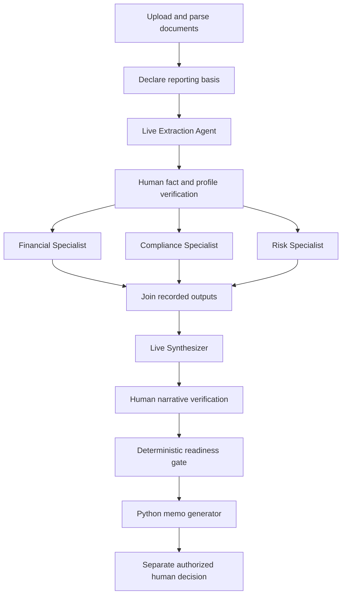

# New uploaded reviews: declared profile and specialist fan-out

Status: implemented under the user's instruction to fix upload acceptance gaps.
Date: 2026-10-25.

Use retained parsed pages plus an explicitly unverified reviewer-declared profile
for new synthetic PDF packages. Preserve the existing registered profile path
and historical contexts. Never infer source authority or transfer sample factor
assessments to an unfamiliar borrower.

After mandatory fact/profile verification, an inner LangGraph subgraph runs
Financial, Compliance and Risk branches in parallel. Each independently derives
its deterministic dependencies from the same verified extraction. This repeats
cheap arithmetic but avoids order dependence and concurrent SQLite mutations.
The outer checkpointed worker joins and persists branch artifacts/events once,
then invokes the existing synthesizer. No additional planning LLM is introduced.

Narrative verification remains mandatory. A partial memo may disclose unknown
inputs and unresolved exceptions; deterministic approval readiness still blocks
approval. Historical demo drafts are not silently converted or re-verified.

See docs/evaluation/upload-acceptance-fixes-results.md for measured offline
evidence and remaining live-verification boundaries.
