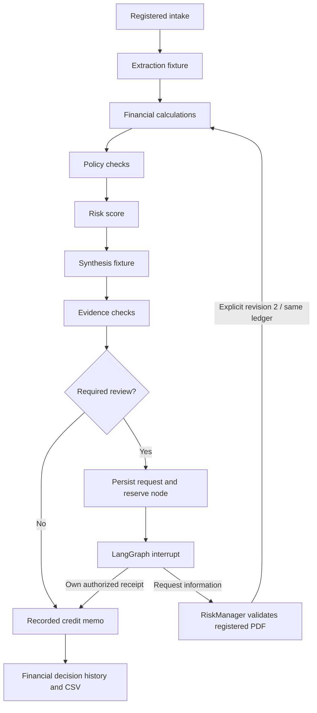

# Deal or No Deal AI — Educational High-Level Design

## Current upload acceptance update - 2026-10-25

**Educational human override:** uploaded_decisions.record_action accepts an
explicit demo_override only for completed uploaded reviews with Pending Review
readiness and exclusively PENDING blockers. Existing current-version/role/tier
checks remain. The separately recorded human event labels the override and
retains the readiness snapshot/unresolved IDs; it never changes gate inputs,
original proposal or graph resume. See docs/specs/uploaded-human-decisions.md.

The user authorized fixing the upload acceptance gaps. This update supersedes
older exact-Standard-only, inspection-only and sequential-only statements for
**new uploaded synthetic text-PDF reviews**. Historical records are unchanged.
See `docs/specs/general-upload-acceptance.md` for the implementation contract.

New uploads can declare their own borrower, reporting periods, transaction date,
USD whole-unit basis and sample-policy applicability. Declarations are unverified
and must be checked against the retained documents. Unknown inputs/applicability
stay unknown. No sample borrower facts or factor ratings are copied. Existing
parser, token, permission and shared spending limits remain in force.

New uploaded reviews use live extraction -> mandatory fact/profile verification
-> parallel Financial / Compliance / Risk subgraph -> joined synthesis ->
mandatory narrative verification -> readiness routing -> partial or complete memo.
Only the parent persists branch outputs; calculations and policy rules are
unchanged. Missing borrower factor assessments produce Insufficient Data, never
a default Low score. Partial reports do not waive approval blockers. The same
Deal ID and uploaded page map feed Workspace, Agent Activity, Memo and History.
Sample Deal and historical contexts keep their existing execution policies.
No new dependencies, migrations, inference model settings or budget were added.
Phase 2 evaluation remains deferred. Offline provider mocks establish functional
behavior, not fresh Nebius answer quality or genuine human verification.

## Single uploaded-deal live demo — 2026-10-25

Post-analysis human actions use the existing SQLite admission/version/history
services, separate from graph execution. They do not resume or rewrite completed
checkpoints. Latest disposition is projected across screens; original reports
remain preserved snapshots. [Contract](../specs/uploaded-human-decisions.md).

New Deal → Upload New Deal now supports the complete unchanged three-PDF Standard Deal package. Explicit Run performs fresh Nebius extraction and synthesis on retained uploaded content, with a distinct upload-derived Deal ID, source map, shared workspace/activity/history and draft memo. It does not use saved answers as live results. Other, partial or changed packages remain inspection-only. Approval readiness and unverified-draft safeguards remain; historical human-checkpoint reviews are unchanged. See [scope, steps and evidence](../specs/upload-live-demo.md). This supersedes older blanket inspection-only statements only for that exact supported profile.

## Approved Phase 1 demo update — 2026-10-25

The user approved the [live demo-draft contract](../specs/phase1-live-demo.md). New explicit Run actions use LIVE / DEMO_DRAFT. Extraction and synthesis call Nebius; Python performs calculations, sample policy checks, illustrative scoring, readiness and draft assembly. Technical integrity checks do not record human verification. Drafts cannot authorize credit approval. Existing HUMAN_REQUIRED reviews retain their checkpoints and original records. Saved examples remain available internally. No model calls on screen viewing and no fallback on failure. Phase 2 RAGAS/judge evaluation and optimization are deferred. This update supersedes older default-FIXTURE and pre-draft human-checkpoint statements only for new demo drafts. Functional evidence is recorded in docs/evaluation/phase1-demo-results.md (relative to repository root).

Documentation authority: requirements and approved feature contracts describe
intended behavior; [current implementation status](../implementation-status.md)
records observed completion. Dated implementation/setup/test paragraphs below
are historical evidence for their stated milestone, not current missing-work
claims. See [documentation alignment](../evaluation/documentation-alignment.md) for the cross-document review.

## Approved uncertain-attempt quarantine - 2026-10-25

The [accepted administrative quarantine](decisions/proposed-unknown-request-quarantine.md)
allows only the specifically approved interrupted attempt to be abandoned without
claiming usage is reconciled. A versioned SQLite audit record blocks its replay,
progress/ledger writes and late-result publication while releasing its exclusive
local execution claim. Unknown cost remains reserved within the shared allowance;
unrelated reviews retain all evidence, readiness and credit-decision gates. There
is no new database, schema migration, automatic expiry or model call. Actual
activation and regression limitations are in [quarantine results](../evaluation/quarantine-results.md).

## Unified review experience - 2026-10-25

The saved-response UI is the shared baseline. Use one Run AI Deal Review action;
there is no user-facing mode selector. Existing config/app.toml mode selects new
FIXTURE (default, no calls) or LIVE (explicit paid Nebius execution). Both sources
share the six screens and per-deal history. Historical source controls display
and resume; live human verification and all backend rules remain unchanged.
See [the unified review contract](../specs/unified-review-experience.md). Earlier sidebar mode instructions
are superseded. This UI change does not authorize a new paid test.

## READINESS-1.0 current update - 2026-10-24

READINESS-1.0 adds deterministic assessment inside the existing route_review node; no additional LLM calls, graph nodes or database. readiness.py evaluates requirements; readiness_service.py binds and versions assessments in existing app_records. Direct approval and resume paths enforce current readiness, role and source/review identity. SQLite stores prior assessments and decision-time snapshots; it is not a tamperproof audit store. See ../specs/approval-readiness.md.

## LIVE-GRAPH-1.0 implementation update - 2026-10-24

User authorized completing the live graph and evidence checkpoints. Follow
[the live graph contract](../specs/live-graph-integration.md). The shared build_graph now has an explicit
live branch with a pre-calculation fact_review interrupt and a post-synthesis
evidence_review interrupt. live_worker uses the existing SQLite admission/ledger,
checkpointer, strict wire parsers and deterministic finance/policy/risk services.
Actual response text is retained; registered sample answers are never a fallback.
ReviewedLiveCase binds the actual extraction to source/profile validation and
immutable human-support receipts without changing the original registration.

Every present term/financial fact and authored scoring premise needs RiskManager
support. Every observation, rationale, condition and next-action reason has an
exact target; policy/control meaning requires ComplianceOfficer support and mixed
content needs both domains. Source quotations, seven explicit checks, comments,
role, target/source digests and UTC timestamps are recorded. Support is metadata
only. Analyst continuation resumes the same checkpoint and cumulative ledger.
Confidence-only normal credit review has a separate AuthorizedApprover checkpoint.
Missing information stops before dependent work; live exceptions/conditions beyond
this bounded E-N01 example stay blocked, never generically waived.

UI update 2026-10-25: one Run AI Deal Review action follows config/app.toml; there is no sidebar mode selector. Live review start,
evidence forms, recorded activity, source-linked pure-Python memo and scoped local
history are connected. Live setup/readiness remains in the sidebar only.
Provider calls use the worker's existing admission claim, reserve the shared
USD0.10 allowance and record actual reported usage; uncertain usage retains its
reservation and blocks replay. No global enable-flag flip or new database.

This is implemented integration, not evidence of paid model quality. Provider
access, hosted model/schema/current rates and exact whole-request counts still
require verification; each changed synthesis packet needs its own count evidence.
Historical boundary: the 2026-10-24 integration implementation itself made no paid calls. Subsequent actual extraction, fixed embedding probes and saved-answer native/custom RAGAS are recorded in the current implementation status. Full live synthesis/report completion and hosted semantic benchmarking remain pending.

## Live foundation update ? 2026-10-24

User approved LIVE-COMPACT-1.0: extraction 4,000 input/1,000 output;
synthesis 2,500/650. Aggregate 8,000/2,000 and protected correction
1,500/350 remain unchanged; Fixture prompts and stage limits are unchanged.
The shared authorized spending allowance is USD0.10 across generation, embeddings
and evaluation. See [live integration specification](../specs/live-synthetic-integration.md)
and [approved fit profile](../evaluation/live-fit-proposal.md).

Implemented: separate live specialist prompts, compact full-source E-N01 offline
packets, explicit credential/readiness checks, guarded transport foundation with
persistent allowance reservation, four-arm retrieval mechanics, and optional
RAGAS 0.4.3/tokenizer dependencies. RAGAS requires the tested
langchain-community 0.3.31 compatibility pin; ID metrics currently use its
available public API with deprecation warnings.

Measured: local packet components 3,699 extraction and 2,282 synthesis tokens;
provider rendering overhead remains unverified. Six actual native RAGAS ID
measurements over three synthetic questions: DIRECT recall 1.0 (precision not
applicable); KEYWORD recall 1.0, precision 0.5. These tiny author-authored cases
are diagnostic, not proof of semantic quality. VECTOR/HYBRID mechanics tests use
synthetic vectors, not hosted embeddings. At that historical milestone no real generation, embedding or judge calls had run; spend was then zero. Subsequent provider execution is recorded in current implementation status, not this earlier measurement. Complete live graph integration, source-backed
critical-fact/narrative review, hosted embeddings/indexing, semantic benchmarks and
LLM-based RAGAS/custom quality scores remain pending. The key was absent at that milestone; subsequent provider access and bounded contracts are verified. Actual changed synthesis packets still need whole-request fit evidence.
An API key alone does not activate Live mode.

**UPLOAD-FACT-1.0:** upload_facts.py appends scoped proposals/support via existing
SQLite/admission and reconstructs current state, binding exact package/page/quote/
normalized value/basis. Existing FIN-1.0 CALC-004 exposes a read-only annual preview
only after compatible RiskManager-supported inputs exist. UI reuses the upload
explorer with one-click candidate citations. No new table/framework/model or graph
admission. See [contract](../specs/upload-fact-review.md).

**UPLOAD-1.0:** upload_intake.py validates packages; short-lived upload_parser.py
uses existing pypdf under one45-second deadline. Existing SQLite admission serializes
retention: raw PDFs in ignored scoped var/uploads, metadata/pages in app_records.
File/database gaps retain recovery. This workspace library is not a registered deal
or trusted corpus. UI exposes inspection/citations/download, no model/index/financial
graph. No new table/service/dependency. See [contract](../specs/upload-inspection-integration.md).

**CORRECTION-1.0:** source_correction.py uses existing scoped services/admission/
SQLite/ledger. A separately registered extraction-miss profile stops after5 nodes.
Analyst Save atomically retains original event, supersedes old run and creates
revision2/new thread READY with no graph dispatch. Explicit Update starts the shared
graph at Financial Analysis, reusing intake and applying reviewer-corrected facts.
Seven affected nodes yield12 cumulative nodes/7 tools/0 provider calls in the fixture.
Exact corrected synthesis is separately registered; memo binds correction provenance.
No new table/framework/service/dependency or generic upload/correction permission.
See [contract](../specs/source-correction-integration.md).

**CONDITIONAL-1.0:** E-P01 reuses the reviewed graph, pause/thread, SQLite and budget.
conditional_review.py applies existing condition-draft/domain-support helpers;
financial_review.py reconstructs gates from persisted events. One source covenant,
separate RiskManager handling, exact draft and both specialist supports precede
AuthorizedApprover Conditional Approve/Reject. Full snapshots stay in history;
compact receipts stay in checkpoints. Memo independently validates acceptance and
leaves the condition OUTSTANDING. No new infrastructure/inference/funding/fulfilment
or arbitrary edits. [Contract](../specs/conditional-integration.md) supersedes older
E-P01-pending observations.

**EXCEPTION-REJECT-1.0:** E-F03 uses the existing reviewed graph and SQLite, with a
source/rubric-bound Reject fixture. PendingReview includes an unhandled numerical
exception requirement. RiskManager records handling without inference/resume;
request gate version advances separately from analytical basis. Service reconstructs
gates from actual events; AuthorizedApprover Reject consumes the current receipt on
the same thread. Memo independently rechecks original findings and handling. Full
snapshots remain in history, bounded fingerprinted receipts in checkpoints. No new
database, model call, production permission system or generic exception waiver.

**E-M01 integration:** Same graph/worker/database now supports the registered
missing-CFADS sample. A conditional edge from Risk Quantifier ends with
WAITING_INFORMATION before synthesis. Confirmed terminal information wait retains
five stage artifacts/checkpoints and missing-item IDs; it is neither a technical
failure nor a completed credit decision. Partial source inspection does not permit
a synthesis request. See ../specs/missing-data-integration.md. No new service/model.

**Current offline refinement:** provider.py prepares/normalizes provider-shaped
messages without a client or dispatch; this is not a Live graph adapter. Financial
History now filters/paginates all permitted frozen events with rechecked filtered
CSV. Core PDF candidates exist with user-approved fictional assumptions, but
alternate-case runtime admission remains incomplete. See implementation-status.md
and the latest execution evidence.

**Current implementation status:** See [../implementation-status.md](../implementation-status.md). Earlier milestone progress paragraphs below are historical and superseded for implemented capabilities; requirements and safety boundaries remain active.

**Current financial integration:**
[FIN-REVIEW-1.0 / FIN-REASSESS-1.0](../specs/financial-review-integration.md)
extends the same StateGraph/worker. financial_review.py owns scoped financial
requests/actions/responses/history in existing app_records/history and admission,
with SqliteSaver in the same database. Decision receipt commits before resume;
the node consumes only its current own receipt. Registered response reassessment
uses a new thread/revision and original ledger, reusing only identical verified
intake/extraction. Original AI control findings remain recorded after handling.
No REST, second database, orchestration LLM or paid call is added. Unknown outcomes
remain RECOVERY_REQUIRED. General uploads, Conditional editing and Live are pending.

**Current integration (2026-10-24): [APP-READ-1.0](../specs/financial-command-center-integration.md) adds app.py -> ui/command_center.py -> scope-checked command_center.py -> existing Store/worker. Six destinations read the same run/artifacts/events/memo. No new schema, database, graph or model call. Source inspection requires exact recorded digests. Illustrative review stays separate; financial HITL/information fulfilment/Conditional remain pending. Installed dependencies/parser are evidenced in execution.md; historical no-install claims are not current blockers.**

**Decision History architecture addition — 2026-10-24:** [SPEC-013](../specs/decision-history.md) adds a sixth target screen and read-only decision_history.py/ui/decision_history.py services/components in the existing Python app. New review events atomically retain DECISION-SNAPSHOT-1.0; legacy context uses exact retained pre-action versions when available, never latest analysis. History queries use one consistent SQLite read transaction with existing role/workspace/deal scope. CSV export rechecks scope/dataset identity and requires explicit preparation. No migration, new database, PDF dependency, inference or financial authority. The local preview has two pages; complete financial lifecycle/six-screen integration remains pending.

**Human-review UI slice — 2026-10-24:** [REVIEW-UI-1.0](../specs/human-review-corrections.md#role-aware-review-comments-and-actions--review-ui-10) implements a reusable Streamlit component in ui/human_review.py and an explicit tools/preview_human_review.py entry point. review_actions.py persists only isolated illustrative UI records through the existing Store, using review.py permissions/acceptance guards. One database, zero graph/provider calls, no real accounts or automatic report completion. The future Workspace/Memo reuse this component through a proper financial-review service adapter; actual pending-request registration, RESUME-1.0 dispatch and full screen integration remain pending.

**Quality preparation extension — 2026-10-24:** [QUALITY-REVIEW-1.0](../evaluation/generation-model-comparison.md#authorized-quality-preparation-and-response-review--quality-review-10) reuses model_comparison.py and documents.py for full registered extraction coverage and per-field/summary diagnostics. quality_review.py plus an explicit local CLI retain original capture/output/task files and prepare manual semantic review without touching deal state. This adds no agent, model call, provider client, database, dependency or parallel branch. Actual provider/tokenizer/schema integration, human source support and live quality evaluation remain pending.

**Authorized normal Fixture slice — 2026-10-23:** [E-N01-SYNTHESIS-1.0](../specs/synthesis-evidence.md#authorized-e-n01-normal-slice--e-n01-synthesis-10) binds the current synthesis request, exact educational stage response and four narrative evidence targets. The normal nine-stage LangGraph/SQLite path, primitive panel handoffs and pure seven-section memo are now implemented; scoped executed checks are recorded in execution.md after verification. Only E-N01/default is supported. Other cases, actual human-review interrupts/corrections, full UI/notebook/HTML and Live remain pending. Fixture expectation checking is not HUMAN_SUPPORTED or a real model-quality result; provider calls remain disabled. Earlier partial/no-graph status notes describe their historical slices.

**Generation comparison — 2026-10-23:** [GEN-COMPARE-1.0](../evaluation/generation-model-comparison.md) adds an isolated offline preparation/check helper and explicit CLI for Qwen versus Nemotron-3-Nano. It reuses existing strict wires, registered sources and role instructions, with no client/network/database startup, new framework, extra graph stage or application model switch. A later live runner must verify provider/token/reasoning behavior and use existing durable execution/usage controls under its separate approved allowance. Qwen3-Embedding-8B and retrieval architecture remain separate.

**Current embedding decision — 2026-10-23:** [ADR-008](decisions/008-nebius-hosted-embeddings.md) supersedes the earlier local-BGE selection. Use Nebius-hosted embeddings; no local embedding weights are required. Qwen/Qwen3-Embedding-8B is selected; its dated catalog dimensions/rates are recorded in ADR-008. Subsequent bounded generation/embedding capability probes and the shared USD0.10 allowance are verified; this does not establish a built public-corpus index or measured VECTOR/HYBRID quality. Each changed generation packet still needs exact token-fit evidence; the corpus benchmark remains pending. Retain local-file intake, source isolation, SQLite storage, DIRECT grounding and the four-arm benchmark. Earlier installation/test observations remain historical evidence, not hosted readiness.

**Accepted architecture extension,2026-10-23:** [ADR-007](decisions/007-proposed-public-financial-rag.md) and the [public-source contract](../specs/public-financial-sources.md) select local Crawl4AI -> retained dated snapshots -> faithful parent/child segmentation -> Nebius-hosted embeddings under ADR-008 (model contract pending) -> app-owned SQLite vectors/exact cosine -> RET-1.0 four-arm retrieval. The exact SEC agreement URL is selected. REFERENCE_CORPUS remains separate from registered deal evidence and policy execution. Architecture approval is resolved; package/browser/model revisions, licenses, setup compatibility and actual implementation/testing remain pending. No second database/server, automatic strategy switch, extra generation agent or completed RAG result follows. Earlier blanket crawling/embedding exclusions apply to the core loan baseline and are superseded for this bounded extension.

**Current implementation evidence, 2026-10-23:** User-approved CASE-REG-1.0 now binds E-N01's exact source/assessment/default extraction profile. Actual PDF checks and scoped finance/policy/risk services pass within85 combined application methods. [M2 evidence](../execution.md#m2-registered-deterministic-panels-evidence) records the deterministic slice and exclusions; full graph, synthesis, UI and Live remain pending. No stack, dependency or model-call expansion. [M1 evidence](../execution.md#m1-implementation-evidence) retains foundation/build results. Older approval-blocked/unimplemented statements below describe their original scopes, not the current registered slice.

*Every deal has a story. Our agents find the plot holes.*

Document version: 1.40
Status: Accepted architecture baseline; M1 scoped compatibility/tests/build passed; full workflow pending  
Date: 2026-10-23  
Current requirements: [Educational prototype PRD v1.48](../product/prd.md)
Historical proposal: [Superseded HLD v0.1](archive/hld-v0.1-superseded.md)

## 1. Purpose and authority

Retrieval sequencing refinement, authorized2026-10-23: implement/report DIRECT, KEYWORD, VECTOR and HYBRID only after reviewed synthetic sources and frozen query annotations are ready. VECTOR-only supplies the semantic retrieval baseline; RRF fuses rankings without a separate semantic reranker. [The benchmark decision](../evaluation/hybrid-retrieval-benchmark.md#implementation-order-and-conditional-reranker-decision) governs any later reranker experiment: first demonstrate an eligible-candidate ranking problem, then justify added model/setup/processing against measured baseline quality. Use the existing offline adapter/result boundary with no graph rewrite, new runtime model stage or automatic app adoption. Status reporting must distinguish specification, implementation, executed testing and measurement; M1's foundation pass is not retrieval-quality evidence.

Design a working local educational prototype that demonstrates a bounded multi-agent review of synthetic loans. The user clarified that an application demo is required and will provide Nebius API access later. This supersedes v1.8 PRD/v1.1 HLD documentation-only restrictions. The Report Generator sits under Memo as a pure-Python node with zero model calls. The user accepted two normal live calls: Extraction plus an explicit Synthesizer reading Compliance, Financial, and Risk panel outputs. No ReAct risk loop or separate financial/policy narrative call is in the MVP. The Synthesizer produces the requested PanelDecision as a simulated credit-committee recommendation, with mandatory gates and reviewer disposition kept separate. The new fictional USD-10M/confidence-0.7 trigger controls conditional HITL routing; this supersedes routine review of every valid package.

Learners and instructors are the primary audience. Analyst, risk manager, reviewer, and administrator are simulated domain personas. No real borrower review, operational investment assessment, loan approval, screening, reporting, or compliance certification is included.

### Authorized SME review fixes — 2026-10-23

The user authorized the seven findings in the [domain review](../evaluation/domain-sme-review.md). They fit existing components and add no framework, graph node, model stage, database or screen. [SPEC-001](../specs/document-intake.md) limits complete walkthroughs to registered reviewed synthetic case packs, with unregistered Live uploads explicitly partial, and binds source/basis passages to supported borrower/entity/facility scope. Trusted pack authoring remains a prerequisite rather than a new upload-based policy/scoring editor.

[SPEC-002](../specs/extraction.md) adds application-side FACT-SUPPORT-1.0: KNOWN is not semantically verified. Critical Live facts require current source-backed Risk Manager support before trusted dependent computation; controlled fixtures retain demonstration labels, not Live verification. [SPEC-008](../specs/human-review-corrections.md) generalizes support to scoped FACT/CLAIM targets. Saving support invokes nothing; [SPEC-007](../specs/orchestration-budgets.md) explicitly continues an information-paused run at the earliest affected stage with a new run/thread, same input revision and same ledger when values/sources/basis are unchanged. Data-quality review is separate from credit disposition; analytical edits still create a new input revision and stale dependent support/review.

SPEC-008's CONDITIONS-1.0 is a Python-derived record over existing source clauses, model conditions and supported human edits. It preserves provenance, owner/status and existing-issue-derived blocking; an outstanding proposal can coexist with a completed simulated Conditional review, but missing current evidence cannot be waived. [SPEC-003](../specs/financial-analysis.md) and [SPEC-009](../specs/credit-memo.md) disclose covenant extraction without automated evaluation and supplied annual-period analysis without full-term/balloon/refinancing adequacy. Reported/adjusted-EBITDA normalization/reconciliation is explicitly deferred, leaving the strict provider wire and FIN-1.0 unchanged. The five-day target, two normal generation calls and all cumulative limits remain.

The recommended sequence is fixture-first development, then live Nebius integration after access, model, and execution budget are configured. Final live-demo acceptance requires an actual validated model-backed run; fixtures alone do not satisfy it.

This is the accepted architecture/specification direction. Current M1/M2 implementation evidence is scoped at the top; older planning/no-code statements below describe their original edits. Root AGENTS.md is active and records existing implementation authorization. ADR-007 now accepts the bounded public-reference architecture, while its setup and runtime implementation remain pending. The [execution plan](../execution.md) and [design system](../design/design-system.md) retain the ordered core/extension work and visual-review boundaries. No additional provider execution or deployment is authorized by documentation alignment.

### Authorized engineering contract refinements — 2026-10-23

All seven [Principal engineering findings](../evaluation/ai-engineering-review.md) are adopted at specification level. Keep the existing graph/stack. SPEC-005 SYN-WIRE-1.0 separates model proposals from Python-owned IDs/provenance/support/authority. SPEC-006 CANON-1.0 gives exact semantic fingerprints plus scoped logical-handle mapping; COVERAGE-1.0 inventories original parsed blocks and expands multi-page evidence to every real contributing location, separately from parser fidelity and semantic truth. DIRECT/SEG-1.0 and the optional offline retrieval benchmark remain unchanged.

SPEC-008 RESUME-1.0 separates an application-committed disposition receipt from graph completion, supports only identical-operation recovery and checks gates again after interrupt. SPEC-007 RUN-OUTCOME-1.0 classifies interrupt/information END/completion explicitly; PROVIDER-1.0 normalizes refusal/truncation/transport/usage before accepting any JSON. Overview STATE-UPDATE-1.0 explicitly clears invalidated current artifacts while retaining historical records and the same durable allowance. The evaluation plan's EVAL-CUTOFF-1.0 freezes original model output before human corrections and reports reviewed workflow quality separately. These are refinements within existing modules, not a new architecture/service, extra model call or verified provider integration. First approved compatibility tasks and later funded model checks remain pending.

### Source applicability within existing components — SOURCEFIT-1.0

SPEC-006 [SOURCEFIT-1.0](../specs/context-optimization.md#source-relevance-authority-and-temporal-fit--sourcefit-10) adds a small deterministic selection contract in existing intake/validation/context services, not a crawler, temporal database, new graph node or source-resolution model. ReviewSourceBasis records explicit review-as-of and knowledge cutoff, purpose and reviewed source-profile/policy versions. Per-candidate metadata distinguishes original evidenced capture, local ingestion, publication/effective dates, financial periods, exact qualifiers and supported field-specific authority/supersession scope. Unknown material applicability pauses dependent use. Newest upload and semantic ranking cannot establish precedence.

Preserve the full bounded extraction inventory and original alternatives. Python records selected/unknown/conflict outcomes plus reasons and passes only eligible material facts to dependent finance/policy/risk/synthesis, retaining unresolved material issues. Existing citation/Workspace/Memo details expose the basis, actual source versions and alternative dispositions. Cache/fixture/retrieval dependency identity includes basis/profile versions; analytical basis changes use revision/affected-stage continuation with the same allowance. A frozen historical demo uses a registered retained pack and excludes later knowledge, while current review uses its explicitly selected basis. No automatic expiry, universal hierarchy, age threshold, retail-pricing model, extra call or budget change. Actual source dates/authority profiles remain reviewed case-authoring prerequisites rather than invented configuration.

### Authorized Director refinements within the current design

The user's fix instruction adopts four small contracts without changing architecture. SPEC-005 NARRATIVE-CHECK-1.0 registers Python-owned Claim/path targets for observations, rationale, each condition and action reason using existing wire refs; no sentence-splitting system/judge or extra model output. Overview INPUT-EDU-1.0 defines strict duplicate-key, JSON/resource and numeric bounds before hydration/canonicalization, preserving exact confidence and financial comparison semantics. SPEC-008 SOURCE-TRIAGE-1.0 maps missing evidence, unresolved applicability/authority/conflicts and missing reviewed setup to existing owners/services, keeping product-control versus policy/missing-document counts honest. Source-support assessment cannot grant authority or credit approval.

SPEC-007 CONTINUE-CHECK-1.0 uses a small deterministic remaining-path table plus the SAME actual ledger, not a planning agent: initial direct/reviewed9/11, Financial correction7/9, pending review resume2 additional nodes. The reviewed11+correction9 path reaches20 exactly; further unexpected recovery may stop with preserved partial/history. Estimates reserve nothing; imminent dispatch is reserved/reconciled once. Nodes bound work; actual provider usage determines inference cost. Keep two normal model calls, unchanged global allowances, no automatic expiry, six target screens and all case/gate boundaries. Runtime compatibility, token fit and case authoring remain unverified. Move toward the first approved E-N01 fixture slice after repository/execution gates, then add the agreed core cases and later funded Nebius demonstration.

### Offline RAGAS addition — explicit evaluation boundary

NATIVE-REPORT-1.0 adds four always-visible native rows to the separate [evaluation report](../evaluation/evaluation-report-template.md): Faithfulness, Response Relevancy, Context Precision and Context Recall. Store exact metric/version/native scale/status alongside the five custom rubric results; never convert or blend them. Native judge/embedding execution is explicitly selected/budgeted offline work, beyond the single shared custom bundle where needed. Missing/unrun metrics remain null; ranked precision on DIRECT is Not applicable. The read-only renderer loads saved results and never calls metrics. Credit-memo sections and graph topology do not change.

The user requested [RAGAS-EVAL-1.0](../evaluation/ragas-evaluation.md), adding five custom1–5 dimensions with explanations/examples and separately labeled optional native metrics. This is an explicit offline service over frozen saved outputs/actual generation contexts and separate evaluator references; it is not a graph node, runtime Evidence judge or third normal generation call. A small lazy RAGAS adapter in existing evaluation modules prepares one shared structured score bundle and five local custom metric projections. Pinned library/custom-metric/Nebius compatibility and actual request accounting must verify that target before funded use; default disabled. A standalone custom prompt/manual result is not labeled executed RAGAS.

Keep package/rubric/model/prompt/sample/cutoff versions and separate evaluator usage in existing evaluation results; display five individual dimensions/examples and critical flags in Activity's developer/instructor expander. Judge scores grant no human support, source authority, workflow clearance or HHH certification. Native Faithfulness0–1 and ID precision/recall0–1 are optional and never converted into the custom scale. Offline requests use a distinct explicitly approved evaluation allowance through existing reservation helpers, with actual calls counted and no automatic provider/default model or rerun. Application caps/two normal calls, same graph/store/source history and all phase gates remain. This explicitly supersedes prior blanket no-judge wording for offline evaluation only.

### 1.1 Main project acceptance goal

Deliver a working multi-agent financial-deal review pipeline with 3+ specialized agent contracts, actual orchestration/delegation/state handoffs, and a sample deal-review output. This is the user's primary goal; the UI, notebook, diagrams, and report template support it rather than replace execution.

| Core agent | Implementation mapping | Inspectable result |
|---|---|---|
| Agent 1 — Extractor | Structured extraction stage | Terms, financial inputs, missing/conflicting values, citations |
| Agent 2 — Compliance | Deterministic Policy/Compliance specialist | Sample-rule findings with versions, applicability, and evidence |
| Agent 3 — Risk & Summary | Composite boundary around Risk Quantifier and explicit Synthesizer | Supported risk measures/flags, source-linked interpretation/summary, and PanelDecision |
| Orchestrator Agent | StateGraph routing, dependencies, validation, budgets, review paths, and completion | Dispatch/receipt/status trace and linked output artifacts |

Financial calculation, Evidence validation, and Memo/Report Generator remain supporting specialists. The seven responsibility contracts stay inspectable; only Extractor and Synthesizer normally call the model. Do not advertise deterministic nodes as autonomous LLM agents.

The prototype illustrates financial-services work and serves learners, architects, consultants, and program managers. Commercial/small-business term loans remain the narrow synthetic MVP; insurance and other investment workflows are extension examples, not additional implemented products.

## 2. System context and conceptual components

The proposed prototype uses one local Python application, a reusable service layer, and one shared LangGraph definition. Both fixture and live modes execute the graph and deterministic financial/policy tools. Model-backed stages use an injected fixture or Nebius adapter. Nothing is instantiated or connected by this documentation edit.

~~~mermaid
flowchart TD
    Learner[Learner or instructor] --> UI[Streamlit - one Run AI Deal Review action and actual source labels]
    UI --> Example[Synthetic loan and fictional policy]
    Example --> Intake[Bounded intake and source index]
    Intake --> Orchestrator[Orchestrator - bounded graph routing]
    Orchestrator --> Extract[Agent 1 - Extractor - LLM call 1]
    Extract --> FactSupport[Live human fact verification - saved examples use registered checks]
    FactSupport --> Financial[Financial - deterministic calculations]
    Financial --> Policy[Agent 2 - Compliance - Python]
    subgraph Agent3[Agent 3 - Risk and Summary]
        Quantify[Risk Quantifier - direct Python tools]
        Ready[Three panels ready - revision and evidence gate]
        Synthesize[Synthesizer - risks summary PanelDecision - LLM call 2]
        Quantify --> Ready
        Ready --> Synthesize
    end
    Policy --> Quantify
    Financial -. validated panel input .-> Synthesize
    Policy -. validated panel input .-> Synthesize
    Quantify -. validated panel input .-> Synthesize
    Synthesize --> Evidence[Evidence - live human conclusion verification or saved example checks]
    subgraph MemoScope[Memo Agent responsibility]
        Report[Report Generator - pure Python - no LLM]
    end
    Evidence --> Route[Python approval readiness plus amount-confidence score and mandatory-referral routing]
    Route -->|Report or credit review permitted| Escalate{Authorized credit review required?}
    Escalate -- true --> Review[Human Review - interrupt and same-thread resume]
    Escalate -- report permitted - not credit approval --> Report
    Route -->|Blocking state| Stop[Missing information or unsupported blocking workflow - stop without invented approval]
    Review -- valid disposition and required controls resolved --> Report
    Report --> Explain[Annotated learning walkthrough]
    Review -. correction invalidates dependent results .-> Orchestrator
    Orchestrator -. conceptual state .-> Store[SQLite and compatible checkpointer]
    Extract --> Adapter[Mode-specific validated model adapter]
    Synthesize --> Adapter
    Adapter --> Fixture[Fixture outputs - no inference]
    Adapter -. Live mode after access and budget configuration .-> Provider[Nebius Token Factory]
    Orchestrator -. graph structure .-> Notebook[Jupyter shared-graph visualization]
~~~

The diagram represents the intended implementation, not an executed trace or evidence of completed integration. The service owns persona/revision guards and run lifecycle. Core agent boundaries represent contracts/composition, not additional servers, frameworks, or planning-model calls. Dotted panel edges describe data dependencies, not independent execution triggers: dispatch Synthesizer once when all three required panels are valid for the same revision. No separate web API or microservices are required.

## 3. Prototype stack and rationale

Historical local-library setup observation (superseded model direction under ADR-008): optional Crawl4AI/sentence-transformers/CPU PyTorch packages installed and LOCAL_FILE HTML/PDF inspection passed within95 combined application methods. User will supply a downloaded file; no SEC contact or browser fetch is needed now. BGE artifact revision/weights, vector schema/index and retrieval remain pending. [Current evidence](../execution.md#local-reference-setup-and-inspection-evidence). No actual user document has been analyzed.

| Layer | Selected direction / remaining verification | Prototype responsibility |
|---|---|---|
| Development assistance | Codex | Helps implement and explain approved specifications after the gates; not a runtime agent |
| Runtime | Python + uv | A single language and environment can reduce setup complexity |
| Interface | Streamlit | Local review workspace and controls without a separate frontend/backend project |
| Orchestration | LangGraph + selected LangChain primitives | Explicit state, dependencies, branching, checkpoints, and review pauses |
| Contracts | Pydantic | Typed handoffs reject malformed structures; structure alone does not establish truth |
| Inference | Nebius Token Factory | The selected live provider behind a validated adapter; fixture adapter works without access |
| Financial logic | Decimal; pandas only if useful | Explicit arithmetic, periods, units, and rounding |
| Documents | pypdf6.21.2; user-approved BSD-3-Clause dependency, ADR-006 | Known-corpus plain/layout extraction tested. Preserve real source/page/text; unavailable glyph boxes use text fallback. General upload/table fidelity remains to verify |
| Persistence | SQLite + compatible LangGraph checkpointer | Saved state, revisions, and recovery trade-offs |
| Public-source crawling | Local Crawl4AI; ADR-007 accepted, release/browser/license checks pending | Explicit permitted-URL ingestion; retained dated snapshots; no LLM extraction |
| Reference embeddings | Nebius-hosted Qwen/Qwen3-Embedding-8B; fixed capability probe verified; corpus/index/semantic benchmark pending | Versioned adapter and shared allowance, no hidden download or truncation |
| Reference vector storage | App-owned records in the same SQLite boundary; bounded exact cosine search | Corpus/source/date filters, model/dimension validation and additive versioned schema changes; not a second DB or ANN service |
| Graph teaching | Shared-graph local SVG and Jupyter notebook; fresh-kernel execution deferred | Display saved/live graph definitions without inference or a remote rendering service |
| Quality | pytest and synthetic evaluation design | Separate deterministic application checks from empirical model evaluation |
| Observability | Local diagnostic design; LangSmith as an optional reference | Explain usage and error measurement without activating hosted tracing |

Current implementation: the Python environment, selected parser, graph/checkpoint stack and optional evaluation dependencies are installed and tested. Bounded Nebius generation/embedding capability and saved-answer RAGAS have executed. Fresh-kernel notebook execution remains deferred. New or changed provider packets still require exact token-fit verification; wider retrieval quality and a complete live journey remain unverified. See the [implementation status](../implementation-status.md) for current evidence. No GPU host or hosted tracing service is required.

The originally requested HTML artifact is a lightweight clickable presentation using the same synthetic scenarios. Streamlit remains the functional Python application. Do not duplicate finance/policy logic in JavaScript or imply that prewritten HTML outputs are live inference.

A vector database, message queue, GPU host, long-term memory service, voice interface, web-search agent, and external application connectors add no demonstrated value to this narrow teaching scenario.

## 4. Delegation and agent-to-agent communication

Current examiner-facing mapping is Agent 1 Extraction; Agent 2 Compliance; Agent 3
Risk & Summary (the existing risk_quantifier and synthesizer nodes). The
Orchestrator Agent is deterministic LangGraph coordination. Financial calculation,
evidence verification, readiness and reporting are supporting services. Only
extraction and synthesis normally call an LLM during live execution.

Agent Activity projects current-run artifact/output-event references into three
role cards and handoff rows. These are derived views of existing dependencies,
not newly persisted messages, autonomous agents or evidence clearance. See
[role contracts and handoffs](../specs/specialist-handoffs.md). Execution remains
sequential; no threefold speed improvement or scale benchmark is claimed.

| Responsibility | Inputs | Intended output | Why this design |
|---|---|---|---|
| Orchestrator | Current state, validated artifacts, dependency and budget rules | Next permitted stage or pause/stop | Deterministic routing avoids an extra planning-model call |
| Extraction | Selected fictional document passages and source IDs | Terms, financial inputs, units, missing/conflicting values, citations | Demonstrates structured extraction from varied wording |
| Financial | Validated facts and stated formulas | Ratios, provenance, and defined flags or Unknown | Pure Python; no separate interpretation call |
| Policy | Facts, calculations, fictional rule-pack version | Pass / Exception / Unknown / Not applicable, with evidence | Pure Python; ambiguous interpretation requires clarification, not another model call |
| Risk Quantifier | Validated terms/metrics, configured risk methods, and gaps | Python risk calculations, flags, method versions, provenance, or Not assessed | Zero LLM calls; no ReAct loop |
| Synthesizer | Validated Compliance, Financial, and Risk panels with evidence and gates | PanelDecision plus supported financial/risk narrative and evidence metadata | Existing second model call; simulated committee recommendation |
| Evidence | Sources and material claims | Reference/numeric checks and semantic-review flags | Citation existence alone does not prove semantic support |
| Memo / Report Generator | All validated upstream results, review state, and recorded events | Seven-section Markdown report in state, with citations, gaps, mode, and audit cutoff | Pure Python; zero LLM calls in either mode |

At the core-agent boundary, the Orchestrator dispatches Extractor, then coordinates Financial support and Compliance before the Risk & Summary composite. Agent 3's Synthesizer receives all three panel outputs and produces the supported risk/summary result in the existing second model call. The Evidence and report/review stages retain their required gates.

Delegation and communication must be observable behavior: record sending/receiving responsibility IDs, task/run/deal/revision IDs, expected schema, input/output/evidence references, validation outcome, timing, and failure/next action. Shared typed state is the local communication mechanism; no network agent protocol or message broker is required.

Each stage handoff must carry scenario/revision/task IDs, schema version, typed result, source references, validation status, and error/next-step category. Downstream specialists receive compact facts and references rather than full transcripts or repeated PDFs.

Accepted normal live path: two model tasks, Extraction and explicit Synthesizer. Deterministic Financial/Policy/Risk tools supply compact validated inputs to synthesis; unsupported policy interpretations require human clarification. Memo's Report Generator never invokes a model. Five cumulative model attempts and existing token/cost/time ceilings remain unchanged. Fixture mode supplies labeled outputs for the two model-backed stages while executing the graph and deterministic logic. This is an accepted design choice, not an observed quality/cost result.

### Specialist instruction files

[docs/agents/README.md](../agents/README.md) indexes a shared contract, ten role/control instruction files, and evaluation instructions. FIN-1.0 in the Financial Analyst file defines arithmetic; SAMPLE-LOAN-POLICY-1.0 in Compliance defines active fictional rules and reserves retired SYN-ESC-003 for history.

A future explicit, allowlisted loader reads only Extractor or Synthesizer's Runtime prompt section plus the shared Model context rules and bounded current-task schema/evidence. Record instruction version/hash in run provenance. Do not append the whole pack, evaluation answers, or other deals to prompts. Uploaded documents cannot change the instruction files. Deterministic roles use code implementing their Markdown contracts; they add no model call. The loader and executable schemas are not built by this edit. [Phase 3 overview](../specs/overview.md) provides accepted state/service/schema contracts and a decision register; [SPEC-006](../specs/context-optimization.md) defines bounded context loading and exact reuse for review.

### 4.1 Report Generator under Memo

Implement a `report_generator` pure-Python graph node as the Memo assembly responsibility, not another autonomous agent or model task. It reads validated outputs from Extraction, Financial, Policy, Risk, Synthesizer, and Evidence, plus workflow/review/conditions/event state. It returns `report_markdown` and `report_metadata` in the state update.

Render these sections in order: **Executive Summary · Compliance · Financial Analysis · Risk Scores · Decision · Conditions · Audit Log**. Use a versioned deterministic template and explicit generation metadata. Preserve source references and numeric values; copy supported upstream narrative rather than generate new interpretation.

Risk Scores contains recorded educational credit score/band and separate policy/evidence assessments with source/configuration versions. Missing material scoring inputs show Insufficient Data; undefined concentration is Not assessed. Decision displays simulated PanelDecision, uncalibrated confidence and rationale alongside independent gates, required owner/review tier and actual human disposition. A valid Low/no-independent-referral direct-report branch is labeled Review not required by configured demo rules, never Human approved. Conditions distinguishes sourced covenants from proposed review conditions/follow-ups. None is real loan/investment approval.

The user's supplied [RISK-EDU-1.0 framework](../specs/policy-risk.md#educational-weighted-risk-score--risk-edu-10) adds a Decimal helper inside risk_quantifier: five supplied synthetic factor ratings weighted30/20/20/20/10%. SCORE-BANDS-1.0 classifies the unrounded total: Low [0,25], Moderate (25,50], High (50,75], Very High (75,100]. The sample60/40/30/20/50 totals41 Moderate, not default probability or an assigned loan result. Factor-rating generation remains case-author supplied, not model inferred. Missing material factors/inputs yield Insufficient Data without reweighting and pause dependent synthesis/readiness. Source/revision/configuration changes invalidate dependent artifacts.

[SCOREVIEW-1.0](../specs/command-center-ui.md#risk-score-cards--scoreview-10) reads three independent current-revision assessments: credit risk, policy exceptions, missing required evidence. Factor coverage stays in explanation and is not document completeness. SCORE-ROUTING-1.0 is a separate educational product-control registry: Moderate always requires normal human review; High requires Credit Risk Manager handling then package review; Very High requires the existing Authorized Approver persona's SENIOR tier. Independent policy/control/evidence requirements retain precedence. No score automatically approves or rejects. Actual Required action/owner/tier is Python output; optional AI-proposed action is accepted only from current validated synthesis. The existing second model call receives a bounded score/band/supported-driver projection and may return proposed_action outside the unchanged five-field PanelDecision. No additional graph node, registered tool, inference stage, database, external credit data or computation-on-view is introduced; existing budgets remain subject to feasibility measurement.

The node makes no LLM/provider/network call, writes no external file, and does not directly read/write the checkpointer. Its zero inference-token cost does not exempt it from node/runtime limits. Safe Markdown rendering and the detailed contract belong to FR-016 and the later feature spec.

Correction invalidates the prior revision's report. Rerender current validated state after correction or a recorded review disposition without rerunning unaffected model work. Keep the historical report/review references rather than silently editing an earlier accepted artifact.

Audit Log renders recorded upstream events through an explicit cutoff; it is not a claim that all actions or later checkpoints are included. The report's own state update is checkpointed after the node returns. Later completion/review events appear in a later snapshot/version.

### 4.2 Accepted model-call allocation

| Logical node / responsibility | Normal live LLM calls | Execution boundary |
|---|---:|---|
| PDF Input | 0 | Local parsing with source/page references |
| Extractor | 1 | Structured terms/financial inputs/clauses/evidence |
| Financial Analyst | 0 | Python ratios, periods, units, provenance, and flags |
| Compliance Check | 0 | Versioned sample rules; missing/ambiguous data never becomes a silent Pass |
| Risk Quantifier | 0 | Direct configured Python functions; no model-selected ReAct loop |
| Explicit Synthesizer | 1 | Read all three panels; return PanelDecision and supported financial/risk narrative in one structured response |
| Evidence | 0 | Mechanical reference/numeric checks; uncertain semantic support remains review-required |
| Orchestrator / gate aggregation | 0 | Dependencies, workflow status, limits, and mandatory gates |
| Human Review | 0 | Isolated interrupt/resume node |
| Report Generator under Memo | 0 | Seven-section Markdown assembly |
| **Total** | **2** | Successful ordinary complete path before retries/corrections |

These are logical node boundaries, not final API/file names. The three core agent contracts map onto these nodes and supporting specialists; grouping Risk Quantifier and Synthesizer under Agent 3 adds no inference call. There are seven specialist responsibilities: Extraction, Financial, Policy, Risk Quantifier, Synthesizer, Evidence, and Memo/Report Generator. The explicit Synthesizer replaces the prior Risk narrative task, so it adds no normal model call. A stopped/partial run may make fewer calls; additional repair/retry/correction attempts consume the same cumulative five-attempt ceiling. Fixture mode makes zero model calls.

The supplied alternative estimated six calls; two represents about 67% fewer planned calls. This does not establish proportional monetary or latency savings. Measure actual provider requests/tokens and separately record local validation and tool invocations.

The project functions `calc_credit_risk()` and `calc_concentration_risk()` follow the [Risk Quantifier contract](../agents/risk-quantifier.md): supported flags/threshold gaps use validated FIN-1.0 metrics and active sample rules; concentration remains Not assessed without supplied data and an approved method. The only weighted index is the explicitly supplied RISK-EDU-1.0 educational aggregation; no default probability or unapproved scoring method is introduced. Executable schemas and named golden fixtures remain later work.

Do not output compliance confidence 1.0 solely because a rule is deterministic. Report result, input/evidence completeness, applicability, and policy version separately. Python enforces workflow gates; the synthesizer cannot approve a real loan or override a block.

The policy/routing handlers also provide a compact recorded condition-evaluation trace for [RULEVIEW-1.0](../specs/policy-risk.md#read-only-rule-evaluation-details--ruleview-10). A scoped read projection joins the exact predicate/input/calculation/source/policy versions and mapped outcome/consequence for View rule evaluation in the existing Workspace. It performs no policy recomputation, new graph/tool/model work or mutation and does not introduce an editable expression DSL, rule-engine dependency, separate database or approval state. Partial/pre-synthesis/mismatched/historical evidence stays explicit; the UI renders recorded grouping and consequences rather than independently deciding whether a rule passed. The attached no-code product visual is layout inspiration, not a requirement for rule editing, Plaid, invented risk scores or deployment.

Keep paid work outside the Human Review node: resuming an interrupt can re-execute code before it. Reuse completed upstream outputs for a review-only disposition; regenerate the report without inference. Provider/SDK/schema repair retries must be visible, bounded, and included in the attempt/token/cost ledger.

### 4.3 Synthesizer and PanelDecision

The `synthesizer` node acts as a simulated credit-committee exercise. It joins Compliance flags, Financial health/metrics, and Risk scores/flags into the exact five-field PanelDecision defined in PRD FR-017:

- `decision`: Approve / Conditional Approve / Reject.
- `confidence`: finite float in [0, 1], explicitly model-reported and uncalibrated.
- `rationale`: substantive explanation weighing all three panels with usable evidence references.
- `conditions`: list of actionable, evidence-linked strings; at least one for Conditional Approve.
- `escalate_to_human`: Boolean computed/verified in Python from the user-defined trigger and mandatory referrals; model discretion cannot disable routing.

Use SPEC-005's exact compact SYN-WIRE-1.0 provider response, containing the five-field PanelDecision, three supported panel observations, rationale/condition references and nullable proposal. Python creates the domain Claim IDs, provenance/support/criticality and envelope; none is a model-controlled authority field. Store the validated five-field object in `panel_decision` and its mode/revision/panel/prompt/model/evidence/validation metadata separately. This is the existing synthesis call; no third narrative call is added. The full wire/schema must pass token feasibility rather than assuming the 350-output starting target fits.

Check required panel presence, validation, revision, and evidence before dispatch. Where no supported decision is possible, leave the decision unset and retain the applicable needs-information/blocked state; do not invent an enum value or use Reject for a parser/schema error.

Compute threshold escalation in Python as validated requested loan amount in USD ≥ 10,000,000 OR validated confidence < 0.7, before display rounding. Set the routing flag from that trigger OR active SCORE-ROUTING-1.0 referral OR other mandatory referrals. Moderate always requires NORMAL human underwriting; High requires Credit Risk Manager handling then package review; Very High requires SENIOR-tier Authorized Approver. Confidence is uncalibrated and cannot waive a gate. Only valid Low/no-independent-referral packages may proceed directly to reporting. Missing material scoring data pauses dependent synthesis; unsupported or gate-conflicting output is quarantined.

Display SIMULATED PANEL RECOMMENDATION — EDUCATIONAL DATA ONLY. The three labels are not real financial approvals, notices, or transaction authority. When review is required, record its disposition separately; factual corrections invalidate synthesis/report, whereas review-only disposition proceeds to reporting without inference.

The user supplied these two routing thresholds, identified as SYN-ESC-011/012 in SAMPLE-LOAN-POLICY-1.0. No financial scoring weights, calibrated model, or real regulatory rule is introduced. Scenario applicability and specialty-clearing capabilities remain specification items; the old SYN-ESC-003 USD-4M exposure rule is retired.

### 4.4 Conditional Human Review and resume

FR-018 defines the exact amount/confidence rule and deterministic flag. At exactly USD 10M the amount trigger is true; at exactly confidence 0.7 the confidence trigger is false. Validate requested amount/currency and finite confidence; unknown/invalid values must not silently select no-review.

Retain trigger reason codes and active mandatory-control referrals. SYN-ESC-003 is retired and must not independently escalate a case; its historical ID is reserved. Requested loan amount and validated confidence drive SYN-ESC-011/012, while other active referrals can still require review below USD 10M.

True routes to a zero-inference `human_review` node using `interrupt()`. Reviewer inspects all panels, PanelDecision, references, trigger reasons, pending gates, and revision. SPEC-008 RESUME-1.0 validates the command and commits a HumanDisposition/accepted receipt; the worker resumes the same `thread_id` with `Command(resume=validated_receipt_payload)`. That payload contains operation_id, receipt_id, pending_review_id and disposition_digest, not raw replacement state. Supported alternatives are Reject or Conditional Approve with explicit modified conditions/links. Identical-operation receipt recovery and gate checks apply on repeated-node entry. Accepted disposition, paused invoke and completed report remain separate outcomes under RUN-OUTCOME-1.0.

Check demo persona/action, pending state, revision, payload, and idempotency before recording the separate human disposition. Preserve the original panel recommendation. Condition edits alone do not rerun model stages. Factual corrections invalidate affected analysis and re-enter only needed dependencies; unresolved specialty blocks cannot be cleared by generic acceptance.

False with all required gates satisfied goes directly to Report Generator and records review Not required. Both branches merge into the pure-Python seven-section report, which includes review/conditions/trigger status and recorded audit events through its cutoff. The report's completed state is checkpointed only after generation returns.

MemorySaver/InMemorySaver is available for in-process classroom/notebook review. Resume requires the same running checkpointer session; restarting loses RAM history. SQLite remains the durable local-app profile. Checkpoints contain defined serializable graph state, not automatically the entire process, external files, or a full immutable execution trace. Record needed events explicitly.

LangGraph restarts an interrupted node on resume; pre-interrupt code can run again. Keep paid tasks upstream, handle repeated disposition/events idempotently, and exclude human waiting from active processing time. [Interrupt/resume documentation](https://docs.langchain.com/oss/python/langgraph/interrupts)

## 5. Primary walkthrough and failure flows

Principal follow-up fixes retain topology and the two normal calls. Use the corrected compact Extractor Runtime prompt; [REVIEW-BASIS-1.0](../specs/human-review-corrections.md#analytical-basis-versus-review-progress--review-basis-10) distinguishes immutable analysis from current review progress and pre-disposition edited-condition drafts; [EXEC-ADMISSION-1.0](../specs/orchestration-budgets.md#shared-execution-admission--exec-admission-10) supplies same-database cross-process admission through existing operation records; and [STATE-CODEC-1.0](../specs/persistence-observability.md#exact-checkpoint-and-artifact-representation--state-codec-10) defines exact typed save/checkpoint/restore and noncircular narrative identity. Canonical details remain in those specs, not copied model prompts. Existing contract/service/worker/storage/review modules suffice; no new framework, service or table family is introduced. Verify prompt/schema, stale-review versus valid handling, edited-condition target preparation, independent-process contention and exact restart behavior at their existing milestones before enabling affected paths.

[CX-1.0](../specs/command-center-ui.md#first-use-review-effort-and-completion-experience--cx-10) refines the existing UI/service projections: optional sample preparation before explicit Run; trusted static term help; scoped individual evidence checks; intentional local role handoffs; receipt-based saved/pending/uncertain messages; and an outcome/conditions/owner/next-action recap outside the seven-section memo. Selection, help, role changes and result reads add no inference, graph dispatch or support authority. No new database, screen, adapter or financial engine is needed. Manual interaction counts extend existing usability records rather than ordinary telemetry. Carry visual/message consolidation into the existing Phase 5 design-system gate; implementation and rendered checks remain pending.

1. Read a short synthetic loan package and labeled fictional policy.
2. Extract example terms with page/paragraph locators.
3. Calculate a stated ratio using explicit periods and units.
4. Compare it with a fictional threshold; separate policy exception from legal conclusion.
5. Join the three panels in Synthesizer to explain supported risks/financial health and propose a labeled PanelDecision; validate citations, uncertainty, conditions, and gates.
6. Check references, compute amount/confidence plus score and independent mandatory routing, and pause for required simulated specialty/package review using existing personas and NORMAL/SENIOR tier.
7. Resume a triggered review on the same thread, or take the valid no-review branch; generate the seven-section report in Python.
8. Demonstrate modified conditions and factual correction separately; explain which dependent artifacts become stale.

The prototype must support selecting and running three synthetic scenarios, inspecting source-linked outputs, and performing a simulated correction/review. Accepted intake limits are three text PDFs, ten total pages, and 10 MB combined (1 MB = 1,000,000 bytes), with no OCR or silent truncation. [Document Intake](../agents/document-intake.md) and [FIN-1.0](../agents/financial-analyst.md) define input/calculation behavior; executable contracts and UI implementation remain feature-specification work.

| Scenario | Expected explanation |
|---|---|
| Required fact missing | Return Unknown; identify affected calculations/checks |
| Material source conflict | Show both references; pause affected reasoning for clarification |
| Malformed or unsupported model output | Reject the result; explain bounded repair or review-needed stop |
| Unsupported memo claim | Withhold or correct it; do not label it verified |
| Correction | Preserve source history; invalidate affected results and previous review acknowledgement |
| Timeout, rate limit, or budget exhaustion | Stop new work and show a reason; preserve only validated partial artifacts |
| Embedded document instruction | Treat it as untrusted content, not permission to change tools or policy |
| Duplicate/stale action | Explain operation identity and revision checks |

These are required behaviors for the agreed demo cases. Recorded offline checks cover bounded implemented paths; remaining live, corpus and manual-browser evidence is tracked in current implementation status.

### 5.1 Six-screen command-center UI

[PRD section 4.3](../product/prd.md#43-mvp-screens) defines the detailed field, action, state, and acceptance requirements. The interface answers current activity, findings, supporting evidence, and next permitted action without changing financial/policy logic.

| Screen | UI responsibility | Backend responsibility |
|---|---|---|
| Deal Dashboard | Attention-first deal list, owner/status/exception counts, search/filters, and recent activity | Query current visible synthetic records and stored events; navigation/filtering never starts inference |
| New Deal | Synthetic scenario/upload intake, per-file validation, policy/mode readiness, and intentional Run | Validate supported files and fixture identity; assign versions; enforce one-run identity, Live configuration, and budgets |
| Review Workspace | Findings beside evidence; corrections, issues, ownership/notes, PanelDecision, and permitted review actions | Serve source/formula/rule references; validate current persona/deal/revision; enforce correction invalidation and mandatory gates |
| Agent Activity | Actual stage/handoff/event timeline, errors, waits, and usage availability | Expose explicit events and recorded counters, separate human wait from active time, and validate retry/cancel/resume actions |
| Credit Memo | Labeled draft preview or generated report, seven sections, unresolved issues, evidence, and shared review actions | Reuse deterministic report template; keep preview distinct from persisted report; preserve cutoff/revision and use the same guarded review service |
| Decision History | Source-labeled decisions, comments, transitions, review versions and existing scoped CSV | Query retained scoped records; never invent missing historical context or count evidence support as credit approval |

Use one selected deal/run/input-revision context across screens. UI reads, tab changes, persona/mode selection, evidence views, and Streamlit reruns cannot implicitly dispatch model work. Both Workspace and Memo use the same action commands/operation IDs; duplicate buttons do not create independent approval paths.

Collaboration is local simulated workflow ownership: issue assignment/category, short attributed notes, and review handoffs. Add Compliance Officer and the Authorized Approver label for the existing Reviewer role, but do not invent specialty-clearing powers. Exact capability mapping is a feature-spec requirement. No real accounts, simultaneous authenticated editing, messaging, or notifications are added.

Separate source/correction records from collaboration metadata. A note or owner change must not modify analytical facts, waive a gate, or trigger synthesis. Fact changes use the explicit provenance/revision/invalidation flow.

The user-authorized [UX-1.0 hierarchy](../specs/command-center-ui.md#simplicity-attention-and-interaction-contract--ux-10) keeps six screens and uses Workspace as the main working surface: five-column Dashboard defaults; three-step local intake/readiness/start; issue/owner/next action and all mandatory blockers first; paired findings/evidence with return context; expandable technical Activity details; separate memo recommendation/review/report summary above unchanged seven-section Markdown. Labels are presentation mappings over existing states, not a second permission/policy engine. A read-only correction-impact projection explains consequences; Save records revision/invalidation and prepares READY continuation without execution, and explicit Update affected findings queues the existing worker under the same review budget. Confidence remains uncalibrated detail, and current blocking reasons never disappear behind disclosure. No new frontend framework, backend service, model call, screen, benchmark/risk-QA dashboard or implemented design system is introduced. UX-T01–05 in the evaluation plan define the scoped operator check; no usability result is measured yet.

When review is pending before Report Generator runs, an on-demand draft preview can render the validated snapshot through the same pure-Python template. Preview is read-only and is neither a completed graph report-node event nor the persisted final `report_markdown` artifact. After valid review/no-review routing, the existing report node writes the generated report and metadata to state. Neither path calls an LLM. Avoid duplicate report/business logic in the UI.

Source navigation, visible unknown/conflict/stale states, safe rendering, keyboard-accessible controls, and action explanations are P0 UX requirements. Downloadable export remains P1. Detailed components, record/API contracts, analytics payloads, usability thresholds, and tests belong to subsequent approved phases; no UI implementation exists yet.

## 6. Policy-driven escalation and regulatory context

Use [PRD section 4.5](../product/prd.md#45-policy-driven-escalation-framework) for the fictional escalation example and [section 5.3.1](../product/prd.md#531-regulatory-applicability-audit--2026-10-22) for dated reference notes. This HLD introduces no new numerical policy rule.

Keep five workflow outcomes distinct: CONTINUE, REVIEW_REQUIRED, NEEDS_INFORMATION, ESCALATE, and BLOCKED. Financial findings, sample-policy outcomes, severity, lifecycle state, and reviewer disposition are separate concepts.

A worked trace can record the trigger, fictional rule/version, source, affected dependencies, severity, simulated owner, required follow-up, and expected closure. Finalize and approve gate aggregation/closure rules in the feature specifications before implementing them; undefined precedence must remain explicit rather than invented.

A simulated reviewer accepting an analysis package does not automatically clear every mandatory gate. Missing evidence is not proof of borrower misconduct. KYC/sanctions fixture values are fictional statuses, not screening results; no SAR, fraud, legal, or compliance decision occurs.

The regulatory material teaches the distinction between law, supervisory guidance, institutional policy, and demo controls. It is not a complete or maintained compliance inventory, and no actual institution's applicability is established.

## 7. Human review, identity, and permissions

The selected approach is role simulation only. Any illustrative screen should visibly say **SIMULATED ROLES — SYNTHETIC DATA ONLY**.

The command center uses Credit Analyst, Risk Manager, Compliance Officer, Authorized Approver (the existing Reviewer role), and Administrator personas. Local ownership, notes, and issue/review handoffs demonstrate collaboration. A role/action matrix must distinguish analyst corrections, metadata edits, specialty resolution, and reviewer disposition; checks belong in application services as well as UI controls. Exact specialty capabilities remain for specification. A persona selector establishes no real identity, verified signatures, or secure account isolation.

Implement service-level demo persona/action/revision checks and clearly labeled attribution. No real authentication, verified accounts, or shared deployment is required. No simulated action approves a loan or commits an investment.

## 8. Data, grounding, memory, and persistence

[DOCVERIFY-1.0](../specs/context-optimization.md#parsed-document-verification-and-paired-checks--docverify-10) is a parser-independent Python helper in the existing planned `documents.py` module. It validates provided table geometry/period metadata and original-block dependency coverage. BASELINE stays the default; ADAPTIVE is opt-in, restores only already accepted scoped originals and retains all baseline safeguards. No new node, model request, dependency, service or database. Wiring a reviewed parser and the complete ContextPacket/provider preflight remains later work; helper coverage is not parser fidelity or human semantic support.

The proposed data model separates sources, extracted/reviewer-provided facts, calculations, sample-policy findings, risk inferences, evidence checks, corrections, PanelDecision/synthesis metadata, report Markdown/metadata/revisions, review dispositions, explicit audit events, and usage records.

Source references identify fictional document/version/page/passage. Missing values remain missing; corrections do not rewrite original evidence. A citation should both resolve and support the linked claim. Human semantic review remains necessary where mechanical checks cannot establish support.

The user-approved [SEG-1.0 starting profiles](../specs/context-optimization.md#document-specific-segmentation-and-overlap--seg-10) segment agreement clauses, term-sheet sections, financial tables/row groups and complete reference-policy rules. Preserve parent/related-passage links, original spans and qualifications; overlap cannot duplicate financial observations. The accepted public-source path adds hosted-model embedding children under ADR-008 under full tokenizer preflight, not another generation stage. DIRECT grounding and deterministic trusted-policy lookup remain the loan baseline. WEB-FIN-0.1 applies to statement references; the selected SEC agreement retains the agreement profile. Targets and performance remain unmeasured; current intake and budget limits are unchanged.

Optional benchmark boundary, authorized2026-10-23: [RET-1.0](../specs/context-optimization.md#shared-evidence-selection-interface-and-optional-benchmark--ret-10) injects an EvidenceRequest -> EvidenceSelection adapter into context.py. Initial implementation uses DIRECT and returns the existing ContextPacket to graph/agent consumers. The isolated [offline benchmark](../evaluation/hybrid-retrieval-benchmark.md) compares BM25, dense-vector and RRF hybrid adapters with direct coverage over the same SEG-1.0 passages. Explicit hosted embedding requests and scoped vectors are confined to authorized work with their own recorded allowance; normal app/Fixture/notebook startup has no benchmark dependency or model download. No new graph node, autonomous retrieval planner, hosted vector database or policy engine is introduced. This interface avoids backend coupling; implementing new adapters/configuration and verifying model/dependency behavior remain actual milestone work, not a promise of zero future code changes. App retrieval remains DIRECT until a later explicit adoption decision.

Use one SQLite database with distinct application/checkpointer ownership. Specify atomicity boundaries, operation identity, saved pauses, restart handling, serialization, and deletion behavior before implementation. These capabilities are unverified; a diagram is not evidence of recovery.

**Checkpoint and audit distinction:** MemorySaver is an alias for InMemorySaver and can demonstrate in-session checkpoint inspection in notebooks/tests. It uses RAM and loses history on process restart. Keep the SQLite-compatible checkpointer as the persistent local-app backend. Neither option is an immutable/tamper-proof audit store. [MemorySaver reference](https://reference.langchain.com/python/langgraph.checkpoint/memory/MemorySaver), [Persistence documentation](https://docs.langchain.com/oss/python/langgraph/persistence)

Store required stage/tool/review events explicitly; checkpoints are state snapshots and do not automatically capture every external action. Reading stored state/report is distinct from executing replay/resume, which may rerun nodes and must obey the existing permissions and cumulative budgets. Do not advertise complete or permanent checkpoint retention without implementation evidence.

No long-term personal memory is needed. Accepted P3-04 selects no automatic expiry/deletion job in P0; earlier 30-day examples are superseded. Any later explicit reset needs reviewed exact targets and consistent state/checkpoint handling. Store synthetic state only; no database, cleanup job or unlimited-retention promise exists.

## 9. Token, cost, load, and latency controls

Use these proposed ceilings for the live prototype, subject to approved specifications and measured feasibility:

| Measure | Illustrative target or ceiling |
|---|---|
| Model/API cost | USD 0.10 target; USD 0.25 hard ceiling per review |
| Aggregate model tokens | 8,000 input and 2,000 output |
| Model attempts | Two normal successful live calls; five cumulative attempts including repairs, retries, corrections, and resumes; fixture mode zero |
| Execution | 20 cumulative node invocations; 12 tool invocations |
| Retry | At most 1 transient retry per operation, within all global limits |
| Timing | p95 ≤90 seconds target; 180 active seconds total; ≤45 seconds per model call |
| Load | One active review; no speculative parallel model tasks |

These are unmeasured prototype targets/ceilings, not provider quotas, guaranteed performance, an approved spending allowance, or an implemented guard. Define persistent cumulative accounting and reserve-before-dispatch behavior in the specifications. Fixture tokens/model cost are Not applicable, not evidence that live inference is free.

Apply the accepted context-optimization direction through SPEC-006: per-task state projections, loss-aware source deduplication, evidence packets retaining conflicts, shared reference dictionaries/compact wire schema, version-aware exact result reuse, affected-only reruns, complete request token preflight and one-time narrative reused in Python views. Stable prompt prefixes may benefit best-effort provider caching; no hit is assumed. No extra summarization model or semantic decision cache is added. P3-05 allocations are accepted unmeasured targets, and no savings are measured. Never silently omit material evidence to fit a smaller prompt.

A paper cost worksheet should use dated verified rates or symbolic rates; assume no cache hit when discussing worst-case reservation. Model usage, cached input, reasoning/output billing, rate limits, and retry behavior require provider-specific verification before any future experiment. No integration is active yet.

## 10. Jupyter graph visualization

Provide a runnable notebook after the implementation gates:

1. Explain purpose, synthetic-data boundary, and graph legend.
2. Import the same graph factory/metadata used by the application.
3. Render the Orchestrator, specialists, conditional branches, and human-review pause locally.
4. Explain a normal route, missing-data pause, and correction loop.
5. Distinguish possible graph routes from an actual execution trace.

Graph construction/rendering must not initialize a provider client, require a key, invoke inference, call a remote renderer, or modify app state. Verify fresh-kernel reproducibility and node/edge consistency. Any optional execution example is separate and mode-labeled.

The notebook and renderer are not implemented by this document edit. No notebook-only alternative pipeline is planned.

## 11. Evaluation, observability, and measurement

Maintain distinct evidence for:

- **Document review:** Clear responsibilities, consistent scope, traceable examples, authority labels, and explicit unknowns.
- **Application/fixture tests:** Arithmetic/rule boundaries, typed handoffs, actual orchestration, state changes, correction invalidation, simulated permissions, stopping limits, duplicate actions, and zero provider calls in fixture/graph-only mode. Report checks cover all seven ordered sections, deterministic output, unchanged values/citations, missing scores, audit cutoff, stale revisions, and zero model calls in both modes.
- **Live model evaluations:** Extraction accuracy, citation support, supported risk coverage, missing/conflicting inputs, injection resistance, validated handoffs, and usage limits after Nebius access is available.

The accepted [Evaluation instructions](../agents/evaluation.md) define thirty synthetic cases (eighteen development, twelve held out), scoring denominators, and acceptance targets. Use deterministic checks and human narrative scoring; no judge in the application runtime; the user-authorized RAGAS-EVAL-1.0 offline scorer is separately configured/budgeted. The [approved evaluation plan](../evaluation/evaluation-plan.md) defines named case designs/golden expectations and accepted coordination/usability/timing protocols; actual fixtures/evaluators and execution remain pending. Core demonstrations are E-N01/E-P01/E-M01 plus source-backed correction and E-F03 supported Reject QA variants; the full corpus/batch/model-quality/timing studies are optional extensions. At least one later authorized synthetic Live end-to-end run remains required for the Live demo; one successful run does not establish general model quality.

Record mode, scenario/run/stage IDs, status, duration, error category, and available usage/cost status. Never record keys, raw sensitive prompts, or real borrower data. Keep fixture timing distinct from model latency; distinguish measured tokens from estimated cost and unavailable usage.

Local diagnostics are sufficient. LangSmith remains optional and inactive unless configured with approved data/retention/cost boundaries. Verify actual provider attempt counts, the PanelDecision contract, three-panel dependency join, confidence/condition validation, and mandatory-gate escalation despite a model flag, direct risk-function scheduling, zero inference in deterministic/HITL/report stages, and reuse on review-only resume. Add boundary cases at USD 10M and confidence 0.7, invalid values, other mandatory referrals, both route branches, rejected stale/duplicate resumes, modified conditions, correct review-status labels, and zero added inference on review/report. No tests, telemetry, benchmarks, or evaluations have run.

## 12. Environments, integration, security, and deployment boundaries

### 12.1 Local fixture mode

The recommended initial development environment is a local Streamlit app using synthetic sources, versioned sample rules, a fixture adapter, deterministic tools, and SQLite state. It needs no model credentials. Fixtures must be labeled in the UI, timeline, memo, and result reports.

### 12.2 Later live Nebius mode

The user will provide Nebius access later. Keep a single provider adapter and shared validation contracts. Select the model, verify capabilities/rates, configure local secrets, and agree the execution allowance before live checks. A missing key disables Live mode with a useful message while keeping fixtures usable.

A UI refresh or graph render must never initiate inference. A live error must remain visible; do not silently replace it with fixture output or another provider. Avoid automatic retries outside the agreed global limits. API access alone does not authorize unbounded or paid batch evaluations.

### 12.3 Safety and delivery boundaries

Bind the demo locally; allowlist model tools, validate untrusted content, and keep secrets outside source control, UI, saved notebook outputs, checkpoints, and traces. These are requirements to verify, not completed security claims.

No production environment, bank integration, financial action, hosted deployment, repository publishing, or service connection is authorized by this edit. No project license is selected. ADR-006 records approved pypdf installation and scoped E-N01 verification; additional dependency changes and general-upload readiness retain their checkpoints. PyMuPDF is not selected. The prototype demonstrates educational behavior and does not establish operational security, compliance, or bank suitability.

### 12.4 Demonstrating coordination across multiple deals

“At scale” is a bounded local evaluation objective, not a production claim. The five-day core verifies two-deal isolation. The optional follow-on ten-case fixture batch uses independent synthetic deals using the same graph/contracts, distinct thread/run/deal/revision identities, and the existing one-active-review ceiling. Finalize batch size, execution/iteration interface, and throughput/latency acceptance thresholds in the evaluation/execution phases rather than inventing benchmarks here.

Each run must expose core-agent dispatch, validated handoffs, panel/substep results, review branch, stop/error reason, report, and usage. A failure or correction in one deal must not attach outputs to another. Count actual invoked nodes, including composite/subgraph work, toward the twenty-node budget; a wrapper must not hide child model/tool attempts.

The output demonstration requires at least one generated Markdown review linked to an executed run. Prewritten fixture inputs/model-stage outputs are permitted only in labeled fixture mode; orchestration, deterministic calculations, rules, and report assembly still execute. The final live milestone separately needs later Nebius validation.

Record mode, workload/batch size, concurrency, completed/failed/pending runs, queue/wait versus active timing, token/cost availability, and known limitations. Do not run a paid batch without its agreed allowance. No distributed infrastructure, unbounded concurrency, throughput result, or bank-ready reliability is implied.

## 13. Requirement coverage and learning traceability

| PRD learning/reference requirement | HLD explanation |
|---|---|
| Learner personas and smallest walkthrough | Sections 1 and 5 |
| FR-001–003: intake and extraction | Sections 2, 4, and 8 |
| FR-004–007: calculations, policy, risk, evidence | Sections 4–6 and 8 |
| FR-008–011: orchestration, memo, review, transparency | Sections 4, 5, 7, and 11 |
| FR-012: evaluation concepts | Section 11 |
| FR-013: Jupyter shared-graph notebook | Section 10 |
| FR-014: escalation | Section 6; PRD remains the detailed reference |
| FR-015: fixture/live demo modes | Sections 2, 4, 11, and 12 |
| FR-016: deterministic report and audit snapshot | Sections 4.1, 8, and 11 |
| FR-017: Synthesizer and PanelDecision | Sections 4, 4.2, 4.3, 5, and 11 |
| FR-018: conditional escalation and resume | Sections 2, 4.4, 5, and 11 |
| FR-019: core-agent delegation and sample output | Sections 1.1, 2, 4, 11, and 12.4 |
| FR-020: five-screen command center | Section 5.1; PRD section 4.3 contains UI acceptance IDs |
| Low-cost reference stack and budgets | Sections 3 and 9 |
| Educational completion and HHH | PRD sections 11 and 13.6 |

This table maps planned responsibilities, not completed features or measured test coverage.

## 14. Design rationale and open study questions

Active decision records document accepted educational architecture directions. Dependency/version/licensing checks and unapproved Phase4 implementation choices remain separate:

- [ADR-001: Local Python reference architecture](decisions/001-local-python-application.md)
- [ADR-002: Evidence, rules, and conceptual persistence](decisions/002-evidence-and-persistence.md)
- [ADR-003: Bounded inference and measurement](decisions/003-bounded-inference-and-observability.md)
- [ADR-004: Simulated roles](decisions/004-demo-role-simulation.md)
- [ADR-005: Shared-graph Jupyter notebook](decisions/005-offline-jupyter-graph.md)

The user accepted Phase 3 and P3-01–09 on 2026-10-22. State/service contracts, case designs, aggregation, simulated capabilities, no automatic expiry, recovery and evaluation protocols are now the design baseline. R4-01–08 in the repository proposal remain new choices for approval. Actual dependency compatibility/licensing, source/golden artifacts, renderer checks, Nebius model/rates/tokenizer and live execution allowance remain pending. Hosting remains out of scope.

## 15. Phase gate and implementation evidence

The user approved advancing to Phase 4 after the specification/evaluation review, then instructed applying the findings and moving forward on 2026-10-23. The [repository direction](repository-design.md) is now carried into the [execution plan](../execution.md) and [design-system proposal](../design/design-system.md). Review concrete M1-01–09 before implementation under the original Phase 5 gate. The [current user-authorized PRD](../product/prd.md) and contracts remain authoritative; old revision numbers do not override them. CITEVIEW-1.0, professional presentation and proposed visual tokens use the existing services without an architecture/budget change. Scaffolding, runtime compatibility and paid execution remain unperformed.

The [PREREQ-01–08 checklist](../specs/overview.md#implementation-prerequisites-and-required-evidence) remains the canonical dependency/evidence source. Phase 5 now maps its requirements into concrete milestones: compatibility/codec/admission and context contracts first, reviewed sources and actual fixture workflows next, then user-facing artifacts, separately configured/funded Nebius and selected optional evaluations/retrieval. Actual proof is required before each affected path is enabled or claimed complete; optional extensions do not block the first fixture slice. All runtime prerequisites remain pending/Not run.

The five-day implementation target starts after prerequisite approvals. Fixture development can proceed without API access; report live integration pending if access arrives later. Do not mark final live-demo acceptance complete until a validated synthetic Nebius run and agreed checks are recorded.

Completed for this edit: a Phase 4 repository proposal and AGENTS.md draft, plus recorded Phase 3 approval and retention consistency. Historical archives are unchanged. No root AGENTS.md, Git repository, app folders, code, fixtures, notebooks, HTML, dependency install, provider call, paid service, project license, publishing or deployment was created or activated.

## Authorized educational review clarifications

- [SPEC-002's complete wire contract](../specs/examples/extraction-wire.md) resolves strict integer/Decimal/list/object types and Python provenance hydration.
- [SPEC-007](../specs/orchestration-budgets.md) defines service-controlled conditional START entry. Analytical correction creates a revision/new run/thread, stales old review and reuses the same cumulative review ledger; review-only handling resumes the pending thread. Fixture lookup includes normalized current panels, not only source hash.
- [SPEC-006](../specs/context-optimization.md) allocates starting Extraction3,000/1,000 and Synthesis1,500/350 input/output tokens, protecting a further1,500/350 synthesis rerun. Totals6,000/1,700 fit existing8,000/2,000 ceilings on paper; feasibility remains unmeasured.
- [Evaluation](../evaluation/evaluation-plan.md) keeps a high-level offline false-positive count (MET-22) and supported E-F03 Reject QA without a universal breach-to-Reject rule. No additional interface indicators or detailed scoring tooling are required. Three core walkthroughs, two existing-case variants and focused critical checks replace the broad evaluation workload as five-day acceptance; full studies remain optional.
- First approved implementation milestone checks dependency/SQLite interrupt behavior and complete schema/context/correction budget feasibility before dependent features. Parser licensing is resolved before parser installation, provider/model capability/accounting before any authorized Live run. No dependency has been installed or verified by this update.

These fixes do not approve the pending repository/first-milestone choices, add automatic expiry, authorize spending or establish production readiness.
