# Deal or No Deal AI — Product Requirements Document

## Current upload acceptance update - 2026-10-25

**Educational human override:** At the user's request, a NORMAL Authorized
Approver may explicitly approve a completed uploaded review whose readiness is
Pending Review with only PENDING checks. Require comments and an additional
acknowledgment; record an educational override, not satisfied requirements.
Missing/stale evidence, exceptions, recovery and pending information remain
blocked. AI readiness and original proposal remain unchanged. See
docs/specs/uploaded-human-decisions.md for the current bounded contract.

The user authorized fixing the upload acceptance gaps. This update supersedes
older exact-Standard-only, inspection-only and sequential-only statements for
**new uploaded synthetic text-PDF reviews**. Historical records are unchanged.
See `docs/specs/general-upload-acceptance.md` for the implementation contract.

New uploads can declare their own borrower, reporting periods, transaction date,
USD whole-unit basis and sample-policy applicability. Declarations are unverified
and must be checked against the retained documents. Unknown inputs/applicability
stay unknown. No sample borrower facts or factor ratings are copied. Existing
parser, token, permission and shared spending limits remain in force.

New uploaded reviews use live extraction -> mandatory fact/profile verification
-> parallel Financial / Compliance / Risk subgraph -> joined synthesis ->
mandatory narrative verification -> readiness routing -> partial or complete memo.
Only the parent persists branch outputs; calculations and policy rules are
unchanged. Missing borrower factor assessments produce Insufficient Data, never
a default Low score. Partial reports do not waive approval blockers. The same
Deal ID and uploaded page map feed Workspace, Agent Activity, Memo and History.
Sample Deal and historical contexts keep their existing execution policies.
No new dependencies, migrations, inference model settings or budget were added.
Phase 2 evaluation remains deferred. Offline provider mocks establish functional
behavior, not fresh Nebius answer quality or genuine human verification.

## Single uploaded-deal live demo — 2026-10-25

Requested extension: completed uploaded reviews expose comments, Pending,
Reject and Approve in Human Review. Approve requires source-supported current
readiness and Authorized Approver permission; human decisions are separate from
the historical AI draft. [Contract](../specs/uploaded-human-decisions.md).

New Deal → Upload New Deal now supports the complete unchanged three-PDF Standard Deal package. Explicit Run performs fresh Nebius extraction and synthesis on retained uploaded content, with a distinct upload-derived Deal ID, source map, shared workspace/activity/history and draft memo. It does not use saved answers as live results. Other, partial or changed packages remain inspection-only. Approval readiness and unverified-draft safeguards remain; historical human-checkpoint reviews are unchanged. See [scope, steps and evidence](../specs/upload-live-demo.md). This supersedes older blanket inspection-only statements only for that exact supported profile.


## Approved Phase 1 demo update — 2026-10-25

The user approved the [live demo-draft contract](../specs/phase1-live-demo.md). New explicit Run actions use LIVE / DEMO_DRAFT. Extraction and synthesis call Nebius; Python performs calculations, sample policy checks, illustrative scoring, readiness and draft assembly. Technical integrity checks do not record human verification. Drafts cannot authorize credit approval. Existing HUMAN_REQUIRED reviews retain their checkpoints and original records. Saved examples remain available internally. No model calls on screen viewing and no fallback on failure. Phase 2 RAGAS/judge evaluation and optimization are deferred. This update supersedes older default-FIXTURE and pre-draft human-checkpoint statements only for new demo drafts. Functional evidence is recorded in docs/evaluation/phase1-demo-results.md (relative to repository root).


Documentation authority: requirements and approved feature contracts describe
intended behavior; [current implementation status](../implementation-status.md)
records observed completion. Dated implementation/setup/test paragraphs below
are historical evidence for their stated milestone, not current missing-work
claims. See [documentation alignment](../evaluation/documentation-alignment.md) for the cross-document review.

## Approved interrupted-attempt handling - 2026-10-25

An explicitly authorized Administrator may set aside only the approved interrupted
attempt, preserving unknown cost, original evidence and history while preventing
restart. This releases its shared execution lock so other reviews can proceed;
it does not approve a deal or verify facts. The interface explains the action and
links to the earlier live review awaiting fact verification. See the
[accepted bounded exception](../architecture/decisions/proposed-unknown-request-quarantine.md)
and [actual activation evidence](../evaluation/quarantine-results.md). This is not
a general reset, automatic recovery or waiver of mandatory human review.

## Unified review experience - 2026-10-25

The saved-response UI is the shared baseline. Use one Run AI Deal Review action;
there is no user-facing mode selector. Existing config/app.toml mode selects new
FIXTURE (default, no calls) or LIVE (explicit paid Nebius execution). Both sources
share the six screens and per-deal history. Historical source controls display
and resume; live human verification and all backend rules remain unchanged.
See [the unified review contract](../specs/unified-review-experience.md). Earlier sidebar mode instructions
are superseded. This UI change does not authorize a new paid test.

## Recommendation presentation update - 2026-10-24

Recommendation presentation update: show effective readiness outcome, a concise recommendation, two-to-four-sentence rationale from current structured results, required next action and separate human decision. Dashboard is compact; Workspace and new Memos use the full shared explanation. Preserve original AI proposals in audit details and historical records. This is presentation only: no change to approval rules, financial formulas, risk scoring or graph routing. Contract: docs/specs/recommendation-presentation.md (repository-relative).


## READINESS-1.0 current update - 2026-10-24

FR-READY-001: Distinguish the unchanged AI proposal, versioned approval readiness, and authorized human decision. FR-READY-002: Mandatory financial, covenant, policy, evidence and critical-exception checks determine eligibility. FR-READY-003: Unreviewed covenant timing means Pending Review; source-verified future reporting is not automatically breached. FR-READY-004: Backend approvals and resumes require latest eligible assessment plus role authorization. FR-READY-005: Show a consistent assessment and next action across Dashboard, Workspace, Memo and History, retaining original historical responses. These approved requirements supersede older examples that permit approval solely on Low risk or positive AI output. Detailed contract: docs/specs/approval-readiness.md (repository-relative).


## LIVE-GRAPH-1.0 implementation update - 2026-10-24

User authorized completing the live graph and evidence checkpoints. Follow
[the live graph contract](../specs/live-graph-integration.md). The shared build_graph now has an explicit
live branch with a pre-calculation fact_review interrupt and a post-synthesis
evidence_review interrupt. live_worker uses the existing SQLite admission/ledger,
checkpointer, strict wire parsers and deterministic finance/policy/risk services.
Actual response text is retained; registered sample answers are never a fallback.
ReviewedLiveCase binds the actual extraction to source/profile validation and
immutable human-support receipts without changing the original registration.

Every present term/financial fact and authored scoring premise needs RiskManager
support. Every observation, rationale, condition and next-action reason has an
exact target; policy/control meaning requires ComplianceOfficer support and mixed
content needs both domains. Source quotations, seven explicit checks, comments,
role, target/source digests and UTC timestamps are recorded. Support is metadata
only. Analyst continuation resumes the same checkpoint and cumulative ledger.
Confidence-only normal credit review has a separate AuthorizedApprover checkpoint.
Missing information stops before dependent work; live exceptions/conditions beyond
this bounded E-N01 example stay blocked, never generically waived.

UI update 2026-10-25: one Run AI Deal Review action follows config/app.toml; there is no sidebar mode selector. Live review start,
evidence forms, recorded activity, source-linked pure-Python memo and scoped local
history are connected. Live setup/readiness remains in the sidebar only.
Provider calls use the worker's existing admission claim, reserve the shared
USD0.10 allowance and record actual reported usage; uncertain usage retains its
reservation and blocks replay. No global enable-flag flip or new database.

This is implemented integration, not evidence of paid model quality. Provider
access, hosted model/schema/current rates and exact whole-request counts still
require verification; each changed synthesis packet needs its own count evidence.
Historical boundary: the 2026-10-24 integration implementation itself made no paid calls. Subsequent actual extraction, fixed embedding probes and saved-answer native/custom RAGAS are recorded in the current implementation status. Full live synthesis/report completion and hosted semantic benchmarking remain pending.


## Live foundation update ? 2026-10-24

User approved LIVE-COMPACT-1.0: extraction 4,000 input/1,000 output;
synthesis 2,500/650. Aggregate 8,000/2,000 and protected correction
1,500/350 remain unchanged; Demo prompts and stage limits are unchanged.
The shared authorized spending allowance is USD0.10 across generation, embeddings
and evaluation. See [live integration specification](../specs/live-synthetic-integration.md)
and [approved fit profile](../evaluation/live-fit-proposal.md).

Implemented: separate live specialist prompts, compact full-source E-N01 offline
packets, explicit credential/readiness checks, guarded transport foundation with
persistent allowance reservation, four-arm retrieval mechanics, and optional
RAGAS 0.4.3/tokenizer dependencies. RAGAS requires the tested
langchain-community 0.3.31 compatibility pin; ID metrics currently use its
available public API with deprecation warnings.

Measured: local packet components 3,699 extraction and 2,282 synthesis tokens;
provider rendering overhead remains unverified. Six actual native RAGAS ID
measurements over three synthetic questions: DIRECT recall 1.0 (precision not
applicable); KEYWORD recall 1.0, precision 0.5. These tiny author-authored cases
are diagnostic, not proof of semantic quality. VECTOR/HYBRID mechanics tests use
synthetic vectors, not hosted embeddings. At that historical milestone no real generation, embedding or judge calls had run; spend was then zero. Subsequent provider execution is recorded in current implementation status, not this earlier measurement. Complete live graph integration, source-backed
critical-fact/narrative review, hosted embeddings/indexing, semantic benchmarks and
LLM-based RAGAS/custom quality scores remain pending. The key was absent at that milestone; subsequent provider access and bounded contracts are verified. Actual changed synthesis packets still need whole-request fit evidence.
An API key alone does not activate Live mode.


**Uploaded evidence review:** Analyst proposes annual DSCR inputs with exact page
quote and source/basis metadata; RiskManager records semantic checks and reason.
Replacement invalidates support. Three compatible supported inputs enable only an
annual DSCR preview, never a score/approval or full loan review. Manual origin and
pending/withheld states stay visible. See [UPLOAD-FACT-1.0](../specs/upload-fact-review.md).

**Current uploads:** New Deal accepts explicitly declared synthetic text PDFs within
approved limits. Analyst validates/inspects; retained originals and page citations
are navigable in a local workspace library. INSPECTED_NOT_REVIEWED means no borrowed
sample score/decision or verified subject/year/authority. No model call. Source/
profile/fact onboarding and Live remain separate. See
[UPLOAD-1.0](../specs/upload-inspection-integration.md).

**Current source-backed correction:** E-N01/extraction-miss demonstrates a fact
missed by extraction despite existing evidence. Analyst restores registered annual
CFADS900000 from FIN-P2/FY-ASSESS with reason. Save creates a new READY revision
without analysis; explicit Update affected findings recalculates dependent outputs
on the same budget. Original extraction/run remain historical; memo/history identify
reviewer correction separately from original AI quality. This does not enable new
documents, other values/fields or corrections to completed/interrupted reviews.
See [CORRECTION-1.0](../specs/source-correction-integration.md).

**Current E-P01 conditional review:** One registered source covenant, “Supply annual
financial statements,” now follows separate RiskManager exception handling,
AuthorizedApprover draft preparation, RiskManager and ComplianceOfficer support,
then final Conditional Approve or Reject. Comments/role/UTC/evidence are retained.
The DSCR Exception remains; condition OUTSTANDING / owner Unassigned does not mean
fulfilled or ready for funding. Arbitrary condition edits/new documents remain
unsupported. [CONDITIONAL-1.0](../specs/conditional-integration.md) supersedes earlier
E-P01-pending observations for this bounded workflow only.

**Supported-Reject implementation:** E-F03 now demonstrates separate RiskManager
exception handling and AuthorizedApprover Reject before report completion. All
actions require current scope/version/evidence and comments. The original policy
Exception remains visible; handling is not a passing result or final authority.
Source-linked AI/human Reject and handling events persist in memo/history/CSV.
E-P01 conditional handling is separately implemented under CONDITIONAL-1.0.

**E-M01 implementation:** The missing-data sample is now registered and selectable.
The graph stops after risk checks with Pending Information, unknown DSCR and no
complete score/AI decision/final memo. Available facts remain source-navigable.
New CFADS upload/continuation is unsupported; the required Analyst action and that
limit are visible. See ../specs/missing-data-integration.md.

**Dashboard presentation update:** Screen 1 follows the approved screenshot-inspired
[recorded-data dashboard design](../design/dashboard-redesign.md): distinct-deal
KPIs, attention filters/queue and six selected-deal cards. No portfolio observations,
PD, owner assignment or approvals are invented. Financial permissions are unchanged.

**Financial saved example extension:** user-authorized
[FIN-REVIEW-1.0 / FIN-REASSESS-1.0](../specs/financial-review-integration.md)
connects review-required E-N01 to actual interrupt, scoped comments, human
Approve/Reject and memo/history. Confidence0.65 is a registered educational response,
not measured model quality. Bounded fulfilment accepts only exact registered
evidence with RiskManager item-by-item assessment. Reassessment keeps the original
budget, stales the old request and creates revision2/new thread. Unknown/new
financial facts remain unsupported. No lending rule changed.

**User-authorized UI redesign V2 (2026-10-24):** Apply the immediate P0 scope of
the supplied six-screen redesign through [redesign-v2.md](../design/redesign-v2.md):
borrower-centric dashboard, professional navy/slate/teal presentation, consistent
run context, readable analysis tabs, contextual evidence navigation, recorded
pipeline visualization and document-style memo. Human decisions remain separate
from AI recommendations; unavailable uploads/review controls are labeled and
disabled. Future P1/P2 suggestions do not activate paid services or financial
workflow changes. Existing rules, citations, budgets and scope remain authoritative.

**Current implementation alignment (2026-10-24): [APP-READ-1.0](../specs/financial-command-center-integration.md) connects six destinations to actual E-N01 records without new financial rules. FR-021 supersedes earlier five-screen limits. This is normal-path functional fidelity, not complete screen acceptance. Financial human-review resume/information fulfilment, additional cases, notebook/HTML and Live remain pending. Dependencies/parser already have installed/tested evidence in execution.md; earlier no-install statements describe historical edits.**

**Decision History addition — 2026-10-24:** User-authorized FR-021 / [SPEC-013](../specs/decision-history.md) adds a sixth dedicated Decision History page and scoped CSV audit export. This supersedes the earlier five-screen limit and export deferral only for decision history. Existing final-decision roles remain unchanged. Current implementation targets the local illustrative review preview; actual financial lifecycle integration is pending. Event-time AI/risk/source context is preserved when captured; historical gaps are never populated from current analysis.

**Human-review interface addition — 2026-10-24:** [REVIEW-UI-1.0](../specs/human-review-corrections.md#role-aware-review-comments-and-actions--review-ui-10) adds required comments and role-aware Approve, Reject and Request Additional Information (Pending) actions per deal, with simulated reviewer identity, decision status and application UTC timestamp in retained local history. A reusable panel/local illustrative preview is implemented separately from the unfinished five-screen shell and financial interrupt/resume adapter; preview actions cannot approve an executed loan case.

**Quality improvement scope — 2026-10-24:** The user authorized the recommended document/synthesis improvements. [QUALITY-REVIEW-1.0](../evaluation/generation-model-comparison.md#authorized-quality-preparation-and-response-review--quality-review-10) implements offline evidence preparation and original-response review against existing requirements and metrics, without changing financial rules, readiness thresholds, source scope, two-call architecture or budgets. Live model performance, human semantic support and optional RAGAS remain unmeasured.

**Authorized normal Demo slice — 2026-10-23:** [E-N01-SYNTHESIS-1.0](../specs/synthesis-evidence.md#authorized-e-n01-normal-slice--e-n01-synthesis-10) binds the current synthesis request, exact educational stage response and four narrative evidence targets. The normal nine-stage LangGraph/SQLite path, primitive panel handoffs and pure seven-section memo are now implemented; scoped executed checks are recorded in execution.md after verification. Only E-N01/default is supported. Other cases, actual human-review interrupts/corrections, full UI/notebook/HTML and Live remain pending. Demo expectation checking is not HUMAN_SUPPORTED or a real model-quality result; provider calls remain disabled. Earlier partial/no-graph status notes describe their historical slices.

**Authorized generation-model comparison — 2026-10-23:** [GEN-COMPARE-1.0](../evaluation/generation-model-comparison.md) prepares a same-input comparison between Qwen3-30B-A3B-Instruct-2507 and Nemotron-3-Nano-30B-A3B. Qwen remains the baseline candidate; Nano adoption requires existing quality controls and measured cost/latency evidence. No new financial rule, user-facing feature, model stage, paid allowance or default switch. Preparation/test-double validation does not establish model quality; incomplete scenario packs remain explicitly unready.

**Current embedding decision — 2026-10-23:** [ADR-008](../architecture/decisions/008-nebius-hosted-embeddings.md) supersedes the earlier local-BGE selection. Use Nebius-hosted embeddings; no local embedding weights are required. Qwen/Qwen3-Embedding-8B is selected; its dated catalog dimensions/rates are recorded in ADR-008. Subsequent bounded generation/embedding capability probes and the shared USD0.10 allowance are verified; this does not establish a built public-corpus index or measured VECTOR/HYBRID quality. Each changed generation packet still needs exact token-fit evidence; the corpus benchmark remains pending. Retain local-file intake, source isolation, SQLite storage, DIRECT grounding and the four-arm benchmark. Earlier installation/test observations remain historical evidence, not hosted readiness.

**Historical local-library setup snapshot,2026-10-23:** User chose local download/upload. Optional crawler/embedding libraries are installed and a read-only local HTML/text-PDF inspection route is tested;95 combined application methods pass. [Actual evidence](../execution.md#local-reference-setup-and-inspection-evidence). No SEC contact/fetch is needed. Actual user-file inspection, BGE weights/embeddings, vector/index/retrieval quality and the full financial graph remain pending. Inspection-only/unverified provenance never becomes a financial conclusion.

**Approved public financial-source extension,2026-10-23:** The user accepted local-file intake, Nebius-hosted embeddings under ADR-008 and SQLite-backed vector storage with bounded exact cosine search. [Accepted ADR-007](../architecture/decisions/007-proposed-public-financial-rag.md) and the [source specification](../specs/public-financial-sources.md) define the separate REFERENCE_CORPUS scope and selected SEC credit-agreement URL. Architecture approval is resolved; setup/license/package/model revision checks and runtime implementation remain pending. Public source text cannot become synthetic borrower facts or executable lending policy. Preserve the five-day core, two normal generation stages, budgets, DIRECT loan grounding and four-arm retrieval comparison before any strategy change. Earlier no-embedding/no-crawler selection notes describe the prior core baseline; this accepted extension supersedes them only within its scope.

**Latest implementation status, 2026-10-23:** The user approved E-N01 assumptions A1-A4 and resumed development. The registered five-page synthetic pack now feeds qualified financial, policy and risk panels;85 combined application tests passed. [Current M2 evidence](../execution.md#m2-registered-deterministic-panels-evidence) records score21/100 Low, zero policy exceptions and zero missing material inputs, with confidence unevaluated and final readiness false. Full graph, synthesis, UI, Live ingestion/model quality and paid calls remain pending. [M1 evidence](../execution.md#m1-implementation-evidence) retains the earlier foundation/build results. Earlier planning/approval/no-code statements describe their historical scope; current root AGENTS.md governs approved work.

> **Historical Phase5 planning checkpoint — 2026-10-23:** The user's instruction to apply the findings and move forward advances the existing repository direction into Phase 5 planning. The [execution plan](../execution.md) now defines ordered milestones, M1-01–09 files/checks, measurement and rollback; the [design-system proposal](../design/design-system.md) consolidates the existing visual direction. The next gate is approval of this concrete first implementation milestone under the user's original Phase 5 rule. Earlier phase-status notes describe their historical edits. No application code, dependency installation, runtime test, provider call or deployment follows from this planning update; all runtime prerequisite results remain pending/Not run.

> **Native RAGAS report scores — 2026-10-23:** Add the [evaluation report template](../evaluation/evaluation-report-template.md) and NATIVE-REPORT-1.0's four distinct native rows: Faithfulness, Response Relevancy, Context Precision and Context Recall, beside the five custom1–5 ratings. Preserve each actual metric's scale, variant/version and status; no overall score or conversion from the custom rubric. Unrun metrics have null scores; ranked Context Precision is Not applicable for the unranked DIRECT baseline. Native calculation remains explicitly selected offline evaluation with separately accounted judge/embedding work and the existing allowance gates. Displaying the report incurs no inference. The seven-section credit memo, normal two-call graph and existing release controls remain unchanged.

> **User-authorized offline RAGAS evaluation — 2026-10-23:** Add [RAGAS-EVAL-1.0](../evaluation/ragas-evaluation.md) and the [RAG evaluator prompt](../agents/ragas-evaluator.md). Preserve the user's five custom1–5 dimensions—Faithfulness, Context Relevance, Answer Completeness, Source Attribution, Response Coherence—with an explanation and traceable examples for every score. They are distinct from optional native RAGAS metrics with their declared scales and the existing human narrative rubric. This supersedes earlier blanket no-judge statements only for explicit offline scoring of frozen saved outputs; the application graph/Evidence/report/UI reads retain zero judge calls and two normal generation calls. Plan one shared judging bundle with five local RAGAS metric projections, subject to adapter compatibility. No package/model/scorer has run. Scaffolding/dependency gates, verified Nebius evaluator configuration and separately approved paid evaluation allowance remain prerequisites; no runtime approval/support effect or universal RAGAS pass threshold is added.

> **Authorized Director review fixes — 2026-10-23:** Adopt fixed application-owned evidence targets for every AI observation, rationale, condition and action explanation ([NARRATIVE-CHECK-1.0](../specs/synthesis-evidence.md#evidence-targets-for-every-narrative-field--narrative-check-10)); strict duplicate-key/resource/numeric validation ([INPUT-EDU-1.0](../specs/overview.md#strict-external-input-limits--input-edu-10)); existing-role source-problem ownership and honest counts ([SOURCE-TRIAGE-1.0](../specs/human-review-corrections.md#source-issue-ownership-and-permitted-repair--source-triage-10)); and a small continuation path-count check ([CONTINUE-CHECK-1.0](../specs/orchestration-budgets.md#bounded-continuation-feasibility--continue-check-10)). A citation is not semantic truth, assignment is not clearance, and node counts are not model cost. Keep original versus human-edited evidence, partial work/history and exact cumulative allowance. Technical input limits are explicit engineering bounds, not new lending rules. No new model field/call, agent, framework, screen, blanket underwriting approval or budget is added. Complete one approved saved example slice, then the remaining core cases; repository/execution/implementation and later Live gates remain pending.

> **Source relevance and historical correctness — 2026-10-23:** The user requires old/irrelevant details not to contaminate review. Adopt [SOURCEFIT-1.0](../specs/context-optimization.md#source-relevance-authority-and-temporal-fit--sourcefit-10): application-current revision is distinct from business-applicable evidence. Record the explicit review date, evidence/knowledge cutoff, financial period, exact value type/qualifiers and reviewed field-level authority. Later uploads, repeated text or similarity cannot choose the governing value. Preserve evidenced effective/supersession scope and original capture versus local ingestion; a frozen historical review cannot use later knowledge. Missing material date/authority/qualifier evidence pauses affected conclusions. All alternative sources remain inspectable with selection reasons. Source history is retained under no automatic expiry; an old statement may still be valid for its supported period. Website crawling/member chat/retail rate lookup and universal precedence/recency rules are not added. Existing uploaded-document workflow, two normal calls, budgets and implementation gates remain.

> **Authorized Principal AI Engineer fixes — 2026-10-23:** The user requested all seven [engineering refinements](../evaluation/ai-engineering-review.md). Adopt compact model-only SynthesisWire with Python-owned identity/support/authority; exact versioned dependency/saved example fingerprints and current reference mapping; receipt-based idempotent review resumption with explicit pause/completion outcomes; complete parsed-source coverage and all contributing original page locations; normalized provider refusal/truncation/transport/usage outcomes; explicit stale-current-state clearing; and evaluation of original AI output separately from human-corrected workflow. The linked feature contracts define the details and existing planned checks. No new business rule, screen, dependency, generation stage or budget is introduced. Repository/execution gates and later verified Nebius access/allowance remain prerequisites; these are documentation fixes, not tested runtime behavior.

> **Authorized domain/PM review fixes — 2026-10-23:** The user requested fixing all seven [SME findings](../evaluation/domain-sme-review.md). Complete walkthroughs use registered reviewed synthetic case packs; unregistered synthetic Live uploads provide extraction/safe partial analysis without borrowed grades or PanelDecision. Add supported borrower/entity/facility scope, FACT-SUPPORT-1.0 for critical extracted inputs, and CONDITIONS-1.0 for provenance/owners/status and existing-gate-derived blocking. Critical Live source-support review is distinct from underwriting and uses existing services with explicit continuation, not another model/node. Contractual covenants are extracted but not automatically evaluated. Reported/adjusted-EBITDA normalization/reconciliation is deferred, preserving the eighteen-field wire. Annual DSCR does not establish full-term/balloon/refinancing adequacy. Five screens/personas, seven specialist responsibilities, two normal model calls, cumulative budgets and no automatic expiry remain. Repository/implementation/spending gates still apply.

> **Confirmed educational risk dashboard and routing — 2026-10-23:** [RISK-EDU-1.0](../specs/policy-risk.md#educational-weighted-risk-score--risk-edu-10) aggregates five explicitly supplied synthetic factor assessments using30/20/20/20/10% weights. [SCOREVIEW-1.0](../specs/command-center-ui.md#risk-score-cards--scoreview-10) shows three separate assessments: Credit risk, Policy checks, Evidence. Classify the unrounded total: Low [0,25], Moderate (25,50], High (50,75], Very High (75,100]. The user confirmed that Moderate always requires normal human underwriting; High requires Credit Risk Manager handling then package review; Very High requires senior-tier Authorized Approver review. These versioned educational product controls cannot waive independent policy/evidence gates or select automatic Approve/Reject. Missing material factor inputs yield Insufficient Data, without reweighting. The supplied ratings60/40/30/20/50 give41/100 Moderate, not41% default probability or an observed loan result. Numeric factor-rating mappings and calibrated PD remain undefined; no extra model call, external credit integration or implementation authorization is introduced.

> **Read-only rule review — 2026-10-23:** The user requested an inspectable condition/outcome pattern based on the attachment. [RULEVIEW-1.0](../specs/policy-risk.md#read-only-rule-evaluation-details--ruleview-10) lets reviewers compare each recorded rule's exact predicate, applicability, observed values, calculation and sources with its outcome and workflow consequence. Existing policy rows open View rule evaluation; no policy builder/editor, new risk score/Plaid integration, live deployment, validation stamp, extra model call or generic approval is introduced. Conditions/outcomes come from the same trusted Python evaluation, not regenerated AI explanations. Implementation phase gates remain pending.

> **Authorized UX review fixes — 2026-10-23:** [UX-1.0](../specs/command-center-ui.md#simplicity-attention-and-interaction-contract--ux-10) defines a five-column dashboard, three-step intake, Workspace-first overview with all mandatory blockers and contextual actions, paired findings/evidence, progressive technical detail, explicit correction impact/save/continue, and separate memo recommendation/review/report labels. Preserve all five screens, existing fields/metrics, 25 UI acceptance IDs and service gates. No extra model call, benchmark/risk-QA dashboard, frontend framework or runtime implementation is introduced. The changes below are the current presentation baseline; detailed design-system and implementation phase gates remain pending.

> **Optional hybrid benchmark — 2026-10-23:** The user authorized planning an offline comparison of direct, keyword, vector and hybrid retrieval. [RET-1.0](../specs/context-optimization.md#shared-evidence-selection-interface-and-optional-benchmark--ret-10) defines a shared evidence interface from initial implementation; the [benchmark protocol](../evaluation/hybrid-retrieval-benchmark.md) defines the later comparison. DIRECT remains the MVP default, with existing SEG-1.0 profiles, deterministic policies and generation budgets. Optional adapters must not require graph/agent rewrites, run automatically, download models at startup or incur unapproved charges. ADR-007 subsequently selects local-file/Nebius-hosted-embedding/SQLite-vector architecture under ADR-008 for public references; no model/service is installed and setup/implementation evidence remains pending.

> **Document segmentation update — 2026-10-22:** The user approved document-specific proposed chunking settings while retaining direct evidence selection and deterministic policy lookup. [SEG-1.0](../specs/context-optimization.md#document-specific-segmentation-and-overlap--seg-10) defines clause-aware agreements, section-aware term sheets, table-aware financial statements and complete policy-rule passages. Preserve qualifications, source spans and financial units/periods; that segmentation change alone selected no embedding model or vector index. The later accepted ADR-007 adds the bounded public-reference path; it adds no generation stage, loan upload-scope change or budget increase. Settings remain unmeasured until implementation validation.

> **QA scope clarification — 2026-10-22:** Keep both QA checks high level and offline. Record false-positive counts beside recall without adding excessive-risk-flagging indicators or other interface requirements. Preserve E-F03's documented, supported Reject path. Detailed precision/scoring tooling is deferred. Grounding uses direct source selection and deterministic policy lookup; the later accepted ADR-007 separately selects Nebius-hosted embeddings/SQLite vectors under ADR-008 for public references, while faithful document-aware segmentation remains mandatory.

> **Authorized educational review fixes — 2026-10-22:** Keep the five-day target and all hard safety/cost limits. Core acceptance is E-N01/E-P01/E-M01 plus source-backed correction and supported E-F03 Reject QA variants, basic five-screen/notebook/HTML behavior and focused critical checks. Full thirty-case/batch/held-out/timing/multi-person benchmarks are optional extensions. Add false-positive risk counts/precision, strict extraction wire types, new-thread analytical corrections sharing the same allowance, protected correction tokens and early compatibility/size checks. See [current specifications](../specs/overview.md) and [evaluation plan](../evaluation/evaluation-plan.md). No runtime implementation, spending or next-phase approval is implied.

> **Phase 3 approval / Phase 4 proposal — 2026-10-22:** The user accepted the specification/evaluation baseline and P3-01–09 by requesting the next phase. This supersedes earlier draft-status wording and the old 30-day deletion assumption: P0 has no automatic expiry or cleanup job. Review the [repository design](../architecture/repository-design.md) and [AGENTS.md draft](../architecture/AGENTS.draft.md) next. No application scaffolding, project license, dependency installation, paid inference or publishing is authorized by this document approval.

> **Phase 3 draft — 2026-10-22:** [Twelve feature specifications and shared contracts](../specs/overview.md), a [detailed evaluation plan](../evaluation/evaluation-plan.md), and [traceability](../traceability.md) now define the proposed implementation behavior. Record accepted context-optimization direction: per-call state projection, evidence deduplication/packing, compact typed serialization, exact version-aware reuse, affected-only reruns, token preflight and reuse of narrative. P3-01–09 are explicit proposals for review, including simulated capabilities, status aggregation, token allocation, retention/recovery and evaluation workloads. They are not silently approved business rules. No application code or repository scaffolding is created.

> **Specialist instruction pack — 2026-10-22:** Record the accepted calculation/policy/evaluation proposal in [role-specific Markdown contracts](../agents/README.md). FIN-1.0 defines arithmetic; SAMPLE-LOAN-POLICY-1.0 retires SYN-ESC-003's USD-4M rule and preserves the USD-10M/confidence-0.7 triggers. Intake is capped at three text PDFs, ten total pages, and 10 MB combined. Evaluation uses eighteen development and twelve held-out synthetic cases with deterministic checks and human scoring; no judge in the application runtime (later offline RAGAS-EVAL-1.0 is a separate user-authorized boundary). Runtime prompt loading and executable schemas are not implemented by this documentation edit.

> **Command-center UI revision — 2026-10-22:** Expand all five MVP screens around current state, agent findings, supporting evidence, and the next permitted action. Add local collaboration through simulated Credit Analyst, Risk Manager, Compliance Officer, and Authorized Approver personas, ownership, notes, and review handoffs. Preserve role simulation, synthetic data, two normal model calls, conditional review, and the approved phase sequence. Draft memo preview is pure Python and distinct from the post-route generated report. No frontend or application code is created by this revision.

> **Project-goal alignment — 2026-10-22:** The user's project brief is the primary acceptance goal: a working financial-deal review pipeline with three or more specialized agents, orchestration logic, inspectable delegation/communication, and a sample deal-review output. Map the core roles to Extraction, Compliance, and Risk & Summary, retaining Financial, Risk Quantifier, Synthesizer, Evidence, and Report Generator as supporting responsibilities. The educational synthetic-loan scope, later Nebius integration, two normal model calls, review rules, and phase gates remain in place.

> **Conditional HITL revision — 2026-10-22:** The user supplied the synthetic trigger loan_amount ≥ USD 10,000,000 OR confidence < 0.7, conditional graph routing, and interrupt/resume review. This replaces routine review of every valid package with triggered review; existing mandatory evidence/control escalations remain enforced. Compute the flag in Python, not by model discretion. Report Generator runs after required review or the no-review branch. Checkpoints support state history, not an immutable complete audit guarantee. Two normal live LLM calls and all cumulative limits remain unchanged.

> **Synthesizer / PanelDecision revision — 2026-10-22:** Add an explicit Synthesizer responsibility after the Compliance, Financial, and Risk panels. It uses the existing second model call and produces the requested PanelDecision, acting as a simulated credit-committee exercise. Risk quantification is deterministic. There are now seven specialist responsibilities plus Orchestrator; normal live calls remain two. Mandatory gates, evidence checks, and human review remain authoritative for workflow progression.

> **Accepted two-call workflow — 2026-10-22:** Following review of the supplied approximately six-call design, the user accepted two normal live model calls: structured Extraction and a shared interpretation task, now assigned to the explicit Synthesizer responsibility. Direct Python calculations replace the risk ReAct loop. Policy ambiguity goes to human clarification, not an additional interpretation call. Routing, numeric checks, review gates, and Report Generator remain deterministic. Five cumulative model attempts remain the ceiling across retries, repairs, corrections, and resumes; all token/cost/time limits remain unchanged. Call-count savings are planned, not measured cost/latency savings.

> **Report-generator revision — 2026-10-22:** Under the Memo Agent, add a pure-Python Report Generator with no model calls. It writes the seven-section Markdown report to state. Explicit audit events and checkpoint history support inspection/replay; MemorySaver is not immutable storage. The educational-demo scope and later Nebius integration remain unchanged.

> **Educational prototype scope — 2026-10-22:** The user clarified that a working prototype application is required for demonstration and will provide Nebius API access later. This supersedes v1.8's documentation-only restriction. The purpose remains education using synthetic data, not operational financial use. Historical approved documents remain in the archive.

**Document Version:** 1.48
**Date:** October 22, 2026
**Status:** Approved requirements baseline; M1 foundation checks/build passed; subsequent deal/UI/Live milestones pending
**Product Category:** Educational multi-agent AI application prototype
**Domain Example:** Synthetic small-business/commercial term-loan review
**Delivery:** Five-day implementation/demo target after specification and design approvals; live-demo readiness depends on later Nebius access
**Architecture:** LangGraph Orchestrator + three core specialist agent contracts, implemented through seven inspectable specialist responsibilities

**Purpose and boundary:** Teach product thinking, agent coordination, structured handoffs, deterministic financial calculations, grounding, human review, and evaluation through a working local prototype. Learners and instructors are the primary users; credit analysts and reviewers are simulated workflow personas. Only fictional loan data and sample policies are permitted. Real lending decisions, investment recommendations, screening, filings, and compliance certification remain outside scope.

**Required deliverables:** Approved specifications and plans, a local Streamlit demonstration application, LangGraph workflow, a Jupyter notebook displaying the shared graph without inference, meaningful tests and synthetic evaluations, and the clickable HTML presentation artifact requested in the original workflow. Keep HTML limited to a visual walkthrough using the same scenarios; it must not duplicate the Python financial/policy engine or imply live processing. UI details and packaging belong to the specification/repository gates.

**Demo modes:** A clearly labeled demo mode with saved AI responses supports development and walkthroughs without credentials or paid calls. Live model-backed demonstration through Nebius is required at the later integration stage once access and an execution budget are configured. Demo outputs must never be presented as real model inference. Both modes use deterministic financial/policy checks where appropriate.

**Implementation boundary:** This revision updates requirements and architecture only. Continue PRD → HLD → feature specifications/evaluation → repository design → execution plan → code/tests → demonstration, with the user's approval gates. No code, installations, API execution, paid services, publishing, or deployment occur in this edit.

## Table of Contents

1. [Problem](#1-problem)
   - [Agent flow for examiner review](#agent-flow-for-examiner-review)
2. [User](#2-user)
3. [Core Metrics, Prioritisation & Roadmap](#3-core-metrics-prioritisation--roadmap)
4. [MVP Features](#4-mvp-features)
5. [Constraints](#5-constraints)
6. [Technical Requirements](#6-technical-requirements)
7. [Grounding Strategy](#7-grounding-strategy)
8. [Prompt Strategy](#8-prompt-strategy)
9. [Hallucination Guardrails](#9-hallucination-guardrails)
10. [Evaluation Strategy](#10-evaluation-strategy)
11. [Educational Readiness Criteria & Metrics (HHH)](#11-educational-readiness-criteria--metrics-hhh)
12. [Cost Analysis Exercise](#12-cost-analysis-exercise)
13. [Assumptions](#13-assumptions)

---

# 1. Problem

## 1.1 Problem Statement and Business Context

Financial deal review combines document reading, financial calculations, policy checks, risk interpretation, and human judgment. This makes it a useful teaching example for multi-agent design. The educational problem is that learners often see agents as independent chatbots without understanding their dependencies, shared state, evidence, and failure handling.

The case study asks: **How could an orchestrator coordinate specialists to explain a fictional loan's terms, sample-policy exceptions, risks, and missing information while preserving source traceability?**

Potential business benefits such as faster preparation, fewer missed exceptions, and less rework are hypotheses to analyze. No bank workflow was observed, no productivity baseline was measured, and no commercial benefit has been demonstrated.

### Project Goal and Required Deliverable

Design and demonstrate a working multi-agent financial deal-review pipeline:

| Core role from the brief | Required outcome | Mapping to the current design |
|---|---|---|
| Agent 1 — Extraction | Extract key terms from a synthetic deal document | Existing Extractor; one normal model call with structured facts/citations |
| Agent 2 — Compliance | Check terms against the supplied sample rules | Existing Policy/Compliance specialist; deterministic Python with explicit contract and findings |
| Agent 3 — Risk & Summary | Flag supported risks and produce an evidence-linked summary | Composite role containing deterministic Risk Quantifier and the explicit Synthesizer; one normal model call |
| Orchestrator Agent | Delegate work, enforce dependencies, coordinate handoffs, route failures/review, and finish the run | Python-controlled LangGraph state machine; zero planning-model calls |

Financial calculation, Evidence validation, and Memo/Report Generator are supporting specialists. This mapping preserves all seven specialist responsibilities without introducing extra model calls. A named responsibility, graph node, or subgraph is not automatically an autonomous LLM agent; labels and reports must disclose actual execution type.

**Required final evidence:** A reproducibly runnable local pipeline, at least three explicit specialist contracts, real orchestrator dispatch/state handoffs, run/event history demonstrating coordination, critical checks, and at least one generated sample deal-review report. Screens, canned prose, and graph diagrams alone do not satisfy the working-pipeline requirement.

The MVP models a synthetic commercial/small-business term loan. Loan approvals, insurance underwriting, and investment reviews are reference workflow families; additional product domains require separate rules/data/specifications and are not silently added to the five-day MVP.

### Agent Flow for Examiner Review

We built **Deal or No Deal AI** to demonstrate how specialized agents coordinate
document analysis, financial calculations, policy checks and risk interpretation
while producing findings that a reviewer can trace back to their evidence.
The three agent responsibilities are Extraction, Compliance, and Risk & Summary;
the Orchestrator Agent coordinates their dependencies and human-review pauses.

**Agent describes a specialist responsibility; not every agent requires an LLM
call.** Only extraction and synthesis normally call an LLM in live execution.
The Compliance Agent uses Python policy rules. The Risk & Summary Agent combines
Python risk scoring with the existing synthesis stage; those remain separate
internal nodes. Financial calculations and report generation are supporting
Python services. This preserves the approved formulas, policies and scoring.

```mermaid
flowchart TD
    subgraph O["Orchestrator Agent — LangGraph Coordination"]
        A["Deal Documents"] --> B["Agent 1: Extraction Agent<br/>AI extracts facts and citations"]
        B --> C["Human Fact Verification"]
        C --> D["Financial Calculation Service<br/>Python calculates ratios"]
        D --> E["Agent 2: Compliance Agent<br/>Python evaluates policy rules"]
        E --> F["Agent 3: Risk & Summary Agent<br/>Python scores risk + AI explains findings"]
        F --> G["Human Conclusion Verification"]
        G --> H["Deterministic Approval Readiness Gate"]
        H --> I{"Permitted Next Step"}
        I -->|Human decision required| J["Authorized Human Review"]
        I -->|Report permitted| K["Report Generator<br/>Pure Python"]
        I -->|Unresolved blocker| L["Pause for Information or Resolution"]
        J --> K
        K --> M["Source-Linked Credit Memo<br/>and Decision History"]
    end
```



This is a simplified live-review responsibility diagram. Actual graph nodes and
conditional stops also handle missing information, validation failures and
technical recovery. It describes the intended path, not evidence that a complete
live journey has executed. Current observed progress is recorded in the
[implementation status](../implementation-status.md).

Agents communicate through **structured, source-linked results in shared
workflow state**. Agent Activity exposes recorded specialist progress and
handoffs. The orchestrator enforces checkpoints, budgets and permissions; an AI
proposal never overrides mandatory checks or human decision authority. A
generated credit memo does not approve a loan.

Saved examples use preserved AI responses without model calls. The live flow
above requires human verification of newly generated facts and conclusions.
See [specialist role and handoff contracts](../specs/specialist-handoffs.md).

## 1.2 Why Study AI Here?

Unstructured loan text can contain varied wording and ambiguous clauses, making extraction and supported narrative synthesis useful AI examples. Arithmetic, threshold comparisons, routing, permission checks, and budget enforcement are better illustrated with deterministic logic.

Not every specialist needs an LLM call. The learner should be able to explain why a single bounded workflow with specialist responsibilities can be simpler and cheaper than autonomous agents chatting freely.

## 1.3 Learning Vision and Positioning

**Deal or No Deal AI**

*Every deal has a story. Our agents find the plot holes.*

An educational case study showing how specialist agents could examine synthetic financial deal documents, identify gaps, and prepare an evidence-linked draft for a simulated reviewer. The title and tagline do not describe an automated approve/decline mechanism.

## 1.4 Illustrative Current and Proposed Workflows

| Reference manual workflow | Conceptual multi-agent workflow | Learning purpose |
|---|---|---|
| Analyst reads a fictional package | Extraction identifies terms with source references | Structured outputs and missing-data behavior |
| Analyst calculates ratios | Financial specialist applies stated formulas | Deterministic correctness and unit handling |
| Analyst compares policy | Policy specialist checks a labeled sample pack | Rule versioning and applicability |
| Reviewer investigates gaps | Risk and Evidence specialists inspect supported findings | Uncertainty, grounding, and contradictions |
| Analyst writes a memo | Memo specialist assembles a clearly labeled example | Source-linked synthesis |
| Reviewer requests changes | Orchestrator pauses and invalidates dependent results | Human review and state transitions |

These are reference scenarios, not claims about a particular institution's process.

## 1.5 Smallest Useful Educational Walkthrough

Follow one short synthetic term-loan package through the seven specialist responsibilities. Annotate the extracted terms, one calculated ratio, one fictional policy exception, one missing-evidence issue, a cited draft summary, and a simulated reviewer correction. Explain how the correction affects downstream work.

The final demo must let a learner select a synthetic case, run the pipeline, inspect evidence-linked results, and simulate a reviewer correction. Written examples support the demonstration but do not replace the working prototype. Demo mode — saved AI responses is an interim no-inference path; the final live demonstration requires later Nebius integration.

## 1.6 Learning Value

| Learner need | Educational outcome |
|---|---|
| Understand delegation | Explain each specialist's input, output, and handoff |
| Avoid unnecessary AI spending | Identify deterministic stages and avoid repeated context |
| Reason about reliability | Trace missing data, conflicts, retries, and stopping conditions |
| Understand financial-domain limits | Separate synthetic policy from legal/supervisory reference material |
| Evaluate claims honestly | Distinguish proposed targets, calculated examples, and measured results |

# 2. User

## 2.1 Primary Users and Jobs to Be Done

| User | Job to be done |
|---|---|
| Learner building AI product/architecture skills | Understand how requirements lead to a bounded, evidence-based multi-agent design |
| Instructor or portfolio reviewer | Assess the learner's reasoning using diagrams, annotated examples, and a transparent rubric |

The material should use plain explanations, show intermediate artifacts, and explain design choices without requiring paid access or a deployed application.

### Intended Portfolio and Learning Audience

Financial-services professionals studying deal review; architects studying pipeline design; consultants studying process automation; and program managers studying workflow improvement. These audiences motivate the examples and presentation, while learners/instructors remain the users of this educational demo.

## 2.2 Simulated Domain Personas

Credit Analyst, Credit Risk Manager, Compliance Officer, Authorized Approver (the existing Authorized Credit Reviewer role), and Administrator are simulated personas used to demonstrate workflow responsibilities. The command-center UI supports shared local deal records, owner assignments, notes, issue handoffs, and permitted review actions. They are not verified users operating a bank system.

The previously selected role simulation remains the MVP access model. A local operator may switch personas; a role label is not authentication, a signature, or proof of secure user isolation. Concurrent authenticated collaboration, real sign-in, and external notifications remain outside scope. Compliance/specialty clearing capabilities must be explicitly configured in feature specifications; the new persona name does not grant automatic authority to dismiss a block.

## 2.3 Educational Journey

1. Read the problem, scope, and fictional source/policy pack.
2. Follow the orchestrator and specialist diagram.
3. Inspect a worked extraction, calculation, policy exception, and evidence check.
4. Discuss a missing-data or conflict scenario and simulated escalation.
5. Review example prompts, contracts, and evaluation cases.
6. Run the educational prototype, inspect stage results, and explain token/cost/latency trade-offs and the limits of the demonstration.
7. Compare labeled saved example output with a later Nebius-backed run without confusing either with a real financial decision.

## 2.4 Permissions Discussion

The proposed prototype distinguishes an analyst's correction, an owner/note update, issue resolution, and a reviewer's disposition of an analysis package. Services must check persona, action, deal, revision, and required resolution evidence; UI controls alone do not establish authorization.

The prototype must enforce the selected persona/action/revision rules and show a persistent simulation label. These controls teach workflow ownership; they do not establish authenticated identity or real financial approval.

# 3. Core Metrics, Prioritisation & Roadmap

## 3.1 North Star Metric

**Complete, inspectable synthetic demo scenarios / three required scenarios.**

The scenarios are a normal fictional deal, a sample-policy exception, and missing/conflicting evidence. A reviewer verifies each against source saved examples, expected calculations, visible uncertainty, and the recorded stage/review flow.

**Proposed target:** 3/3 scenarios supported in demo mode with saved AI responses. At least one complete synthetic scenario must also be demonstrated using the later Nebius integration; selected AI evaluation thresholds require separate agreement in the evaluation plan. **Observed:** No prototype runs or evaluations performed.

## 3.2 Educational and Prototype Success Metrics

| Metric | Measurement | Proposed target | Observed |
|---|---|---|---|
| Core agent contract coverage | Extraction, Compliance, and Risk & Summary contracts exercised with observable orchestrator dispatch/receipt | 3/3 core roles plus Orchestrator | Not implemented |
| Responsibility coverage | Inspectable specialist outputs / 7, plus orchestrator events | 7/7 plus orchestrator, including explicit Synthesizer | Not implemented |
| Command-center usability | Operator locates attention deal; explains issue/owner/action; inspects evidence; completes a source-backed correction with stale-impact understanding; distinguishes memo recommendation/review/completion | All five defined tasks completed; record duration/hesitation/help/errors and self-assessment; no new core time gate | Not assessed |
| Demo walkthrough completion | Required scenarios with correct expected results / 3 | 3/3 | Not run |
| Live integration completion | Synthetic end-to-end Nebius-backed run with recorded validation and usage | At least one before final live demo acceptance | Not run; access pending |
| Evidence traceability | Material claims with resolving, supporting locators / material claims | 100% for required demo examples | Not measured |
| Deterministic arithmetic | Correct worked calculations / calculations checked against golden answers | 100% on agreed demo cases | Not run |
| Uncertainty handling | Missing-data, conflict, and unsupported-claim cases handled as specified / agreed cases | All critical cases pass | Not run |
| Review/correction control | Corrections invalidate affected outputs and stale acceptance in specified cases | All critical cases pass | Not run |
| Normal live call count | Actual provider attempts grouped by stage and run; retries/corrections reported separately | Two successful calls on an ordinary complete live path; maximum five cumulative attempts | Not measured |
| Graph notebook | Fresh-kernel graph-only run using shared graph without credentials/inference | Pass | Not created |
| Report assembly | Seven-section report preserves expected facts, events, and unknowns; no model calls | All agreed report saved example checks pass; zero report-writing tokens | Not implemented |
| Mode transparency | Outputs/events visibly identify Demo or Live Nebius; saved example use has no inference request | All reviewed runs | Not implemented |
| Learning outcomes | Explain delegation, evidence, arithmetic, escalation, and cost/evaluation | 5/5 checklist outcomes | Not assessed |
| Sample output | Generated seven-section Markdown report traceable to an executed synthetic run | At least one linked sample report; saved example/live mode explicit | Not generated |
| Multi-deal coordination | Agreed saved example batch records distinct run IDs, handoff histories, outputs, failure isolation, and usage with bounded active work | Batch size/throughput criteria finalized in evaluation phase; initial one-active-review ceiling retained | Not run |

Targets are proposed, not observed results. No business-user time saving, real underwriting quality, or adoption result is asserted.

## 3.3 AI, Cost, and Latency Measurement

Use the [approved evaluation plan](../evaluation/evaluation-plan.md) for labeled-case design, development/held-out splits, scoring denominators, model/prompt versions, repetitions, failures, and release criteria; its protocol choices were accepted with Phase 3 on 2026-10-22. Section 10 and the agent evaluation instructions record accepted design targets; they are not claims of executed evaluations.

Record saved example and live measurements separately. Demo runs may measure application behavior but cannot establish model accuracy, inference latency, or live token usage. Live runs must report available token counts, attempts, status, latency, and measured versus estimated cost. A single successful run is not a quality benchmark or a p95 measurement.

Section 12's low-token/cost limits remain proposed live-run budgets. Do not claim they are feasible until measured.

## 3.4 Priorities and Non-Goals

**P0 demonstration:** Three synthetic scenarios; orchestrator and seven specialist responsibilities; source-linked terms; deterministic calculation/sample-policy checks; supported risks; visible missing/conflicting information; draft memo; stage timeline; simulated human correction/review; explicit demo mode; shared-graph Jupyter visualization; critical tests; later Nebius-backed integration.

**Presentation artifact:** The original requested clickable HTML walkthrough follows approved design. Keep it lightweight, synthetic, and labeled. It is not a second implementation of the pipeline.

**Out of scope:** Real borrower data, operational banking/investment use, production authentication, regulatory certification, live KYC/sanctions checks, financial transactions, commercial packaging, external deployment, GPU hosting, and fine-tuning.

Feature IDs in section 4 describe the reference design. Phase 3 must narrow implementation to the core-agent deliverable and required supporting responsibilities. Demonstrate repeatable multi-deal coordination with bounded local saved example work; no measured enterprise scale or live integration beyond Nebius is implied.

## 3.5 Five-Day Prototype Roadmap

| Day | Implementation focus after prerequisite approvals | Expected evidence |
|---|---|---|
| 1 | Approved repository setup, synthetic cases, typed contracts, intake/UI shell | Reproducible local start and labeled saved example selection |
| 2 | Extraction handoffs, source navigation, financial/sample-policy tools | Golden arithmetic and rule checks |
| 3 | Orchestration, risk/evidence/memo, stopping controls, shared-graph notebook | End-to-end saved example flow and graph-only notebook |
| 4 | Simulated review/correction, timeline, mode boundary and Nebius adapter | Revision/control tests; live smoke test only if access/budget available |
| 5 | Agreed evaluations, demo fixes, HTML walkthrough, presentation | Honest result report and reproducible demonstration |

This is a planning target after required approvals, not permission to skip phases or a guaranteed calendar deadline. If Nebius access arrives later, complete saved example-based work first; mark live integration and live validation pending. Final live-demo acceptance remains incomplete until the required Nebius-backed run is verified.

## 3.6 Optional Further Study

Compare rules versus AI, one-agent versus graph orchestration, and direct evidence selection versus retrieval. The user-authorized optional hybrid-retrieval benchmark now has a specific design/protocol; other comparisons remain discussion topics rather than a committed product roadmap.

---

# 4. MVP Features

**Educational demo interpretation:** Implement the narrow P0 prototype defined in section 3 through approved feature specifications. The broader feature inventory is a reference; optional/enterprise capabilities remain deferred. Acceptance must distinguish real deterministic execution, saved example-generated specialist output, and live Nebius inference. Legal references are contextual reading, and all deal/policy examples remain synthetic.

## 4.1 Feature Inventory

| Feature ID | Feature | Priority | Owner Component |
|---|---|---|---|
| F-001 | Deal workspace and intake | P0 | Intake Service |
| F-002 | Document parsing and validation | P0 | Ingestion Service |
| F-003 | Key-term extraction | P0 | Extraction Agent |
| F-004 | Financial ratio computation | P0 | Financial Agent |
| F-005 | Policy compliance checks | P0 | Policy Agent |
| F-006 | Deterministic risk quantification and supported flags | P0 | Risk Quantifier |
| F-007 | Evidence verification | P0 | Evidence Agent |
| F-008 | Multi-agent orchestration | P0 | Orchestrator |
| F-009 | Credit memo/report preparation | P0 | Memo Agent / deterministic Report Generator |
| F-010 | Human review and correction | P0 | Review Service |
| F-011 | Agent execution timeline | P0 | Observability/UI |
| F-012 | Evaluation and regression tests | P0 | Evaluation Service |
| F-013 | Cross-document conflict detection | P1 | Evidence Service |
| F-014 | Semantic policy RAG | P1 | Retrieval Layer |
| F-015 | Downloadable review package | P1 | Export Service |
| F-016 | Live external system integrations | P2 | Integration Layer |
| F-017 | Jupyter notebook for workflow graph visualization | P0 | Developer Learning / Orchestrator |
| F-018 | Policy-driven escalation and specialist-review routing | P0 | Orchestrator / Policy / Review Service |
| F-019 | Seven-section Markdown report and audit snapshot | P0 | Report Generator under Memo Agent |
| F-020 | Simulated committee synthesis and PanelDecision | P0 | Synthesizer |
| F-021 | Amount/confidence escalation and conditional interrupt routing | P0 | Orchestrator / Review Service |
| F-022 | Three-core-agent delegation, handoff trace, and generated sample output | P0 | Orchestrator / core agents / diagnostics |
| F-023 | Five-screen command center, local persona collaboration, and evidence-led next actions | P0 | UI / application services |

## 4.2 Functional Requirements

### FR-001 — Deal Creation

The user must be able to create a deal workspace with a unique identifier and optional metadata.

**Acceptance Criteria**

- A new deal ID is generated.
- The workspace initially contains no findings.
- The deal has a visible lifecycle status.
- Users cannot accidentally access other unauthorized deal workspaces.

### FR-002 — Document Upload

The system must accept supported deal documents and validate their basic properties.

**Acceptance Criteria**

- MVP supports text-based PDF files.
- Users can upload multiple files.
- Invalid and unreadable files produce explicit errors.
- Every file receives a source ID and version.
- File size and count limits are enforced.
- Unreadable scans are marked unsupported unless an approved OCR capability is enabled.

### FR-003 — Document Extraction

The Extraction Agent must produce normalized deal fields with source references.

Complete-review intake requires the registered, reviewed source/assessment/configuration pack in SPEC-001. Unregistered synthetic Live uploads are explicitly Partial analysis only; missing trusted factor/applicability/subject configuration cannot be supplied by uploaded instructions or another case's scores. Required critical Live facts need the separate source-backed FACT-SUPPORT-1.0 record before trusted dependent use; KNOWN extraction does not mean semantically verified. Subject/facility and period/basis attribution must agree with the reviewed borrower, including explicitly supported consolidated scope rather than guessed entity equivalence. Missing/ambiguous support pauses affected work, never fabricates Reject.

Reported/adjusted-EBITDA normalization and automated reconciliation are deferred; original statements remain inspectable, but the strict eighteen financial keys do not promise an additional reported-EBITDA record or mismatch result. FIN-1.0 and its component arithmetic remain unchanged.

**Required Fields**

- Borrower and legal entity.
- Facility type.
- Principal amount and currency.
- Term or maturity.
- Interest-rate terms.
- Repayment structure, where stated.
- Collateral, where stated.
- Guarantees, where stated.
- Financial covenants.
- Use of proceeds.
- Relevant financial data.

**Acceptance Criteria**

- Each field includes source provenance.
- Missing information is represented explicitly.
- Currency and units are normalized.
- Malformed model output is rejected.
- Users can correct an extracted value.
- Material corrections are logged.

### FR-004 — Financial Analysis

**Execution:** Pure Python with zero LLM calls. Compute ratios, input/provenance checks, and defined threshold flags deterministically. Qualitative financial interpretation belongs to the one shared Synthesizer call; do not create a separate financial-narrative call.

The Financial Agent must calculate supported ratios using deterministic functions. [Financial Analyst instructions](../agents/financial-analyst.md) define FIN-1.0, the input/period basis, invalid-value behavior, provenance, and fictional golden examples.

**MVP Calculations**

- Debt / EBITDA.
- Debt Service Coverage Ratio.
- Revenue growth, when data is provided.
- Current ratio, when inputs are available.
- Basic interest coverage, when inputs and definitions are available.
- Equipment collateral LTV, when applicable exposure/value inputs and an approved definition are available for the synthetic escalation rules in section 4.5.

**Acceptance Criteria**

- Results identify calculation inputs and formula definitions.
- Divide-by-zero and invalid inputs are handled.
- Missing inputs do not produce fabricated values.
- Controlled numerical tests pass exactly within defined rounding tolerances.
- Ratios are not calculated from incompatible periods or units.

### FR-005 — Policy Compliance

The Policy Agent must compare validated deal information with applicable versioned policy rules using Python with zero LLM calls. Unsupported clause interpretations require clarification or simulated human review, not an automatic additional model call.

Do not assign confidence 1.0 merely because the code is deterministic. Keep rule result, input validation, evidence completeness, policy version, and applicability separate; a correct comparator cannot guarantee that the extracted input or selected policy is correct.

**Supported Outcomes**

- Pass.
- Exception.
- Unknown / insufficient evidence.
- Not applicable.

**Acceptance Criteria**

- Each finding includes a policy rule ID.
- The applied policy version is recorded.
- The applicable comparator is deterministic.
- Unsupported interpretations are escalated.
- Missing data never silently results in a pass.
- Source policy passages can be inspected.
- View rule evaluation exposes the exact recorded condition/comparator/threshold, applicability, observed operands/units/periods, source references, financial formula and sufficient unrounded detail, condition/group result and separate policy/workflow outcome. Show rule/pack/evaluator and input versions; preserve original/historical snapshots. Missing/conflicting/pre-synthesis inputs and unavailable/version-mismatched traces cannot appear verified or passing. Inspection reads existing Python artifacts and adds no tool/graph/provider execution or state mutation. A disputed source uses the explicit correction flow; existing permitted support assessments/dispositions remain separate.
- UI/report wording identifies these results as configured internal/sample policy checks. A passing policy rule or verified citation is never displayed as regulatory clearance or proof that the deal is legally compliant.

### FR-006 — Risk Assessment

The Risk panel is a pure-Python quantifier with zero LLM calls. Directly execute configured calculation/rule functions, returning supported measures, severity/flags, evidence references, and explicit unknowns.

The project functions `calc_credit_risk()` and `calc_concentration_risk()` follow the [Risk Quantifier contract](../agents/risk-quantifier.md): calculate supported risk flags and threshold gaps directly; concentration remains Not assessed without supplied data and an approved method. RISK-EDU-1.0 additionally permits one deterministic educational weighted total from five explicitly supplied synthetic assessments, with weights repayment30%, leverage20%, collateral20%, borrower credit20% and business/industry10%. Python combines ratings; it does not infer their values from ratios or an LLM. SCORE-BANDS-1.0 classifies before rounding and SCORE-ROUTING-1.0 requires the confirmed human handling without automatically approving/rejecting a loan. Missing material inputs produce Insufficient Data and pause dependent synthesis/readiness. No statistical credit/default-probability model is introduced. Executable schemas remain specification work; no ReAct loop or unapproved scoring method is permitted.

The explicit Synthesizer in FR-017 reads the Risk panel alongside Financial and Compliance, using the existing second model call for qualitative interpretation and PanelDecision. Deterministic gate aggregation and conditionally required human review remain separate from that simulated recommendation.

**MVP Risk Categories**

- High leverage.
- Weak debt-service coverage.
- Liquidity concerns.
- Missing collateral evidence.
- Policy exceptions.
- Missing or conflicting terms.
- Material borrower or repayment concentration when supplied data supports the assessment.

**Acceptance Criteria**

- Each finding includes category, severity, evidence, and recommended follow-up.
- Unsupported risks are marked unverified.
- Severity is based on documented rules or transparent heuristics.
- The agent does not claim to predict default probabilities without a validated model.

### FR-007 — Evidence Verification

The Evidence Agent must check whether material claims can be traced to source material or verified calculations.

**Citation discovery requirement — CITEVIEW-1.0:** A reviewer validating details can find descriptive citation links beside material facts/findings/conditions/rationale and policy checks; calculated metrics expose their formula and source inputs. Selection opens the exact recorded document/version/page/passage, rule, calculation or attributed assessment/correction in the existing evidence pane, with source context and truthful highlighting fallback. All supporting/conflicting sources remain reachable. Missing/stale/unavailable evidence is explicit, and inspecting a citation never confers semantic support or approval. This is scoped read-only navigation with zero model calls; [SPEC-010](../specs/command-center-ui.md#citation-discovery-and-source-navigation--citeview-10) defines the interaction and existing acceptance checks.

FACT-SUPPORT-1.0 in SPEC-002 and typed FACT/CLAIM assessment targets in SPEC-008 make critical input support actionable. The simulated Risk Manager records current value/row/unit/scale/period/entity/basis checks for critical Live facts; reference existence alone cannot set HUMAN_SUPPORTED. Demo execution stays labeled demonstration and does not confer Live verification or load evaluator gold into runtime permissions. Support-only Save has zero inference and no fact-value change; explicit continuation revalidates dependencies with the same cumulative allowance. Source/value edits use the separate analytical revision path. Required data-quality review does not imply credit approval or remove score/policy referrals.

**Acceptance Criteria**

- Every material factual claim has a usable reference.
- The system validates whether cited source locations exist.
- Unverified material claims are withheld or clearly marked.
- Contradictory evidence is surfaced.
- The review status cannot become verified when a critical evidence check fails.

### FR-008 — Agent Orchestration

At existing prerequisite boundaries enforce prepared-pack completion scope, supported subject/facility and critical Live fact support. A source-support pause uses the information state and explicit earliest-stage continuation described in SPEC-007; no new agent, graph node, underwriting rule or generation stage is introduced. Capture source-support waiting separately from active processing and final credit-review waiting.

The Orchestrator must coordinate agent execution using explicit dependencies and shared state, without a planning-model call. The ordinary complete live path has two model-backed tasks: Extraction and the explicit Synthesizer. Demo mode — saved AI responses has zero model calls. All provider attempts, including SDK/structured-output repairs, retries, corrections, and resumed work, count within the five-attempt global ceiling.

Keep human-review `interrupt()` in its own zero-inference node. Code before an interrupt may run again on resume; paid work must remain in completed upstream nodes. A review-only disposition or report rerender must not rerun unchanged model stages.

**Acceptance Criteria**

- Each specialist has bounded inputs and outputs.
- Dependencies are enforced.
- Node results are validated before downstream use.
- Agent status is visible.
- Failed steps cannot silently become successful.
- Retries, recursion, and execution limits are enforced.
- Critical missing inputs cause a controlled pause or escalation.

### FR-009 — Credit Review Memo

The Memo Agent owns preparation of the review package. Its **Report Generator** is a pure-Python graph node, not a model-backed agent. It assembles validated upstream outputs using a versioned template with no LLM, inference, or network calls. See FR-016.

**Required report sections and retained memo content**

| Section | Contents |
|---|---|
| Executive Summary | Deal summary, borrower overview, facility terms, and upstream supported findings |
| Compliance | Fictional policy results, applicable rule references, exceptions, escalation/blocking reasons, and source links; no regulatory certification |
| Financial Analysis | Validated metrics, formulas, periods/units, and citations, with values unchanged |
| Risk Scores | Only supplied validated scores/labels and their method/version if available; supported risk findings and uncertainty |
| Decision | Simulated PanelDecision recommendation, uncalibrated model-reported confidence, rationale, current workflow/gates, and separate simulated reviewer disposition; pending when unavailable |
| Conditions | Recorded covenants and separately labeled Synthesizer-proposed conditions/follow-ups, missing evidence, mitigants, owners, and provenance |
| Audit Log | Recorded upstream execution/review events and source/reference index through the report's stated cutoff |

**Acceptance Criteria**

- Generate and store a structured Markdown string in graph state.
- Use only validated upstream facts and recorded events; do not invent prose conclusions, financial values, risk scores, conditions, or review actions.
- Include citations for material claims and preserve open exceptions, missing information, draft/review status, and blocking gates.
- “Decision” includes the simulated PanelDecision and separate analysis-package/reviewer status. Neither is a real loan approval, investment recommendation, or authority to act.
- No LLM prompt or API call is permitted for Memo/report assembly in either saved example or live mode.
- Report generation adds zero model tokens/API inference cost and still counts within graph execution/runtime limits.

### FR-010 — Conditional Human-in-the-Loop Review

Use LangGraph `interrupt()` when the deterministic escalation/routing decision requires review. Otherwise the valid no-review branch proceeds to Report Generator. A bypassed review is recorded as **Not required by configured demo rules**, never as Reviewed or Human approved.

**Review Actions**

- Approve the simulated recommendation.
- Reject the simulated recommendation.
- Modify proposed conditions, recorded as a Conditional Approve disposition with an explicit conditions list.
- Request factual correction or refer unresolved issues to the configured simulated owner.
- Add a required review comment with each submitted action; scoped Analyst, Risk Manager, Compliance Officer and Authorized Approver roles may also save comments independently.
- Request Additional Information (Pending), with required comments and an explicit item list, records Needs information without a credit disposition or gate clearance. The same four roles may request information; Administrator remains read-only in this review panel.

**Acceptance Criteria**

- Reviewer sees the original PanelDecision, all three panels, citations, trigger reasons, current revision, and unresolved gates.
- Pause with the configured checkpointer and resume with `Command(resume=...)` using the same `thread_id`. In-memory review depends on the same live process/checkpointer instance; SQLite is the persistent-app plan.
- Validate demo persona, action, pending-review state, deal/revision, and resume payload before applying it. No verified identity is claimed.
- Preserve the original panel recommendation; record human disposition/notes/condition edits separately with unverified persona attribution and audit events.
- Record each comment/action with simulated reviewer ID/role, exact comment, resulting status, requested items when applicable, server-generated UTC timestamp and current deal/review/revision identity. Duplicate identical submissions retain their original event and timestamp; history is not silently edited or expired.
- Approve/Reject require an Authorized Approver with the configured tier and all current prerequisites. Outstanding information requests remain blocking; comments and role selection cannot resolve them. Source-backed resolution follows the existing correction/support workflow.
- Modified conditions require at least one explicit nonblank condition; editing conditions does not rewrite facts/source evidence.
- Resume after disposition to Report Generator without rerunning unchanged model work.
- Factual corrections retain history/provenance, invalidate affected outputs/dispositions, and rerun only dependencies within existing budgets.
- Generic review cannot clear an unresolved specialty/control block without its specified resolution evidence.
- No simulated action approves/funds a real loan, sends a notice, or creates an external financial commitment.

**Illustrative worker resume pattern — documentation only**

The reviewer submits the guarded SPEC-008 command first. RESUME-1.0 commits its validated disposition and accepted receipt; only the worker sends this receipt-bound payload to the paused graph. Raw reviewer text cannot replace state or bypass gates. Accepted disposition and completed report have separate progress statuses.

```python
from langgraph.types import Command

graph.invoke(
    Command(resume={"operation_id": operation_id, "receipt_id": receipt_id,
                    "pending_review_id": pending_review_id,
                    "disposition_digest": disposition_digest}),
    config={"configurable": {"thread_id": thread_id}},
)
```

For modified conditions, the application command uses `human_decision="Conditional Approve"`, `conditions=[...]`, supported condition_links and notes. Where new domain support is required, the existing editor first saves an exact condition draft for the permitted reviewers; final acceptance consumes that reviewed draft/target identity. Do not require an assessment of a target created only after approval. Bind the command to current analytical basis and review-gate version; legitimate specialty handling is progress against unchanged analysis, while a real source/fact/support change invalidates the old review. The graph receives the validated receipt, not another unrestricted condition edit. SPEC-008 defines identical-operation recovery and repeated-node validation; no endpoint exists yet. A returned interrupt is WAITING_REVIEW, an information END is WAITING_INFORMATION, and only a current report with satisfied gates is COMPLETED.

Resume restarts the interrupted node, so pre-`interrupt()` code can run again. Keep model work upstream and make disposition/event persistence idempotent. Human waiting time is excluded from active-processing limits. [LangGraph interrupts](https://docs.langchain.com/oss/python/langgraph/interrupts)

### FR-011 — Execution Transparency

Users must be able to inspect the agent workflow.

**Acceptance Criteria**

- Display step and agent status.
- Show execution duration.
- Show errors and retries.
- Display source and rule references.
- Display final stop reason.
- Avoid exposing credentials, hidden model reasoning, or sensitive tool payloads unnecessarily.

### FR-012 — Evaluation Dashboard

Developers must be able to inspect evaluation results for individual specialists and full workflows.

**Acceptance Criteria**

- Store test inputs and expected results.
- Run deterministic tests.
- Run representative end-to-end cases.
- Compare agent outcomes across versions.
- Report accuracy, latency, cost, and failures.

### FR-013 — Jupyter Workflow Graph Notebook

Provide a runnable Jupyter notebook that explains and displays the same LangGraph definition used by the prototype.

**Acceptance Criteria**

- Show the Orchestrator, seven specialist responsibilities, conditional routes, and simulated human-review pause.
- Distinguish deterministic work from potential model calls.
- Derive the diagram from the shared graph structure rather than maintain an independent notebook pipeline.
- Explain that a graph shows possible routes, not proof of an actual completed run.
- Graph-only cells run from a fresh kernel without API credentials, inference, paid services, or remote rendering.
- Rendering does not modify app state. Example outputs are synthetic and mode-labeled.
- Keep keys and sensitive data out of notebook code and saved outputs.

Exact rendering dependencies and checks are finalized in the feature/repository phases; no notebook is created by this documentation edit.

### FR-014 — Policy-Driven Escalation

Apply the framework in section 4.5 using approved rule configuration, evidence quality, dependency requirements, and system controls. Keep workflow status, financial/policy outcome, severity, reviewer disposition, and lifecycle state separate.

**Acceptance Criteria**

- Support CONTINUE, REVIEW_REQUIRED, NEEDS_INFORMATION, ESCALATE, and BLOCKED with the meanings and progression boundaries in section 4.5.
- Determine configured numerical triggers and mandatory gates with code. A model confidence score cannot waive evidence, a rule, or a required reviewer action.
- Record each triggered issue with its rule/source, affected dependency, severity, owner, blocking effect, required action, and history.
- Surface material agent disagreement, missing policy, unverifiable critical inputs, integrity failures, and exhausted execution budgets without silently completing the review.
- Route issues to the appropriate simulated owner category. Live notifications, real screening, SAR decisions/filings, fraud determinations, legal clearance, and financial decisions remain out of scope.
- Prevent a generic Accept Draft action from resolving a blocking escalation or silently waiving an exception. Acknowledge, resolve, and approve an exception are distinct recorded actions.
- Permit continuation only for unaffected work allowed by the gate; never mark the complete review verified while a critical unresolved finding or mandatory block remains.
- Re-evaluate gates after corrections or a documented simulated disposition; preserve the original issue, evidence, rule version, and prior outcomes.
- Show escalation reasons, missing information, assigned simulated owner, and allowed next action in the workspace, timeline, and memo.
- Meet the controlled escalation/routing/gate tests without adding mandatory inference calls or increasing the existing budgets.

### FR-015 — Fixture and Live Nebius Demo Modes

- Provide a visibly labeled demo mode with saved AI responses for synthetic walkthroughs without credentials or model calls.
- Demo mode — saved AI responses must execute the orchestration and deterministic financial/policy logic; canned extraction/risk outputs are clearly identified as saved examples.
- Later integrate Nebius for the approved model-backed tasks using the same validated contracts.
- Do not initialize or invoke a provider merely because the UI refreshes or graph notebook renders.
- Missing access disables Live mode with a clear configuration message; it does not block saved example development.
- A failed live request must show the error and preserve validated state; do not silently substitute saved example output.
- Keep credentials in local secret/environment configuration, excluded from source control, UI, notebook output, logs, and traces.
- Run live inference only after the provider/model, access, and applicable execution budget are configured. The user will provide access later; no credentials are requested for the current document review.
- Final acceptance reports saved example and live results separately. A saved example-only demo does not satisfy the later live-integration requirement.

### FR-016 — Deterministic Report Generator and Audit Snapshot

**User story:** As a learner or simulated reviewer, I can inspect one consistent report built from all validated upstream node outputs without paying for a report-writing model call.

**Inputs:** The current deal/run/revision and demo mode; validated Extraction, Financial, Policy, Risk, Synthesizer, and Evidence outputs; workflow/escalation status; recorded conditions; simulated review disposition when present; explicit audit events; and report template/version metadata.

**Output:** A Markdown string in `state["report_markdown"]`, plus `report_metadata` describing run/input revision, mode, template version, generation cutoff, and source/event references. Exact typed schemas are finalized in feature specifications.

**Behavior and boundaries**

- Render the seven FR-009 headings in their stated order using deterministic Python formatting.
- Assemble Executive Summary from existing structured fields and validated upstream narrative; do not perform new synthesis or invoke a model.
- Copy financial values and risk scores unchanged. An absent score is **Not assessed**, never zero or an invented scoring formula.
- Show missing values as **Unknown / Not provided** and identify affected sections. Label permitted partial reports incomplete; do not portray a blocked run as reviewed or complete.
- Preserve source citations and distinguish sourced loan conditions from recorded follow-up requests or mitigants.
- Include only explicitly recorded events in Audit Log. Report an absent/incomplete audit record visibly rather than claiming a complete trace.
- Accept generation timestamps/cutoffs as input metadata so identical normalized inputs and template version produce identical report content.
- Corrections invalidate the report tied to the old input revision. Re-render from the new validated state without additional report-writing inference; preserve prior report/version references in review history.
- Treat embedded Markdown/HTML as untrusted data and render it safely in the UI.
- Do not create a file, send the report, or call an external system from this node. Display/export behavior is separately specified.

**Checkpoint and replay boundary**

The graph checkpointer stores graph-state snapshots, not an automatic complete log of every tool/provider/reviewer action. Record the required events explicitly. Checkpoints before report generation cover upstream state; the completed report is checkpointed after the node returns according to graph execution boundaries. Audit Log describes its cutoff and cannot contain an unobserved future checkpoint or later approval.

For notebook/testing, `MemorySaver` (an alias for `InMemorySaver`) may demonstrate checkpoint inspection/replay within the process lifetime. It stores data in RAM and loses it on process restart. It does not guarantee that every checkpoint is retained forever, nor provide immutable/tamper-proof evidence. SQLite remains the planned persistent local-app checkpointer. Neither choice alone establishes an immutable audit store. [MemorySaver reference](https://reference.langchain.com/python/langgraph.checkpoint/memory/MemorySaver), [LangGraph persistence](https://docs.langchain.com/oss/python/langgraph/persistence)

Inspecting a saved report/checkpoint is distinct from resuming/replaying graph execution, which can execute downstream nodes and model calls. Any replayed live work must obey the same mode, permission, and cumulative budget controls.

**Proposed acceptance checks**

1. Exactly seven ordered sections; all required validated saved example facts and unresolved issues retained.
2. Identical explicit inputs/template produce identical Markdown; missing inputs do not produce fabricated scores/decisions.
3. Zero model/provider calls and zero inferred report-writing token usage in saved example and live modes.
4. Financial values/citations preserved; unsafe content is displayed safely; stale reports cannot attach to a newer revision.
5. Audit events/cutoff match the recorded inputs; later actions do not appear retroactively.
6. In-memory checkpoint history is inspectable during the session; no restart durability/immutability is claimed.
7. Persistent-app report recovery and controlled replay are checked separately once the SQLite adapter is implemented.

These are planned checks, not executed results.

### FR-017 — Synthesizer and Simulated PanelDecision

**User story:** As a learner or simulated reviewer, I can see how a credit-committee-style synthesis weighs Compliance flags, Financial health, and quantified Risk results into one structured recommendation, then inspect its supporting evidence and conditions.

**Role and call budget:** Add an explicit `synthesizer` graph node after the three panels. It replaces the prior Risk narrative/synthesis task, not an additional model call. Extraction is call one; Synthesizer is call two on the ordinary complete live path. Demo mode — saved AI responses supplies a labeled equivalent without inference.

**Inputs:** Validated Compliance/Policy, Financial, and Risk panel outputs for the same deal/revision, plus source/evidence references, known gaps, sample-policy version, and mandatory workflow gates. These panels remain pure Python.

**Decision output — illustrative Pydantic contract**

```python
from typing import Literal
from pydantic import BaseModel, Field

class PanelDecision(BaseModel):
    decision: Literal["Approve", "Conditional Approve", "Reject"]
    confidence: float = Field(ge=0.0, le=1.0, allow_inf_nan=False)
    rationale: str = Field(min_length=1)
    conditions: list[str]
    escalate_to_human: bool
```

Field constraints illustrate the requested five-field domain shape; this snippet is not the complete strict runtime parser. INPUT-EDU-1.0 rejects ambiguous/oversized JSON before schema hydration and retains the exact validated confidence for routing/canonical identity, without a binary-float conversion that could change a threshold comparison. Final schema compatibility/pinning remains a specification/dependency check. [Pydantic field constraints](https://docs.pydantic.dev/latest/concepts/fields/)

**Meaning and validation**

- “Final PanelDecision” means the Synthesizer's completed panel recommendation. Display **SIMULATED PANEL RECOMMENDATION — EDUCATIONAL DATA ONLY**. It is not a real committee approval, applicant notice, lending decision, or investment instruction.
- Preserve the five requested fields. All must be present; decision must match the three literal values exactly. Confidence must be finite and between 0 and 1, rationale must contain substantive non-whitespace text, conditions must be a list of nonblank strings, and escalation must be a Boolean.
- Conditional Approve requires at least one specific, actionable condition linked to supplied findings. Do not invent loan covenants, undocumented guarantees, or conditions unrelated to the inputs. Label proposed review conditions separately from sourced contractual obligations.

CONDITIONS-1.0 in SPEC-008 defines the application-side records for those strings and source covenants: origin/category, current references, owner or Unassigned, status and existing-issue-derived blocking. Required missing current evidence cannot be recast as an acceptable future condition. A completed simulated Conditional Approve review report may retain outstanding supported proposals after required handling; it does not mean those conditions were fulfilled, a covenant was evaluated, or a loan was funded. Covenant clauses remain Extracted — not automatically evaluated. The exact five-field PanelDecision and its list of condition strings remain unchanged.
- Confidence is model-reported and uncalibrated, not probability of repayment, legal compliance, or correctness. The user-defined demo routing cutoff is confidence < 0.7; this is not a calibrated probability threshold. Confidence never overrides a gate or required review.
- Rationale must weigh all three panels, cite usable finding/source references, distinguish facts from interpretation, and explain conflicting signals or uncertainty. Narrative length and citations are bounded by the existing token budget.
- If a mandatory panel is missing, stale, invalid, or blocked by required evidence, keep `panel_decision` unset and surface the existing needs-information/blocked state. Do not force Unknown into the literal enum or manufacture a Reject to represent technical failure.
- Compute `escalate_to_human` in Python from FR-018 after validating the model response. Amount/confidence, SCORE-ROUTING-1.0 and other mandatory referrals are authoritative; model output cannot disable them. Moderate always requires normal human underwriting, High requires separate Credit Risk Manager handling then package review, and Very High requires senior-tier Authorized Approver review. Only valid Low packages without independent referrals may take the no-review path. Do not label that path as human reviewed.
- Validate output against evidence and gates before accepting it for display/reporting. A proposed Approve cannot bypass a blocked workflow; retain any rejected conflicting output only as clearly marked diagnostic history.
- A schema/evidence failure permits only the existing bounded repair/review path; each model retry/repair counts toward all cumulative limits.

**State and integration:** Store accepted output as `panel_decision`, with run/input revision, mode, panel references, prompt/model version, validation status, and effective-escalation metadata in a Python-owned envelope. The provider returns SPEC-005's strict compact SYN-WIRE-1.0, containing exactly five nested PanelDecision fields, three panel observations, supported references/condition links and nullable `proposed_action`. Python creates IDs/support/criticality/authority; the model cannot self-grant them. Label any accepted current proposal AI-proposed action, separately from Python's Required action/owner/tier. No accepted current synthesis means AI proposal unavailable. No third narrative/action-generation call. Complete wire/schema token feasibility remains unmeasured.

The Evidence node validates references and numerical consistency. When routed, Human Review records a separate disposition without silently overwriting the panel recommendation. The pure-Python Report Generator copies the accepted PanelDecision into Decision/Conditions and preserves gate/reviewer status. Material correction invalidates the decision and dependent report; review-only disposition rerenders the report without model work.

**Proposed acceptance checks:** All three decision labels; confidence 0/1 and invalid/out-of-range/nonfinite values; missing fields; blank rationale; empty Conditional Approve conditions; evidence-supported/unsupported rationale; all three panels represented; missing/stale panels; Approve conflicting with a mandatory block; escalation true and mandatory escalation despite false; correction invalidation; saved example/live labeling; unchanged two-call normal budget. No such tests have been run.

### FR-018 — Amount/Confidence Trigger and Conditional Routing

**User-supplied fictional rule:** Set the amount/confidence trigger when either condition holds:

```text
threshold_escalation = loan_amount_usd >= 10_000_000 OR confidence < 0.7
escalate_to_human = threshold_escalation OR active_score_referral OR other_mandatory_referral
```

The first line preserves the exact amount/confidence rule. The second adds the confirmed SCORE-ROUTING-1.0 referrals and preserves all independent escalation controls, so the final PanelDecision Boolean can drive the conditional edge. Store individual reason codes and raw versus computed flag values; model-provided false cannot defeat Python routing. Moderate requires NORMAL human review; High requires Credit Risk Manager handling plus package review; Very High requires SENIOR-tier Authorized Approver review. Missing material score inputs pause dependent synthesis/readiness rather than fabricate a Boolean or PanelDecision. Fulfilled current referrals do not create an endless interrupt/resume loop; analytical revisions stale dependent prior handling.

**Inputs and comparisons**

- `loan_amount_usd` is the validated requested loan amount normalized to USD, not substituted aggregate exposure. Use Decimal for money; no live currency conversion is added.
- Use validated finite confidence before display rounding. Exactly USD 10M triggers; exactly confidence 0.7 does not independently trigger.
- Missing, invalid, conflicting, stale, or unsupported-currency amounts remain Unknown. Invalid confidence fails validation. Do not fabricate defaults or silently take the no-review branch; retain needs-information/review/block state.

**Routing**

1. Validate panel/synthesis/evidence state and aggregate mandatory controls.
2. Compute the threshold and final `escalate_to_human` in Python.
3. True routes to `human_review`, which pauses through `interrupt()`.
4. False with required evidence/gates satisfied routes directly to `report_generator`.
5. Valid review disposition resumes to Report Generator. Pending blocks, invalid payloads, and stale revisions do not proceed as cleared.
6. Both branches preserve simulation labels and original PanelDecision. Report review performed versus not required, trigger reasons, human disposition if present, and conditions.

**Accepted policy interaction:** SAMPLE-LOAN-POLICY-1.0 retires the prior SYN-ESC-003 exposure-above-USD-4M rule; retain its historical ID but do not execute or reuse it. SYN-ESC-011/012 identify the USD-10M amount and below-0.7 confidence triggers. Other active mandatory referrals still apply below USD 10M; no-review routing requires all other gates to pass. See [Compliance instructions](../agents/compliance.md).

**Threshold-only expected examples** — assume all other gates pass:

| Loan amount (USD) | Confidence | Threshold trigger |
|---:|---:|---|
| 9,999,999.99 | 0.70 | False |
| 10,000,000.00 | 0.70 | True — amount |
| 1,000,000.00 | 0.6999 | True — confidence |
| 10,000,000.00 | 0.6999 | True — both |
| 1,000,000.00 | 0.90 | False |

Additional planned checks cover invalid inputs, unrounded comparisons, mandatory referrals despite threshold false, same-thread resume, stale/duplicate actions, modified conditions, direct-report labels, and zero added model calls on resume/report. These are expected outcomes, not executed tests.

### FR-019 — Core-Agent Delegation and Demonstrable Coordination

**Outcome:** Deliver the user's requested working 3+ specialist-agent pipeline, orchestration, and sample review output.

- Define distinct core agent contracts for Extraction, Compliance, and Risk & Summary, with responsibilities, validated inputs/outputs, state transitions, and failure behavior.
- Agent 3 is a composite Risk & Summary role: Risk Quantifier computes supported measures/flags in Python; the explicit Synthesizer reads Compliance, Financial, and Risk panels to generate supported interpretation/summary and PanelDecision in the existing second model call.
- Retain Financial, Evidence, and Memo/Report Generator support without adding new autonomous planning or model-driven delegation.
- The Orchestrator must actually dispatch stages and enforce their dependencies. A decorative timeline over a single canned answer is insufficient.
- Agent-to-agent communication uses typed state/handoff records carrying deal/run/input-revision/task IDs, sender/recipient, schema version, artifact/evidence references, validation/outcome, and timestamps. Do not require network messaging, MCP, or A2A protocols for this local demonstration.
- Observe dispatch, accepted/rejected handoff, stage completion/error, review pause/resume/skip, and report generation through explicit content-minimized events. Show useful artifacts and source references without exposing credentials.
- Generate a sample review report from an executed synthetic run, linked to its run ID and source/rule versions. Label saved example versus live inference and retain the honest checkpoint/audit limitations.
- Exercise normal, policy-exception, missing/conflicting-input, and correction paths using the agreed cases; show affected-only reruns and no hidden increases to the model budget.
- Demonstrate repeatable independent deals using a bounded local saved example batch. Keep one active review initially; specify the batch size, queue/iteration boundary, reporting, and acceptance criteria in the evaluation/execution phases.
- At-scale behavior is a design/evaluation objective, not an observed claim. Record workload, mode, concurrency, completion/failure counts, timing, and usage before making throughput/reliability claims. Do not imply distributed operation, unlimited concurrency, or production readiness.

**Proposed acceptance:** All three core contracts execute and have inspectable handoffs; the agreed seven responsibilities produce expected artifacts; one sample report is generated from recorded state; critical failure/correction/route cases pass; the agreed saved example batch keeps deal state separate and respects limits. No implementation or evaluation evidence exists yet.

### FR-020 — Financial Deal Review Command Center

Provide the six-screen experience detailed in section 4.3. Make four answers visible: current activity/attention, agent findings, supporting evidence, and the owner/next permitted action.

- Implement Deal Dashboard, New Deal, Review Workspace, Agent Activity, and Credit Memo on the same deal/run/revision state and application services.
- Support the requested financial-role personas as explicit simulation, including Compliance Officer and Authorized Approver; finalize their capabilities before implementation.
- Local owner assignments, attributed notes, and issue/review handoffs support collaboration without requiring real accounts, external messages, or concurrent authenticated editing.
- Keep source corrections, collaboration metadata, policy outcomes, escalation severity/status, panel recommendation, and reviewer disposition distinct.
- Enforce current-revision/persona/gate checks in services. Acknowledgement, note, owner change, or generic acceptance cannot clear mandatory controls or silently trigger inference.
- Support source/formula/rule inspection, missing/conflicting evidence, available next actions, and useful loading/empty/failure/stale states.
- No new model calls for screen rendering, citation inspection, filtering, graph display, notes/ownership changes, memo preview, or review-only disposition.
- When review precedes final report generation, render a labeled draft preview from validated state with the same pure-Python template. Final Report Generator still writes the generated artifact after the required review/no-review route.
- Demo mode — saved AI responses cannot attach canned outputs to an arbitrary unmatched document; Live availability depends on later Nebius configuration and execution allowance.
- Download/export remains F-015/P1. Concurrent real-user collaboration, messaging integrations, and extra AI chat/judge agents are not added.

**Acceptance:** The screen-specific UI-DASH, UI-NEW, UI-WORK, UI-ACT, and UI-MEMO criteria and cross-screen checks in section 4.3 are met by the later implementation. Metrics and test evidence remain unmeasured/unexecuted.

### FR-021 — Decision History and Scoped Audit Export

Authorized users inspect chronological decisions/status changes across their allowed deals, with deal/borrower/amount/type, historical and current statuses, action/reason/comments, reviewer name/role/ID and exact UTC time. Preserve the AI recommendation/analysis version, risk assessment, compliance findings, policy exceptions and supporting documents available at action time. Unknown historical values remain explicitly Not captured. Provide deal/borrower/reviewer/action/status/date filters, deterministic pagination, clickable complete recorded deal timelines and event details. All five simulated roles may view/export only their configured deal scope; history grants no approval authority. CSV export includes all filtered authorized events across pages, uses spreadsheet-safe cells and a recorded export time, and rechecks the dataset/permissions. Bound exports to5000 events with a visible narrowing requirement; PDF remains deferred. No history editing/deletion, automatic expiry, inferred decisions or model calls. See SPEC-013 acceptance checks TEST-013-01–07. Older illustrative timeline examples are not automatically seeded as executed events.

## 4.3 MVP Screens

**Authorized customer-experience fixes — 2026-10-23:** Adopt [CX-1.0](../specs/command-center-ui.md#first-use-review-effort-and-completion-experience--cx-10) within the five existing screens. Offer an optional inline E-N01 sample introduction with expected learning outcome, prepared-versus-partial scope and actual readiness; selection never starts analysis. Provide fixed accessible financial/AI term help, explicit local role handoffs with no implied notification, and individually selected evidence checks without blanket acceptance. Recovery messages distinguish saved corrections/receipts from pending reports, failed saves and uncertain dispatch. The existing Workspace/Memo summary gives the recorded outcome, outstanding issues/conditions/owner and permitted next action, with zero added inference. Extend UX-T01–05/MET-19 with descriptive manual interaction counts and optional unfamiliar-person feedback, without new metrics or acceptance thresholds. Consolidate visual/message patterns at the planned design-system gate. These are approved requirements/specification refinements; rendered usability and implementation remain pending.

### 4.3.1 Command-Center Experience

The MVP functions as an **educational financial deal review command center**. Credit Analysts, Risk Managers, Compliance Officers, and Authorized Approvers collaborate with the specialist agents through shared synthetic deal records, issue ownership, attributed notes, review handoffs, and permitted actions.

The existing demo-role simulation remains in force. A local operator can switch personas; this is not verified identity, concurrent authenticated collaboration, or a production banking workspace. Administrator remains a configuration/support persona and has no automatic credit or specialty-issue approval authority.

Every screen should answer these questions:

| User question | Required visual answer |
|---|---|
| What is happening? | Current deal/run/revision, processing stage, lifecycle state, pending work, and last update |
| What did the agents find? | Extracted facts, calculations, supported risks, sample-policy exceptions, missing information, and conflicts |
| Can the findings be trusted? | Source/page links, formulas and inputs, policy/method versions, validation status, and visible uncertainty |
| What should happen next? | Named simulated owner or owner category, blocking reason, permitted action, and required review/resolution evidence |

**Shared layout and navigation**

**Confirmed visual direction — 2026-10-23:** The user requires a professional, realistic financial-review application. Use a compact navy navigation area, light neutral workspace, white content surfaces, restrained blue actions, readable aligned financial tables and consistent typography/spacing. Prioritize required action, blockers and cited evidence. Realism comes from coherent synthetic loan documents, meaningful source-backed values, owners, conditions and actual recorded states; do not manufacture activity or imply a bank affiliation, external clearance, real approval or production readiness. Keep the educational/role/mode labels visible. The [visual review](../evaluation/ui-ux-visual-review.md) provides proposed component values to consolidate in the later approved design-system phase; exact tokens remain proposals. No added screen, framework, model call or implementation approval follows from this visual preference.

- Persistent application name/tagline and **EDUCATIONAL DEMO — SYNTHETIC DATA ONLY** banner.
- Sidebar/navigation with Deal Dashboard, New Deal, Review Workspace, Agent Activity, and Credit Memo. Deal-specific destinations require a selected deal; otherwise show a useful selection prompt.
- Visible Demo / Live Nebius mode badge and selected simulated persona. Display Live unavailable when access/model/budget configuration is missing; never show credentials.
- Compact deal-specific header with display name/borrower where known, validated request, current state, role/mode and current-revision label. Owner appears with the current issue/action. Stable deal/run IDs, exact policy/source versions and other metadata remain accessible in labeled Details; unknown fields show Unknown or Not provided.
- A consistent next-action area containing one prominent permitted action, its reason/owner and a compact list of all unresolved mandatory blockers. A relevant unavailable action explains its prerequisite; unrelated role actions need not fill the screen as disabled buttons. UI presentation does not replace service-side checks.
- Laptop-first layouts; narrower views stack panels and preserve source navigation, labels, keyboard access, and primary actions. Use existing Streamlit components where feasible; detailed styling belongs to the later design-system phase.

**Product-design acceptance:** The initial reading order is deal/context -> required action, reason and owner with every mandatory blocker -> the three independent assessments -> selected finding and evidence -> optional technical detail. The active task or form has one prominent action; navigation and inspection are secondary. Use visible descriptive citations beside material details, not hover-only links. Define unfamiliar terms through short keyboard-accessible help. Text/icons accompany status colors; neutral report completion cannot resemble loan approval. Ordinary labels, action text and error messages remain readable at narrow widths and zoom; controls grow for long text rather than clip it. Stable case/finding context, valid drafts and focus survive supported navigation/rerendering, with an explicit Keep editing / Discard draft choice if navigation would lose unsaved work. This choice affects the draft only, not retained deal/source history. Exact colors, spacing and control dimensions are consolidated at the existing design-system gate; no measured visual/accessibility result is claimed.

Apply [UX-1.0](../specs/command-center-ui.md#simplicity-attention-and-interaction-contract--ux-10): attention -> reason -> supporting evidence -> next permitted action. Workspace is the main working surface. Technical IDs, graph detail, detailed formulas/history and numeric model confidence are available on request; mandatory blockers, current-action prerequisites and uncalibrated-confidence review reasons stay visible. Modeled state/permission data remains the source of truth; this hierarchy introduces no new status, business priority rule or financial authority.

**Keep these concepts separate**

| Concept | Example display | Meaning |
|---|---|---|
| Lifecycle / execution stage | Draft; Validating; Running; Paused for review; Completed; Failed; Stopped | Where the run is operationally; exact enum/schema finalized in feature specs |
| Workflow/escalation status | CONTINUE / REVIEW_REQUIRED / NEEDS_INFORMATION / ESCALATE / BLOCKED | Existing control status and permitted progression |
| Policy outcome | Pass / Exception / Unknown / Not applicable | Result of a configured sample rule |
| Issue severity | Informational / Medium / High / Critical | Existing issue classification, with reason |
| Panel recommendation | Approve / Conditional Approve / Reject | Simulated Synthesizer output; not real credit authority |
| Human disposition | Pending; approved/rejected by a simulated reviewer; conditions modified; review not required | Actual review branch/action recorded for the current revision |

Do not collapse these into one green/red approval badge. A completed report can still contain exceptions; a simulated Approve can coexist with a blocked workflow. A no-review route is never labeled Human approved.

**Trust and collaboration conventions**

- A citation opens the correct document/version/page or passage; a broken/unavailable citation has an explicit state.
- Show provenance labels such as Extracted, Calculated, Reviewer-provided, Unverified, Missing, or Conflicting. Mechanical validation is not a claim of semantic truth.
- Use text labels/icons alongside color, visible focus, labeled controls, readable contrast, descriptive errors, and status updates that do not steal keyboard focus.
- Owner assignments and short issue/review notes are local records attributed to an unverified demo persona. Notes and owner changes do not silently alter facts, dismiss issues, trigger model calls, or notify real people.
- Changing analytical facts uses the explicit correction flow with provenance/history and dependent-result invalidation. Notes are not automatically treated as grounded facts or model instructions.
- Show numeric model confidence in Decision details as **Model-reported, uncalibrated**, with no confidence gauge. It supports the configured review route, not repayment probability or a certificate of correctness. A confidence-triggered review reason remains visible in the attention area even while details are collapsed.
- Sample-policy thresholds and rule versions come from configuration. Do not hard-code unresolved policy choices into screen behavior.

### 4.3.2 Screen 1 — Deal Dashboard

**Purpose:** Help the operator identify which synthetic deals need attention and open the correct next action.

**Linked requirements:** FR-001, FR-011, FR-014, FR-015, FR-018, FR-019, FR-020.

**Layout**

1. Header with New Deal and the current simulated persona/mode context.
2. Compact stored counts for visible deals, active reviews, attention-required deals and completed packages; the deal list remains the primary surface.
3. Search/filter controls above the main deal table.
4. Expandable recent activity linked to the relevant deal, issue or run.

**Deal table**

| Default column | Behavior |
|---|---|
| Deal / borrower | Clickable display name plus stable ID; show missing borrower information explicitly |
| Loan request | Validated amount and currency; unknown is not zero |
| Review state | Plain-language state, concise attention/blocking reason and unresolved issue count; operational state is distinct from a credit recommendation |
| Owner | Assigned simulated persona/category or Unassigned |
| Next action | A specific permitted action such as Inspect findings, Add evidence, Record review decision or View credit memo |

Row details retain current/last stage, separate exception/gap/conflict counts, exact Demo/Live mode and last activity. All required data stays available; default scanning uses five columns. A list filtered to mixed modes says All modes, and opening a run shows its actual mode. Do not imply that a global mode selection rewrites existing rows.

P0 search covers deal ID/display name/borrower. P0 filters cover lifecycle or workflow status, owner, attention required, and mode. Keep filters local; they must not invoke a model. Default ordering should surface actionable/blocked work before ordinary completed packages, with the exact sort contract specified later.

**Actions**

- New Deal opens intake.
- Opening a deal preserves its ID and current revision and lands on Review Workspace.
- A pending review action opens the relevant review controls rather than launching a new run.
- View Activity and View Memo open the existing selected run/artifact.
- No approval, bulk rerun, or issue dismissal directly from a summary card. Bulk model execution is outside this screen's P0 scope.

**States and safeguards**

- Empty: show Start with a sample deal as the main introduction and Synthetic upload as an alternative. Explain the expected learning outcome, prepared scope and actual E-N01 availability. Selecting a sample prepares documents/readiness only; the later explicit Run starts execution. On a populated dashboard, sample help is secondary to attention-required deals; no forced tour or fabricated sample results.
- Loading: show table/card placeholders, not fabricated counts.
- No filter matches: retain the filters and offer Clear filters.
- Failed to load: show a readable error and reload action without resetting or rerunning reviews.
- Stale row: reload the current revision before any state-changing action.
- A role change updates available actions/visible demo assignments while retaining the simulation label; it must not imply secure account switching.

**Acceptance criteria**

- UI-DASH-01: Stored records determine counts, status, ownership, and recent activity.
- UI-DASH-02: The five-column default list exposes each attention deal's concise reason, owner and next action together; stage/mode/issue breakdown/last activity remain available in row details without requiring horizontal scanning through eight default columns.
- UI-DASH-03: Search, filtering, navigation, refresh, and persona selection create no inference calls.
- UI-DASH-04: Opening an existing run cannot create a duplicate run or silently change its mode. The empty-state sample introduction states its purpose/availability; sample selection prepares readiness without executing, while populated dashboards keep actual attention work prominent.

### 4.3.3 Screen 2 — New Deal

**Purpose:** Prepare a valid synthetic document package and start exactly one intentional review.

**Linked requirements:** FR-001–003, FR-008, FR-015, FR-019, FR-020.

**Layout**

1. **Choose documents:** visible synthetic boundary/limits and an explicit Prepared sample — complete review / Synthetic upload — partial analysis choice, with the selected package's actual scope/readiness. Optional metadata never blocks creation. Opening the sample introduction or selecting its files does not start analysis.
2. **Check readiness:** local per-file validation, safe file replacement/back navigation, source details on request, selected read-only policy/version and Demo/Live availability. Explain an unmatched upload or unavailable Live configuration immediately, not only after a failed Start attempt.
3. **Start review:** readiness summary with exact unmet prerequisites and one actual-scope action: Run saved example review for a registered saved example, Start live review for a ready registered Live case, or Run partial analysis for a permitted unregistered Live upload. Partial uploads cannot promise a complete score or PanelDecision. Show mode, policy and required budget/configuration information before dispatch; unavailable actions explain their prerequisite.

Use one ordinary form with a simple three-step indicator and retained safe draft data, not a new wizard framework. Visual steps do not alter service-level validation or operation identity.

**Document behavior**

- Accept synthetic text-based PDFs from FR-002. Display the accepted limits before upload: at most three files, ten combined pages and 10,000,000 combined bytes. Passing these limits does not guarantee fitting the context budget.
- List filename, source ID/version, size, page/readability result when available, validation state, and a clear error/warning.
- Validate format, readability, configured limits, and source/version assignment before inference.
- Explain unsupported scans, encrypted/unreadable/corrupt inputs, empty text, and limit violations with a specific corrective action. Do not silently add OCR or claim to have extracted unreadable content.
- Before run, allow removal/replacement of a pending file. Source replacement after a completed run creates a new revision through the correction/re-ingestion path.
- Metadata typed by the operator is reviewer-provided, not automatically documentary evidence.

**Mode and policy controls**

- Demo mode — saved AI responses runs bundled or recognized pre-labeled packages. Arbitrary uploaded PDFs may be validated, but cannot receive unrelated canned extraction/risk results; require a matching saved example or configured Live mode.
- Show the selected sample-policy name/version and a read-only inspection link. Policy editing and real regulatory clearance are outside the intake flow.
- Live mode displays configuration availability and selected model where known, without a key field or exposed secret.
- If Live is unavailable, explain how to continue with a sample saved example now and configure Nebius later.
- No silent saved example fallback after a live failure.

**Primary actions and readiness**

- Validate documents performs local validation, with visible progress and no model call.
- Run saved example review / Start live review / Run partial analysis clearly distinguishes mode and permitted scope. Explain Demo as recorded model-stage responses with actual local workflow execution; Live remains synthetic data analyzed through the configured model. A valid upload alone does not establish complete-review readiness.
- Run remains unavailable for invalid inputs, missing required policy/configuration, unsupported saved example packages, or an existing active review under the one-active-review ceiling.
- Before a live run, show the configured per-review budget, known usage allowance, and availability of pricing/usage estimates. Missing pricing/configuration cannot be replaced with a fabricated cost estimate.
- A single intentional Run creates one operation/run identity and opens Review Workspace. Disable duplicate submission while dispatch is pending; browser/Streamlit refresh does not redispatch work.

**States and safeguards**

Empty intake, validating, invalid files, partially valid package, ready, starting, and failed-to-start all have explicit messages. Retain safe form/source information after recoverable errors. A selected sample scenario must be labeled synthetic; starting Demo mode — saved AI responses must not imply a model-backed result.

**Acceptance criteria**

- UI-NEW-01: Every accepted file has a source ID/version and visible validation outcome.
- UI-NEW-02: Invalid or unrecognized saved example packages cannot start a misleading review; an unmatched upload shows the matching-saved example/configured-Live prerequisite before the Start step.
- UI-NEW-03: Missing Nebius access leaves saved example demonstrations usable and Live unavailable.
- UI-NEW-04: Validate/refresh/navigation makes zero inference calls; duplicate Run actions create at most one run.
- UI-NEW-05: The three-step form preserves safe draft data during file changes; mode, policy version, deal revision, applicable limits and exact readiness reasons are visible before one intentional execution. The operator can explain prepared versus partial scope before Start; unavailable Live and missing trusted assessments are visible then, rather than after a misleading run. Run labels match actual scope, and sample selection performs no execution.

### 4.3.4 Screen 3 — Review Workspace

**Purpose:** Inspect findings beside their evidence, resolve uncertainties, and take the next permitted action.

**Linked requirements:** FR-003–010, FR-014–020.

**Layout**

- Persistent deal/run/revision header, current stage, and Demo/Live label.
- Prominent attention strip showing the strongest workflow status while retaining all underlying unresolved issues.
- Default overview with key supported observations, separate AI recommendation/Human review labels and all mandatory blockers. Labeled detailed sections retain all terms, six metric cards, policies, risks, decision detail and issue history.
- Main findings area with adjacent selected source/evidence pane; preserve selected finding and list position on return. On narrow screens, evidence opens immediately beneath the finding with Back to finding.
- Consistent action area with one prominent contextual action and visible relevant prerequisite/reason for permitted correction, issue handling and triggered human review.
- Direct links to Agent Activity and Credit Memo for the same run.

**Findings sections**

| Section | Required content |
|---|---|
| Extracted Terms | Borrower, facility, requested amount/currency, term/rate, repayment, collateral, guarantees, covenants, use of proceeds; raw/normalized values, source references, and missing/conflict markers |
| Financial Analysis | Supported ratios, formulas, input values, periods/units, provenance, validation errors, and exact-versus-display rounding context when relevant |
| Compliance / Policy | Rule ID/version, applicability, observed value, configured comparator/threshold, outcome, evidence, exception/gap, and next action; label sample-policy checks |
| Risks | Configured measures/flags, severity, evidence, method/version, supported Synthesizer interpretation, and follow-up; undefined scores display Not assessed |
| Panel Decision | All five PanelDecision fields, current revision, evidence-linked rationale, proposed conditions, uncalibrated confidence, and clearly labeled simulated recommendation |
| Issues / Escalations | Reason, workflow status, severity, blocking effect, detecting specialist, assigned owner/category, required evidence/action, history, and allowed closure path |

**Evidence interaction**

- Selecting a field, metric input, risk, rule, or rationale citation opens the correct source/version/page and supporting passage.
- Where feasible, highlight the selected passage; exact highlighting behavior is a feature-spec decision. Page-aware text with a clear locator remains the minimum.
- Conflicts show both sources/values; never silently pick the highest-confidence value.
- Show citation missing, document unavailable, version mismatch, and unverified support as explicit states.
- Formula inspection displays recorded inputs/results; opening the pane does not request fresh model reasoning.
- Keep unfamiliar financial/AI terms next to accessible fixed help and the actual formula/source detail. Related evidence checks may share context, but every submitted support target/outcome is individually selected and scoped; no preselected blanket verification. Preserve valid selections/drafts while inspecting evidence, and explain invalidation when their target/revision changes.
- Policy rows provide View rule evaluation: compact observed-versus-required/outcome first, then the exact trusted predicate, applicability, operand sources, formula/unrounded comparison, recorded condition/group states, rule/version and resulting owner/action. Use the same evaluation trace as the policy engine; the UI does not independently recompute conditions. True can mean Exception or review trigger, not automatically Pass. Preserve AND/OR grouping when present, missing/Not evaluated distinctions and other mandatory referrals. This is read-only rule validation by inspection, not a no-code editor, automatic approval or Mark validated action. See RULEVIEW-1.0 for E-P01's DSCR1.15<1.25 example.
- Below mandatory actions/blockers, three independent cards show Credit risk (score/band or Insufficient Data), Policy checks (unique current applicable policy exceptions) and Evidence (unique unresolved required missing-evidence items). Unknown/not-run/conflict states are explicit, not fabricated zero counts. View score explanation shows RISK-EDU-1.0's five supplied ratings, weights, contributions, material inputs, source/configuration versions, limitations and factor coverage. The illustrative60/40/30/20/50 yields41/100 Moderate but is not assigned to a loan automatically. Coverage5/5 is not complete deal evidence. Missing material factors/inputs suppress the total/band without reweighting; an unrelated required evidence gap can coexist with a valid score while independently blocking readiness. Thus41/100, two exceptions and one missing item is coherent only when that item is outside the score's material inputs. SCORE-ROUTING-1.0 enforces normal human review for Moderate, Risk Manager handling plus package review for High, and senior-tier Approver review for Very High. A low score never clears an independent gate. Python's Required action/owner is authoritative; AI-proposed action is separately labeled and available only from accepted current synthesis. The existing second call may receive a bounded score/band/driver projection; no extra inference, editable score sliders or automatic loan decision. Memo reuses these recorded assessments in its existing Risk Scores section.
- Explain findings with recorded rationale and evidence, not hidden chain-of-thought or an added chat/judge-model call.

**Corrections and issue collaboration**

- Correct a fact through an explicit edit/reason/source-reference flow. Before Save correction, show original/new values, supporting reference and a read-only impact preview identifying affected analysis/recommendation/memo and possible model work. Preserve persona attribution and revision history; revalidate current revision when saving.
- A change without documentary support is marked Reviewer-provided.
- Save correction records provenance/new revision and marks affected outputs Out of date after correction without graph execution. Show Correction saved; affected findings need updating, followed by a separate intentional Update affected findings action only when mode/budget/permission prerequisites permit. Show a verified estimate only when available; do not fabricate usage/cost. Notes/ownership/review-only condition edits remain zero-inference actions.
- Assign/reassign a simulated issue owner and add a short local note. These actions change collaboration metadata only, not facts, severity, mandatory gates, or model results.
- When another role is required, show its actual role/tier, reason and permitted action with Local demo handoff; no notification sent. Intentional persona selection retains the selected deal/finding where valid and does not record support or trigger execution. Role selection and owner assignment are separate from substantive review.
- Provide evidence/request clarification records a local next step; it does not email a borrower or contact another person.
- Acknowledge is distinct from Resolve. Resolution requires the evidence/capability in the approved issue contract; generic acceptance cannot clear a block.

**Conditional human review**

- When routed, show each independent reason: amount ≥ USD 10M, confidence <0.7, active score referral and/or another mandatory control, with required owner and NORMAL/SENIOR tier. The retired SYN-ESC-003 USD-4M rule must never appear as an active trigger.
- A permitted simulated reviewer selects an explicit Approve, Conditional Approve or Reject disposition, edits supported conditions where applicable, and submits Record simulated credit review through the shared service. Do not preselect a credit outcome or present the AI recommendation as an already chosen human disposition. Notes, conditions and override reasons follow the approved review schema; no new universal decision rule is added.
- Modified conditions must be explicit/nonblank; preserve original model conditions and separate human disposition/notes. When required, Save conditions for review prepares exact draft targets for the existing permitted domain reviewers before final disposition. Record simulated credit review consumes those same current reviewed targets; a saved draft is not an approval or graph resume.
- Keep a relevant unavailable action beside a concise prerequisite explanation: wrong persona/capability, stale revision, unresolved mandatory issue, no pending review, or invalid payload. Irrelevant role actions need not appear as a wall of disabled buttons. Service guards remain authoritative.
- A valid no-review branch says Not required by configured demo rules. It must not show a reviewer signature or Human approved.
- Reviewer disposition/condition edits make no new model calls; factual correction may require dependency reruns.

**States and safeguards**

Before results, show a useful empty/pending state and link to current activity. During execution, display only completed validated stage outputs and mark later sections pending. On pause, make the required action visible. On failure/budget stop, preserve validated partial results and explain incomplete/stale sections. Block stale state-changing review/continuation actions until their prerequisites are valid; retained historical reports/evidence stay readable with their actual revision and Out of date labels. A saved correction says Correction saved. Findings are out of date. Analysis has not restarted only when its commit/invalidation/no-dispatch state is confirmed. An unconfirmed save or provider request instead explains the uncertainty; never claim saved work, no charge or safe replay without evidence.

**Acceptance criteria**

- UI-WORK-01: A user can move from a finding to its supporting source/formula or rule evaluation (condition, inputs, calculation, exact version, outcome/consequence) and return with selection/list position retained; narrow layouts preserve context and inspection adds no inference/mutation.
- UI-WORK-02: Default overview prioritizes current issue/owner/action and all mandatory blockers; lifecycle, policy outcome, severity, AI recommendation, human disposition and report completeness remain distinct. Detailed metrics/metadata/confidence stay accessible without a confidence gauge. Three independent credit risk, policy exception and missing evidence cards show current sources/status, with score breakdown in detail. Missing material scoring inputs show Insufficient Data. Numeric bands classify before rounding and require their configured human handling; no fabricated numbers, default probability or implicit approval. Required action remains distinct from any accepted current AI proposal.
- UI-WORK-03: Missing/conflicting evidence, an unevaluated control or a missing/stale/version-mismatched rule trace never appears verified because of confident prose, a citation or an outcome badge; users can inspect the exact predicate and supporting input/rule sources.
- UI-WORK-04: Corrections preview impact, retain history and mark dependent outputs stale on Save; only explicit permitted continuation dispatches affected work. Notes/ownership changes invoke no model. Save feedback reflects actual persistence/no-dispatch state; valid drafts/context survive supported inspection/navigation, and stale targets require revalidation. Historical reports/evidence remain inspectable without enabling stale actions. Local handoffs name the required role and disclose that no notification was sent.
- UI-WORK-05: Only permitted current-revision actions reach services; pending blocks remain enforced.
- UI-WORK-06: Normal live execution still uses only Extractor and Synthesizer calls; source inspection adds none.

### 4.3.5 Screen 4 — Agent Activity

**Purpose:** Demonstrate real delegation, agent-to-agent handoffs, execution progress, failures, and budget use.

**Linked requirements:** FR-008, FR-011–015, FR-018–020.

**Layout**

1. Deal/run/revision/mode selector and current run status.
2. Current stage, last successful stage, actual wait/stop reason and required next action/link first.
3. Expandable read-only actual graph/stage list and chronological event timeline with stage/handoff details.
4. Expandable diagnostics for attempts, usage/budgets, active duration and context/cache; exhausted limits and actionable stop reasons stay prominent. No invented percentage or remaining-time estimate.

Keep the current-status message visible during recovery: what was confirmed saved, what is incomplete, and the permitted next action. A review receipt supports Review recorded; report completion pending, while Report generated requires the actual current artifact. Uncertain provider dispatch preserves its technical reason/reservations and cannot imply an uncharged request or an unrestricted Retry. Optional instructor/developer evaluation results stay in this screen's existing expander, separately labeled from credit risk; reading RAGAS scores runs no evaluator or embedding work.

**Pipeline representation**

- Show Orchestrator, Agent 1 Extractor, Agent 2 Compliance, Agent 3 Risk & Summary, and Financial/Evidence/Memo support.
- Expand Agent 3 to Risk Quantifier and Synthesizer; label each operation Model, Python, or Human.
- Distinguish possible routes from observed execution. A displayed graph edge is not proof that a handoff occurred.
- Derive progress from actual stage events. Do not animate fabricated agent conversations or invent a completion percentage.
- Use text states such as Pending, Running, Completed, Failed, Skipped, Waiting for review, and Stopped; final enum mapping belongs to feature specs.

**Stage and handoff details**

- Sender/recipient, stage/task IDs, timestamps/duration, input/output revision, validation outcome, and referenced artifacts.
- For each handoff: what artifact was sent, which contract/version was expected, whether the receiver accepted it, and why it failed if rejected.
- Extractor/Synthesizer show actual model attempts and available usage. Python stages and review/report show zero inference calls.
- Summaries of errors/decisions are human-readable and source-linked where applicable. Never expose secrets, raw provider headers, sensitive payloads, or hidden chain-of-thought.
- Filters cover stage/core role, event status/error, and handoff/review events for the selected run.

**Budgets and controls**

- Show actual attempts versus the five-attempt ceiling, input/output tokens where available, tool/node counts, and elapsed active processing.
- Mark estimated cost explicitly; unknown pricing/usage stays Unavailable. Demo inference cost/tokens are Not applicable, with zero provider calls—not a live-cost benchmark.
- Separate human waiting from active runtime; show Paused for review with a link to the relevant controls.
- View outputs/source links opens existing artifacts without rerunning a node.
- Retry only appears when the service allows that failure/revision and all remaining budgets. A stop caused by exhausted limits is not a normal unrestricted Retry.
- Cancel/stop requests halt dispatch at a safe boundary. Do not show Stopped until acknowledged; disclose an in-flight operation separately where relevant.
- Resume navigates to or invokes the pending validated human-review flow; refresh/filtering never resumes or replays paid work.

**States and safeguards**

No run selected, run not started, loading events, active stage, review pause, partial failure, stop, and completed run each have clear explanations. If usage/events are delayed or unavailable, show that limitation rather than zero/fabricated metrics. Older runs remain visibly historical; stale actions cannot target the latest revision.

**Acceptance criteria**

- UI-ACT-01: Visible progress and handoffs correspond to recorded events, not simulated animation.
- UI-ACT-02: Users can identify current stage, last successful step, wait/error/stop reason and next permitted action before opening technical detail; actual graph/handoffs/usage remain accessible on request. Saved, pending, failed and uncertain states use receipt/artifact evidence, and refresh/reopen cannot repeat an action or disguise pending report completion as success.
- UI-ACT-03: Demo/live/model/Python/human distinctions and usage availability remain explicit.
- UI-ACT-04: Inspection, filtering, and refresh add no provider calls or hidden execution.
- UI-ACT-05: Nested/composite work remains visible and included in runtime/attempt accounting.

### 4.3.6 Screen 5 — Credit Memo

**Purpose:** Present the review package as a readable, source-linked memorandum with unresolved issues and permitted next actions.

**Linked requirements:** FR-007, FR-009–010, FR-014–020; downloadable export remains F-015/P1.

**Layout**

- Compact header with deal, Demo/Live and artifact status; run/revision, policy/template and generation/cutoff metadata remain in labeled Details.
- Clear educational/draft label and separate top summary lines for AI recommendation, Human review and Report status. This is UI chrome above the unchanged seven-section report, not an eighth report section or new generated conclusion.
- Prominent unresolved-issues strip showing severity, blocking reasons, assigned simulated owner/category, and permitted next action.
- Section navigation for the seven report sections.
- Shared review/action area or direct link to the same current-revision workspace controls; no independent approval logic.

The existing summary gives a concise recorded outcome, outstanding blockers/conditions and owner, and permitted next action. Keep all mandatory blockers visible and link to detailed conditions/history. Show a no-further-step message only when the current service state actually permits it, with educational scope and outstanding-condition limitations. Partial, historical and unregistered-upload output cannot masquerade as a completed final review. The summary is derived from saved records with zero extra generation.

**Report content**

| Section | Presentation |
|---|---|
| Executive Summary | Borrower/facility overview, key validated facts, supported financial/risk narrative, and material gaps |
| Compliance | Versioned sample-policy results and exceptions; citations and applicability limitations |
| Financial Analysis | Recorded metrics, units/periods, formulas/inputs, and missing/incompatible-data markers |
| Risk Scores | Validated measures/methods, supported risk interpretation, and Not assessed where undefined |
| Decision | Exact simulated PanelDecision, uncalibrated confidence, rationale, effective gate status, and separate human disposition |
| Conditions | Sourced covenants, model-proposed review conditions, human-modified conditions, owners, and follow-up distinguished by provenance |
| Audit Log | Recorded events and source/reference index through the artifact's cutoff, with saved example/live identity and declared limitations |

**Draft, review, and final-report behavior**

- While a run is incomplete, show Report pending and available validated sections/gaps rather than a fabricated finished memo.
- To support review before the final report node runs, allow an on-demand **Draft preview** from the current validated snapshot using the same pure-Python template. This is not the final report artifact, a completed report-node event, or a new LLM task.
- The pending reviewer can inspect that preview, PanelDecision, panels, and evidence, then act through the same persona/revision/gate-checked service used by Review Workspace.
- After a required valid resume—or a valid no-review branch—the Report Generator writes the generated Markdown and metadata to state. Replace the preview with the versioned generated artifact.
- Show Review not required when applicable; never manufacture a human disposition.
- If a correction invalidates the report, label it Superseded / based on an older revision and prevent stale acceptance. Keep prior report/history references separate from current status.
- The report cannot claim future review or report-completion events already existed at its cutoff. Current activity after the cutoff belongs in Agent Activity or a newer artifact.
- A blocked/partial report remains visibly incomplete; having a report string does not clear an escalation.

**Actions and states**

- Open citation navigates to the exact source/version in Review Workspace.
- View issue opens its owner, reason, history, and permitted action.
- The same explicit disposition selector and Record simulated credit review action are available only for a current pending review and permitted persona; supported condition edits use the shared service. Do not preselect approval or create a second memo-specific acceptance flow. Otherwise explain the current prerequisite or link to the active workflow.
- Inspecting/reopening the report makes no LLM call. Explicit preview/report rendering is pure Python and cannot silently replay graph/model stages.
- P0 requires readable report inspection and a generated sample output tied to a real demo run. Downloadable/exported packages remain P1 unless separately approved; do not add a nonfunctional download control.
- Empty/pending, preview, generated, incomplete, failed-generation, unavailable source, and superseded states must be distinct. Render Markdown safely and preserve structured findings if formatting fails.

**Acceptance criteria**

- UI-MEMO-01: All seven ordered sections and required provenance/gap markers appear in generated reports.
- UI-MEMO-02: Separate summary lines for AI recommendation, Human credit review and Report status distinguish draft/incomplete/generated/historical artifacts without adding an eighth report section or treating completion as credit approval. The outcome/conditions/owner/next-action recap uses current recorded state; all mandatory blockers remain visible, a valid no-further-step state is scoped, and a conditional completed review never implies conditions were fulfilled or funds released.
- UI-MEMO-03: A generic acceptance action cannot clear an unresolved mandatory gate or act on a stale revision.
- UI-MEMO-04: Both review and no-review branches produce the correct review/conditions labels and recorded audit cutoff.
- UI-MEMO-05: Memo preview/assembly/inspection uses zero inference; source links preserve deal and document revision.

### 4.3.7 Cross-Screen Acceptance, Measurement, and MVP Boundary

**Required navigation journey:** Dashboard → New Deal → Review Workspace ↔ Agent Activity → triggered Human Review when required → Credit Memo → source/issue drill-down. Existing deals can reopen their current run without triggering new work.

**Cross-screen checks**

- Current deal/run/revision/mode context follows navigation; accidental cross-deal artifact attachment is rejected.
- Loading/error/empty/stale states are useful, keyboard-accessible, and do not hide unresolved issues.
- Owner changes, local notes, permitted review actions, and corrections update shared records rather than parallel screen-specific state.
- Trigger reasons and the next permitted action agree across Dashboard, Workspace, Activity, and Memo.
- Synthetic examples and observed versus illustrative/saved example/live data remain labeled.
- Primary action double-clicks, refreshes, citation views, filters, and tab changes cannot create duplicate model work.
- Review-gate boundaries, modified conditions, wrong-persona actions, stale revision, and missing Live configuration are represented in the later UI/service test matrix.
- Equivalent actions use the same label/effect across Workspace and Memo. Cancel editing concerns the current draft; Cancel processing requests the existing safe-boundary stop and does not erase records or promise that an in-flight provider call was cancelled. All final credit outcomes require explicit selection. Read-only inspection has no extra confirmation; a possible loss of an unsaved draft has an explicit Keep editing / Discard draft choice.

**Proposed events for the later measurement plan:** screen_viewed, deal_opened, document_validation_completed, review_start_requested, evidence_opened, finding_correction_submitted, issue_owner_changed, issue_note_added, human_review_submitted, agent_activity_opened, and memo_viewed. Record only necessary deal/run/stage references, mode, timing, and outcome; do not log note content, source text, credentials, or borrower details in analytics. These are proposed names, not implemented instrumentation.

**Core usability check:** One operator/instructor completes UX-T01–05 in the evaluation plan: locate attention deal and discover the sample entry; explain issue/owner/action and local handoff; inspect supporting evidence and exact rule; perform a source-backed correction with saved/stale/continuation understanding; distinguish recommendation, human credit review and report completion/remaining work. Record completion, duration, hesitation, help/errors and descriptive manual interaction counts as defined there. Learning checklist target5/5 remains separate. Optional unfamiliar-person feedback and the existing three-person timed study remain extensions; no new core time gate or measured usability result is introduced. RAGAS scores cannot establish ease of use.

**Five-day scope:** Prioritize the six screens, three synthetic cases, evidence inspection, local role/issue handoffs, conditional review, and report preview/output, plus the existing correction/Reject variants. Keep concurrent authenticated co-editing, real notifications, bulk paid execution, advanced analytics dashboards, external collaboration tools, and P1 exports outside this P0 expansion. Use the accepted feature contracts, schemas, evaluation plan and traceability; detailed visual tokens, repository/execution approvals and implementation evidence remain pending at their existing gates.

This section records the user-authorized product and design requirements; it does not claim that a UI, prototype, instrumentation, accessibility check or runtime test has been created or verified. The initial reading order, first-use/scope labels, evidence interaction, recovery and completion criteria must be checked in the later rendered prototype.

### 4.3.8 Screen 6 — Decision History

Chronological cross-deal dashboard with filters and pagination, separate historical/current statuses, reviewer/comments/UTC time and recorded deal context. Selecting an event reveals its original AI/risk/policy/source context; selecting a deal provides an ascending clickable full recorded review timeline independent of dashboard filters. CSV exports all matched authorized events after explicit preparation, not merely the visible page. The current local preview covers saved illustrative review actions only; upload/agent/reassessment lifecycle events await the financial integration. Missing names, loan amounts or context are labeled Not captured rather than fabricated. Detailed contract: [SPEC-013](../specs/decision-history.md).

## 4.4 Explicit Non-Goals

The MVP will not:

- Approve or reject real loan applications.
- Disburse or transfer funds.
- Make binding borrower commitments.
- Modify production lending systems.
- Conduct full regulatory AML/KYC adjudications.
- Guarantee legal or regulatory compliance.
- Train a credit default prediction model.
- Replace certified financial professionals.
- Support unrestricted web-browsing agents.
- Process real customer data without approved controls.
- Implement a fully distributed A2A infrastructure.
- Maintain long-term personal memory.

---

## 4.5 Policy-Driven Escalation Framework

This section incorporates the user's escalation proposal. Separate (a) jurisdiction/product-specific supervisory references, (b) fictional institution policy for synthetic cases, and (c) product-defined AI/system controls. There is no universal threshold for every banking metric. A source-backed reference is not proof that it applies to a particular borrower, product, institution, or transaction.

The application remains a local, synthetic, role-simulated decision-support demo. Rules identify review needs; agents do not decide legality, real credit approval, sanctions clearance, or regulatory filing obligations. Synthesizer labels are simulated recommendations only.

### 4.5.1 Regulatory and Supervisory Reference Context

**Real-estate lending LTV references.** The interagency real-estate lending guidelines reproduced in 12 CFR part 365, subpart A, appendix A list these supervisory limits for specified categories:

| Real-estate category | Supervisory LTV reference |
|---|---:|
| Raw land | 65% |
| Land development | 75% |
| Commercial, multifamily, and other nonresidential construction | 80% |
| One-to-four-family residential construction | 85% |
| Improved property | 85% |

These values are not universal limits for commercial business loans or equipment collateral. Applicability, exclusions, senior liens, and the institution's policy must be established. The guidelines address documented exceptions and aggregate controls; exceeding a reference is not an automatic illegal-loan determination. This is a reference table, not an enabled CRE underwriting product or an automatic rule for every demo deal. [Current eCFR reference](https://www.ecfr.gov/current/title-12/chapter-III/subchapter-B/part-365/subpart-A/appendix-Appendix%20A%20to%20Subpart%20A%20of%20Part%20365)

**Exceptions and delegated authority.** The OCC's June 2026 lending handbook discusses identifying, documenting, approving, monitoring, and tracking exceptions under a bank's policies. Product implication: never silently waive an exception; preserve its justification and route to the configured owner. Applicability depends on the supervised institution, not simply use of this application. [OCC exception guidance](https://www.occ.treas.gov/publications-and-resources/publications/comptrollers-handbook/files/lending-loan-portfolio-risk-management/pub-ch-lending-loan-portfolio.pdf)

**Suspicious-activity escalation.** The FFIEC BSA/AML manual describes defined referral/escalation and decision processes for potentially suspicious activity. It directs readers to newer interagency FAQs for certain SAR topics. Product implication: an applicable concern is a referral for authorized personnel, not an AI filing decision or a finding that a crime occurred. [FFIEC escalation and investigation reference](https://bsaaml.ffiec.gov/manual/AssessingComplianceWithBSARegulatoryRequirements/04)

**Model-risk reference correction.** On April 17, 2026, SR 26-2 replaced SR 11-7 and SR 21-8; its applicability statement emphasizes larger covered banking organizations. Its attachment explicitly excludes generative and agentic AI from that guidance's scope. Therefore this PRD does not claim that the agent pipeline is directly governed or validated by SR 26-2. Evidence checks, bounded retries, challenge, and human review below are product reliability requirements; any institutional AI governance applicability needs separate assessment. [Federal Reserve replacement notice](https://www.federalreserve.gov/supervisionreg/srletters/sr2602.htm), [scope and guidance attachment](https://www.federalreserve.gov/supervisionreg/srletters/SR2602a1.pdf)

References checked on 2026-10-22. Keep source URL, review date, applicable scope, and policy/reference version in the rule registry. Reference research during specification does not enable runtime web browsing or turn the demo into a compliance certification system.

### 4.5.2 Illustrative Synthetic Underwriting Settings

The following fictional settings are accepted for the educational prototype, with definitions in [FIN-1.0](../agents/financial-analyst.md) and [SAMPLE-LOAN-POLICY-1.0](../agents/compliance.md). They are not industry averages or universal legal requirements. Scenario applicability and executable contracts still require specification; no older archived rule silently overrides this table.

| Rule ID | Metric/control | Illustrative setting | Trigger and result |
|---|---|---|---|
| SYN-ESC-001 | DSCR | Minimum 1.25× | Verified value below 1.25× → ESCALATE |
| SYN-ESC-002 | Debt / EBITDA | Maximum 4.00× | Verified value above 4.00× → ESCALATE |
| SYN-ESC-003 | Retired historical exposure rule | Former USD-4M setting; ID reserved | RETIRED — do not execute or reuse |
| SYN-ESC-004 | Equipment collateral LTV | Maximum 80% | Verified applicable LTV above 80% → ESCALATE |
| SYN-ESC-005 | Loan term | Maximum 60 months | Verified term above 60 months → ESCALATE |
| SYN-ESC-006 | Collateral valuation / appraisal or evaluation as applicable | Valuation evidence required by the configured covered-case policy; no universal legal appraisal/expiry rule is implied | Missing, stale under an explicitly configured age rule, or inadequate evidence → NEEDS_INFORMATION; block affected complete assessment when mandatory |
| SYN-ESC-007 | Financial statements and debt schedule | Required period/recency/supporting schedule configured by case policy | Missing or materially inconsistent inputs → NEEDS_INFORMATION; mandatory missing repayment inputs block complete risk assessment |
| SYN-ESC-008 | Interest-rate terms | Must agree with an identified authoritative approved source | Material source conflict without an authorized precedence rule → NEEDS_INFORMATION |
| SYN-ESC-009 | Required KYC verification status | Supplied synthetic control status complete | Explicitly unresolved required saved example status → BLOCKED for downstream completion; refer to configured specialist |
| SYN-ESC-010 | Required sanctions-screening status | Supplied synthetic alert resolved by the designated process | Explicit unresolved potential-match saved example → BLOCKED for affected progression and specialty referral |
| SYN-ESC-011 | Requested loan amount | USD 10,000,000 | Validated amount ≥ threshold → required simulated human review |
| SYN-ESC-012 | Synthesizer confidence | 0.7 | Validated confidence < threshold → required simulated human review; Python evaluates after synthesis |

DSCR 1.25×, debt/EBITDA 4.00×, LTV 80%, and term 60 months pass those numerical comparisons only. Requested amount exactly USD 10M triggers human review; confidence exactly 0.7 does not independently trigger. Other controls may still prevent continuation. Invalid, missing, incompatible-period, or incompatible-unit inputs yield Unknown/NEEDS_INFORMATION or a mandatory block; they are not automatically a threshold failure or a pass.

Example, not an observed result: DSCR 1.15× against 1.25× produces an underwriting exception with a 0.10× shortfall and referral to the configured credit underwriter/exception authority. Stress testing may be useful later, but this edit does not invent stress assumptions or require a new forecasting model.

FIN-1.0 defines unadjusted EBITDA, post-loan funded debt, DSCR, and lien-aware equipment LTV. No appraisal-expiry period, document-recency duration, materiality tolerance, valuation haircut, or concentration limit is invented. Required valuation/assessment-basis and case-applicability evidence must be supplied; missing essential configuration prevents the affected conclusion.

KYC, sanctions, AML, suspected manipulation/fraud, and specialist-clearance scenarios are synthetic status/alert saved examples or clearly attributed supplied information only. The MVP performs no live identity verification, list screening, fraud forensics, SAR analysis/filing, or legal clearance. An absent screening integration does not mean checks passed; an unconfirmed match does not establish a violation.

### 4.5.3 Five Workflow Statuses

| Status | Meaning | Permitted progression |
|---|---|---|
| CONTINUE | Required inputs for the affected task are supported and applicable checks pass | Continue to the next permitted task; final human-review gate still applies |
| REVIEW_REQUIRED | A nonblocking concern needs analyst investigation | Preserve the issue and allow only policy-permitted unaffected work; do not label an unsupported claim verified |
| NEEDS_INFORMATION | A material input is missing or contradictory | Request the specific source/correction; pause dependent conclusions, calculations, and complete-assessment claims |
| ESCALATE | Material policy/credit/compliance concern needs the designated review owner | Create a referral and pause the affected final disposition pending recorded handling; safe diagnostics/unaffected analysis may remain available |
| BLOCKED | A mandatory gate, unresolved restriction indicator, or system-integrity/budget condition prevents affected automated progression | Stop affected dispatch/completion and preserve validated partial results until the gate is actually resolved |

BLOCKED describes the automated workflow, not an AI determination that a transaction is illegal or must be declined. A technical budget stop is not a credit rejection.

Keep policy outcomes (Pass/Exception/Unknown/Not applicable), severity, escalation status, review disposition, and lifecycle separate. Each finding records its affected scope and blocking effect. Proposed aggregate display priority is BLOCKED → ESCALATE → NEEDS_INFORMATION → REVIEW_REQUIRED → CONTINUE; retain every underlying issue and dependency even when a stronger status is displayed. A lower-priority missing-input issue cannot disappear because another issue is escalated. The exact priority/merge contract requires approval with this revision.

### 4.5.4 Agent-Specific Triggers

The brief's three primary agents map to Extraction, Compliance, and the composite Risk & Summary role (Risk Quantifier plus explicit Synthesizer). Financial, Evidence, and Memo/Report Generator remain supporting specialists. This groups responsibilities without changing the accepted call count or gates.

| Owner | Trigger/example | Required action |
|---|---|---|
| Extraction | Missing material term, such as maturity | NEEDS_INFORMATION with field/source request |
| Extraction | Material conflict, such as 9.25% in an agreement versus 9.75% in a term sheet | NEEDS_INFORMATION; retain both sources; no confidence-based selection |
| Extraction | Extracted value lacks supporting passage | REVIEW_REQUIRED and mark unverified; critical unsupported inputs pause dependent work |
| Extraction | Ambiguous readable clause or low extraction confidence | REVIEW_REQUIRED based on evidence ambiguity, not a confidence score alone |
| Extraction | Supplied synthetic suspected-manipulation flag or specific cited material anomaly | ESCALATE to the configured specialist; label suspicion, not a fraud finding; critical integrity concerns block affected use |
| Extraction | Essential document cannot be parsed | BLOCKED until supported replacement/correction; scans remain unsupported without separately approved OCR |
| Financial | Missing repayment inputs, incompatible periods/units, invalid denominator, or unapproved formula | NEEDS_INFORMATION; BLOCKED for a required complete assessment; never fabricate a ratio |
| Financial | Calculation/check inconsistency or repeated tool failure | Pause dependent tasks; route technical review; integrity failure → BLOCKED |
| Policy/Compliance | Applicable DSCR, leverage, exposure, collateral, or term threshold exception | ESCALATE with rule version, comparison, sources, and configured owner |
| Policy/Compliance | Applicable lending policy/version missing or not approved | BLOCKED for policy conclusions and review completion |
| Policy/Compliance | Explicit unresolved required KYC status saved example | BLOCKED for downstream completion; specialist referral |
| Policy/Compliance | Explicit unresolved potential sanctions-match saved example | BLOCKED for affected progression; refer to configured sanctions specialist; no automatic clearance |
| Policy/Compliance | Supplied synthetic suspicious-activity concern | ESCALATE to the AML/financial-crimes owner category; no SAR decision or filing |
| Policy/Compliance | Ambiguous rule/exception authority | REVIEW_REQUIRED; block any conclusion that requires an unsupported interpretation |
| Risk | Weak repayment, excessive leverage, insufficient collateral, or configured concentration exception | ESCALATE with evidence and the applicable approved threshold; no invented concentration limit |
| Risk | Debt schedule materially conflicts with financial statements | NEEDS_INFORMATION with both sources and affected ratios |
| Risk | Reliable cash-flow/repayment inputs missing | BLOCKED for a complete risk assessment; permit only clearly partial supported observations |
| Risk | Risk conclusion cannot be traced to evidence | REVIEW_REQUIRED; withhold the unsupported conclusion/final summary claim |
| Evidence | Missing/invalid locator, unsupported material statement, changed source version, or numeric mismatch | Mark unverified and request repair/review; critical support/integrity failure blocks verified completion |
| Memo | Narrative introduces new values, removes an exception, or omits a material unresolved escalation | Reject that draft; regenerate from validated records or request correction within existing limits |
| Orchestrator | Material disagreement among specialists | Request bounded reconciliation or simulated human adjudication; do not pick a favorable result |
| Orchestrator | Required result/dependency missing | Pause dependent tasks and identify the missing result |
| Orchestrator | Policy exception | Route to the assigned exception owner; do not waive it |
| Orchestrator | Repeated validation failure, model failure, or tool failure | Stop exhausted retries, preserve state, and route unresolved technical work |
| Orchestrator | Token/cost/call/node/time budget exhausted | BLOCKED for further dispatch under the exhausted allowance; return incomplete status and safe stop reason |
| Orchestrator | Required human action or critical unresolved finding | Persist the pause; never mark the review ready for final disposition until the gate is satisfied |

### 4.5.5 Severity and Simulated Human Ownership

| Severity | Typical configured trigger | Owner category | Workflow effect |
|---|---|---|---|
| Informational | Minor observation without material assessment impact | Credit Analyst | Continue and record |
| Medium | Missing supplementary document or nonmaterial discrepancy | Credit Analyst / Underwriter | Request review/correction; pause dependencies where necessary |
| High | DSCR, leverage, collateral, exposure, or other material policy exception | Credit Risk Manager / Authorized Exception Approver | ESCALATE and retain the exception pending recorded handling |
| Critical | Explicit unresolved sanctions-control saved example, suspected-fraud saved example, mandatory control failure, or critical integrity problem | Compliance / Financial Crimes / Legal as configured; technical integrity issues to Technical Review | BLOCKED for affected progression and require designated specialist handling |

Severity comes from approved rule/control type, applicability, product, exposure, and evidence conditions. The model cannot assign itself exception authority or downgrade a mandatory gate. Severity alone is not a legal conclusion, calibrated default risk, or a substitute for explicit blocking metadata.

For the five-day demo, Compliance/Financial Crimes/Legal/Technical Review are simulated owner categories/queues, not connected staff or notification channels. Existing demo personas receive only explicitly configured capabilities. A generic reviewer or administrator is not implicitly authorized to clear a specialty issue. Demonstrate specialist handling through an explicitly labeled configured specialist persona or an approved synthetic disposition saved example; the exact capability mapping is a specification decision, not a new authenticated-account system.

### 4.5.6 Decision Matrix, Closure, and Audit

| Situation | Case handling | Completion guard |
|---|---|---|
| Missing material source | NEEDS_INFORMATION; identify requested document/field | No dependent calculation or complete-assessment claim until supplied |
| Known numerical policy exception | ESCALATE to configured credit authority | No silent waiver; keep comparison and exception even after an authorized simulated disposition |
| Required policy/control unavailable | BLOCKED for affected conclusions | A generic acknowledgement cannot replace the missing policy/control |
| Potential sanctions/suspected-fraud saved example | BLOCKED as configured plus specialist referral | No automatic match clearance, legal finding, or borrower rejection |
| Unsupported critical model claim | Withhold and block verified completion | Require supported correction/removal and revalidation |
| Technical failure or exhausted allowance | Preserve partial result and technical/budget stop reason | No implicit retry/allowance reset or false successful completion |
| Required human review | Persist human-review checkpoint | Only a permitted simulated persona can act on the current revision |

Every escalation record contains a unique ID; deal/revision/run/task IDs; detecting agent; rule/control ID and version; relevant source/claim/calculation references; observed versus configured values where applicable; reason code; policy outcome; workflow status; severity; affected dependency/scope; blocking flag; assigned owner category; requested evidence/action; timestamps; history; and permitted disposition/closure evidence.

Acknowledging an issue, resolving missing evidence, approving a fictional internal-policy exception, and accepting the draft analysis are distinct actions. A purported legal restriction is never waived through the demo UI. Corrections or synthetic dispositions trigger deterministic re-evaluation and preserve the old record. New sources/policies invalidate dependent conclusions and any stale approval. No real person is contacted and no external write is performed.

Escalation aggregation, routing, and mandatory gates use code and existing workflow guards. They add no mandatory LLM calls, do not raise the USD 0.10 target / USD 0.25 ceiling or 8,000-input/2,000-output-token budgets, and remain subject to all retry/node/time limits. Diagnostic routing continues to explain a stop even when inference allowance is exhausted.

### 4.5.7 Evaluation Additions

Include these controlled cases within the representative evaluation suite and define exact scoring/partitioning in Phase 3:

- All five workflow statuses and all four severity levels; correct configured owner and preserved underlying issues when multiple statuses coexist.
- Numerical boundaries and violations for DSCR 1.25×, leverage 4.00×, equipment LTV 80%, 60-month term, requested amount USD 10M, and confidence 0.7, including the supplied DSCR 1.15× example. Verify retired SYN-ESC-003 never triggers.
- Missing maturity, conflicting rates, absent source passage, unreadable essential PDF, missing cash-flow input, and invalid/unknown metric definitions.
- Missing policy, unresolved synthetic KYC/sanctions status, suspected-manipulation saved example, and out-of-scope requests to clear a match or file a SAR.
- Material specialist disagreement, validation retries exhausted, cancellation/budget stop, restart, and duplicate/stale reviewer actions.
- Attempted generic Accept Draft bypass; simulated owner capability mismatch; corrected evidence followed by appropriate re-evaluation; exception history retained after disposition.
- No incorrect application of CRE reference limits to equipment or ordinary unsecured term-loan cases. No automatic assertion that an unresolved alert is a violation or that a blocked workflow means credit rejection.

Proposed acceptance: 100% correct routing/status/gate behavior on the controlled escalation saved examples, 100% required record fields, zero missed critical saved example escalations, and zero mandatory-gate bypasses. These are acceptance targets, not observed results or production regulatory validation. Additional live/model evaluation calls still need their separately approved batch allowance.

---

# 5. Constraints

## 5.1 Time and Scope

**Constraint:** Five-day educational prototype implementation/demo target after specification/design approvals. The project is a working local demo, not an operational banking product.

Demonstrate a normal synthetic loan, a sample-policy exception, and missing/conflicting evidence. Use demo mode with saved AI responses while Nebius access is pending. Record the later live-integration dependency and do not report the full live demo complete prematurely.

## 5.2 Data Constraints

- Use fictional/synthetic examples only for the learning exercises.
- Do not request or ingest real borrower, customer, bank, credit-report, or account information.
- Label all sample thresholds, example outcomes, and screening statuses as fictional.
- Source citations are reference reading; they do not turn an example into a regulatory assessment.

## 5.3 Regulatory and Governance Context

This is an educational prototype, not an operational decision-support product or legal/financial advice. It does not approve loans, assess real investments, perform screening, send notices, or certify compliance.

The source review below is retained to teach authority classification and applicability. Its dated statements are historical reference notes, not a maintained compliance rulebook. No actual institution, transaction, or deployment is being assessed, and no bank-readiness work is required to finish this project.

### 5.3.1 Regulatory Applicability Audit — 2026-10-22

**Review conclusion.** Section 4.5 correctly separates illustrative ratios from supervisory references and avoids autonomous legal/financial decisions. However, the document is not a complete regulatory requirements inventory for bank use. The applicability entries below are review findings and future-use gates, not new live compliance services or a determination that a named rule applies to this developer/prototype.

**Authority classification.** A statute/regulation, supervisory guidance, an institution's internal policy, and a product-defined demo control must have distinct labels. Supervisory guidance generally does not itself create binding law; the Federal Reserve explains that distinction. A document's title alone is insufficient to classify its legal effect, including standards issued within a regulatory framework. An internal threshold breach must not be described as a legal violation merely because the prototype labels a specialist “Compliance.” [Federal Reserve explanation of supervisory guidance](https://www.federalreserve.gov/newsevents/pressreleases/bcreg20210331a.htm)

| Audit ID | Topic and finding | Authority / applicability | Learning takeaway / hypothetical design boundary |
|---|---|---|---|
| REG-01 | Fair lending was not explicitly addressed | ECOA/Regulation B prohibits prohibited-basis discrimination in credit transactions; business-credit context must be assessed, not assumed exempt | Record fair-lending applicability as a real-use gate. As a product safeguard, do not infer protected characteristics or use them to generate credit-risk recommendations; distinguish any lawfully collected monitoring data from decision inputs. Test synthetic recommendations for unsupported discriminatory reasoning. This is not a fairness/compliance certification |
| REG-02 | Internal review acceptance/rejection could be confused with creditor action | Regulation B notification/reason requirements include business-credit provisions with differing conditions | Label all dispositions as internal analysis-package actions. Do not generate/send applicant notices or assume one universal notice deadline. Actual credit decisions/communications require the creditor's separately approved process and accurate, specific reasons where required |
| REG-03 | Thirty-day deletion is unsuitable as a universal real-credit record policy | Regulation B record retention has business-credit distinctions and preservation provisions for investigations/proceedings | P3-04 selects no automatic expiry in the P0 demo. Any future disposable-synthetic expiry must be separately configured. Real application/decision records need an approved retention schedule and preservation/legal-hold controls before ingestion; an ordinary user request cannot override an applicable retention duty |
| REG-04 | Source/reference applicability needs an institution profile | The cited FDIC real-estate standard and interagency LTV references address defined institutions/transactions; agency-specific counterparts may apply elsewhere | Record charter/regulator, product, collateral, jurisdiction, effective date, exceptions/exclusions, and owner. Never apply the CRE table to equipment or all commercial loans. Missing applicability data remains Unassessed/Review required, not compliant |
| REG-05 | Appraisal wording needs an exemption/evaluation distinction | FDIC appraisal rules include transaction-specific exceptions and certain evaluation requirements; other regulators have counterparts | Do not imply every secured/equipment loan legally requires a real-estate appraisal or shares one expiry period. Keep SYN-ESC-006 a configured fictional valuation-evidence rule; no appraisal certification is performed |
| REG-06 | KYC/AML and sanctions must remain separate control domains | Bank CIP requirements, BSA/AML referral processes, and OFAC sanctions guidance have distinct scopes; a name hit is not a confirmed sanctions result | Keep saved example status/provenance visible and route to configured owner categories. No live verification, sanctions clearance, SAR filing decision, or criminal conclusion. Treat the sanctions status as only the supplied saved example's result, not a complete sanctions assessment |
| REG-07 | Privacy/security obligations need an applicability boundary | Applicable bank information-security standards address covered customer information and service-provider oversight; confidential corporate data and legally defined customer information are not automatically identical | Before real data, assess institution/data coverage, confidentiality, access, incident handling, and approved disclosures to Nebius/LangSmith. The synthetic role selector and redacted logs do not demonstrate a bank-compliant information-security program |
| REG-08 | Vendor governance is broader than acquiring an API key | Interagency third-party risk guidance discusses risk-based management of third-party relationships | Assess provider/subprocessor terms, retention/training use, location, security, contractual controls, monitoring, and exit/deletion before real-data/provider activation. Identify this as guidance/risk assessment, not a universal checklist of identical statutory duties |
| REG-09 | Consumer-report rules are conditional future scope | FCRA governs consumer-report information and permissible purposes; introducing an owner's/guarantor's consumer report can require a separate assessment | No credit-bureau integration in MVP. If proposed later, determine report type, permitted purpose, access/use, and associated notification/disposal obligations rather than assuming a business-loan label resolves them |
| REG-10 | Small-business data-reporting rules were absent | Regulation B section 1071 coverage and current compliance provisions require institution/transaction-specific review | Record as a future applicability question, not a reporting feature or a requirement to collect demographic data in the demo. Recheck operative coverage/dates before bank use; avoid hard-coded historical deadlines |
| REG-11 | Model-risk guidance exclusion could be overstated | SR 26-2 replaced earlier guidance but excludes generative/agentic AI from its own scope | Keep section 4.5.1's correction. Noncoverage by that guidance is not an exemption from fair lending, privacy, applicable sanctions laws, institutional governance, or other authorities |

**Primary-source register for the findings above**

- REG-01: [12 CFR 1002.4](https://www.ecfr.gov/current/title-12/chapter-X/part-1002/subpart-A/section-1002.4) establishes the general discrimination rule. The synthetic protected-characteristic guardrail above is a product requirement, not an assertion that this audit determines every lawful information use.
- REG-02: [12 CFR 1002.9](https://www.ecfr.gov/current/title-12/chapter-X/part-1002/subpart-A/section-1002.9) includes business-credit notification provisions and reason requirements. Borrower revenue/type and transaction circumstances matter; neither the retired synthetic USD-4M exposure setting nor the active USD-10M review trigger is a notification-law threshold.
- REG-03: [12 CFR 1002.12](https://www.ecfr.gov/current/title-12/chapter-X/part-1002/subpart-A/section-1002.12) contains retention distinctions and investigation/proceeding preservation provisions. The demo's earlier 30-day assumption is superseded by P3-04; no generic legal retention duration or automatic expiry is selected.
- REG-04: [12 CFR 365.2](https://www.ecfr.gov/current/title-12/chapter-III/subchapter-B/part-365/subpart-A/section-365.2) and the [real-estate lending appendix](https://www.ecfr.gov/current/title-12/chapter-III/subchapter-B/part-365/subpart-A/appendix-Appendix%20A%20to%20Subpart%20A%20of%20Part%20365) supply the institution/real-estate context; they do not set the fictional equipment-LTV policy.
- REG-05: [12 CFR part 323, including section 323.3](https://www.ecfr.gov/current/title-12/chapter-III/subchapter-B/part-323) distinguishes appraisals, exemptions, and evaluations. No single universal appraisal amount or age is added here.
- REG-06: [31 CFR 1020.220](https://www.ecfr.gov/current/title-31/subtitle-B/chapter-X/part-1020/subpart-B/section-1020.220), the [FFIEC referral discussion](https://bsaaml.ffiec.gov/manual/AssessingComplianceWithBSARegulatoryRequirements/04), and [OFAC potential-match guidance](https://ofac.treasury.gov/faqs/5) address different processes. An OFAC FAQ is interpretive guidance, not the complete sanctions law/program inventory.
- REG-07: [12 CFR part 364 appendix B](https://www.ecfr.gov/current/title-12/chapter-III/subchapter-B/part-364/appendix-Appendix%20B%20to%20Part%20364) defines its customer-information scope and service-provider provisions. Identify the applicable agency counterpart and data definition before generalizing it.
- REG-08: [2023 interagency third-party risk guidance](https://www.occ.gov/news-issuances/bulletins/2023/bulletin-2023-17.html) is the referenced vendor-governance guidance; the prototype has not performed provider due diligence or approved external tracing.
- REG-09: [FTC FCRA statute resource](https://www.ftc.gov/legal-library/browse/statutes/fair-credit-reporting-act) identifies consumer-report and permissible-purpose concerns; this audit does not enable consumer-report access.
- REG-10: [CFPB current small-business lending resources](https://www.consumerfinance.gov/compliance/compliance-resources/small-business-lending-resources/small-business-lending-collection-and-reporting-requirements/) identify a May 2026 revision and changed compliance timing. Use the current rule/coverage review, not older implementation materials as an automatic deadline source.
- REG-11: [SR 26-2 notice](https://www.federalreserve.gov/supervisionreg/srletters/sr2602.htm) and [scope attachment](https://www.federalreserve.gov/supervisionreg/srletters/SR2602a1.pdf).

**Rule-record design exercise**

For any referenced legal/supervisory rule, record source type, citation/URL, source version/effective date, last checked date, covered institution/product/data, jurisdiction, exclusions, responsible reviewer, applicability decision and rationale, and implementation coverage. Unassessed or missing applicability information must not be converted into a legal Pass or Not applicable. Versioned fictional rules remain clearly marked INTERNAL_SAMPLE_POLICY; workflow safeguards remain DEMO_PRODUCT_CONTROL.

Only configured sample policy outcomes and evidence/review statuses are delivered by this MVP. Findings may refer to applicable source context, but the UI must not advertise “regulatory compliant,” “legally cleared,” “bank approved,” or equivalent certification based on sample ratios, a citation check, an escalation closure, or simulated human acceptance.

**Limits of this audit.** This is a focused U.S. federal source/applicability review as of 2026-10-22. Institution charter/regulator, actual deployment/activities, borrower geography, state commercial-lending/disclosure/privacy requirements, and other fact-specific obligations are not established. It is not a complete legal inventory or legal sign-off for a bank. No real credit record or borrower data is authorized by identifying these future gaps. The five-day learning scope and simulated examples remain educational only; no real-data ingestion or operational build is planned.

## 5.4 Infrastructure Constraints

Use the selected Python/uv, LangGraph/LangChain, Nebius, Streamlit, Pydantic, Decimal, SQLite/checkpointer, pypdf, pytest, Jupyter, and local-diagnostics stack, subject to specification and dependency/licensing review. User-approved [ADR-006](../architecture/decisions/006-proposed-pdf-parser.md) replaces the earlier unselected PyMuPDF candidate with pypdf;6.21.2 is installed/tested on the five E-N01 pages. General upload validation and case approval remain separate. LangSmith stays optional and disabled unless separately configured.

A local runtime is required for the working prototype. Demo mode — saved AI responses requires no API credentials or paid services. The user will provide Nebius access at the later integration stage. No external hosting, GPU, bank integration, or real-data transfer is required.

Exact versions, model, rates, integration behavior, and dependencies remain unvalidated. Dependency installation and scaffolding follow the repository/execution gates.

## 5.5 Error and Quality Constraints

- Unsupported information must not become invented facts.
- Calculation errors must be caught before report finalization.
- Agent failures must not be concealed.
- The system must not silently substitute outdated policies.
- User corrections must not overwrite source evidence.

---

# 6. Technical Requirements

**Educational prototype design:** These technical requirements guide the later approved specifications. Keep implementation proportional to a local synthetic-data demo. This edit creates no runtime components; compatibility, controls, performance, and AI quality require implementation evidence.

## 6.1 Architecture Overview

**Authorized Principal follow-up fixes — 2026-10-23:** Keep the existing graph and budgets while clarifying four boundaries: the Extractor returns only its compact wire schema; [REVIEW-BASIS-1.0](../specs/human-review-corrections.md#analytical-basis-versus-review-progress--review-basis-10) separates changed analysis from permitted review progress and prepares edited-condition support targets before disposition; [EXEC-ADMISSION-1.0](../specs/orchestration-budgets.md#shared-execution-admission--exec-admission-10) admits one execution across same-workspace app/notebook/CLI processes; [STATE-CODEC-1.0](../specs/persistence-observability.md#exact-checkpoint-and-artifact-representation--state-codec-10) preserves exact saved types, fingerprints and current-state clears. These use existing services/storage and add no graph node, model call, framework, screen, automatic expiry or banking rule. Runtime prompts exclude developer contracts and evaluator gold. Specification consistency checks and actual implementation evidence are separate; all runtime compatibility tests remain Not run.

**Recommended Pattern:** Supervisor-Orchestrated Multi-Agent Graph.

The system includes:

1. Intake Service.
2. Orchestrator.
3. Extraction Agent.
4. Financial Agent.
5. Policy Agent.
6. Risk Agent.
7. Evidence Agent.
8. Memo Agent.
9. Synthesizer.
10. Human Review Service.
11. Evaluation and Observability Layer.

Three core specialist agent contracts map onto seven inspectable responsibilities. Agent 3 groups the Risk Quantifier and explicit Synthesizer; Financial, Evidence, and Memo/Report Generator provide support. Only Extraction and Synthesizer normally invoke the model. Deterministic specialists remain labeled honestly.

## 6.2 Execution Flow

```text
Synthetic PDF -> Python intake -> Extractor [LLM call 1]
    -> Financial panel [Python]
    -> Compliance/Policy panel [Python]
    -> Risk Quantifier panel [Python]
    -> dependency/revision/required-evidence gate [Python]
    -> Synthesizer [LLM call 2] -> PanelDecision
    -> Evidence and mandatory controls [Python]
    -> amount/confidence + score referrals + independent gates [Python]
       -> true: human_review [interrupt; wait; same-thread resume]
       -> false with gates satisfied: no-review branch
    -> Report Generator [Python Markdown written to state]
```

Dispatch Synthesizer once all required panels are valid for the same revision. Missing required panels pause/stop affected work. Route using the computed flag while retaining every blocking/owner reason. False does not imply human approval.

Material factual corrections invalidate affected panels, PanelDecision, prior disposition, and report; rerun only dependencies within cumulative budgets. Review-only disposition or condition editing preserves the original panel recommendation and produces the final report without additional inference.

## 6.3 Technology Stack

The user selected the stack below on 2026-10-22. Selection establishes technology direction; package versions, adapter contracts, deployment settings, and compatibility evidence belong in the revised HLD/specifications. No dependencies or services have been installed or activated.

| Layer | Choice | Purpose and decision status |
|---|---|---|
| Development assistant | Codex | Selected to help implement approved specifications, write tests, review changes, and explain code; development role only |
| Model inference | Nebius Token Factory | Selected provider/service; account endpoint, model ID, pricing, and configuration pending verification |
| Agent orchestration | LangGraph + selected LangChain primitives | Selected for explicit dependencies, structured handoffs, shared state, checkpointing, and human-review pauses |
| Interface | Streamlit | Selected Python review workspace for the local prototype |
| Graph visualization and learning | Jupyter notebook / JupyterLab with a Python kernel | Selected by user to visualize the shared LangGraph workflow and explain its stages; offline graph rendering is required |
| Validation | Pydantic | Selected to validate facts, findings, and agent handoffs before downstream use |
| Financial calculations | Python Decimal; pandas where useful | Selected deterministic arithmetic and policy comparisons; pandas is optional when tabular operations justify it |
| Persistence | SQLite + compatible LangGraph checkpointer | Selected to save deal state, corrections, findings, and review progress; exact adapter and restart/deletion behavior need verification |
| Documents | pypdf6.21.2; approved BSD-3-Clause dependency | Actual E-N01 plain/layout extraction verified; preserve page/text references. No PDF renderer or general table-fidelity guarantee; retain honest text fallback |
| Testing | pytest + synthetic evaluation cases | Selected to test arithmetic, policies, workflow controls, and AI quality separately |
| Observability | Local diagnostics first + LangSmith | Selected: local timings, usage, errors, and handoffs are the baseline; LangSmith is the chosen tracing/evaluation integration, with hosted tracing disabled until approved/configured |
| Application and package management | Python + uv | Retained project foundation; interpreter and dependency versions will be pinned after compatibility checks |
| Policy rules | Versioned JSON/YAML + Python | Accepted sample content is documented in SAMPLE-LOAN-POLICY-1.0; executable representation and scenario applicability remain specification work |
| Demonstration | Local Streamlit execution | Five-day delivery target; external hosting remains outside the current authorization |

Pinecone, LlamaIndex, Langfuse, and additional providers are future alternatives rather than MVP dependencies. Changes to the selected stack require an explicit recorded decision. Learning notebooks continue to call shared Python application logic without a separate implementation.

LangSmith selection does not replace pytest or local AI evaluations. Local diagnostics must remain usable without a LangSmith account/connection. Hosted tracing configuration must define allowed fields, redaction, retention, account limits, and any costs before activation; ordinary telemetry excludes raw deal documents and credentials.

### 6.3.1 Nebius Provider Integration

Nebius Token Factory is the selected inference provider for the later working live demo. The user will provide API access later. OpenAI-hosted inference is not selected.

Define one provider adapter behind validated input/output contracts and cumulative budgets. Make saved example and live implementations swappable without changing financial calculations, policy rules, or workflow semantics.

The application must remain usable in demo mode with saved AI responses without credentials. Live execution requires explicit mode selection, valid local configuration, selected model, and an agreed allowance. Never infer paid-run approval from a UI refresh or silently fall back to another provider.

Do not request credentials in this document phase or commit/display them. Model capability, current rates, token accounting, rate limits, and integration compatibility must be verified before live validation. No successful integration or measured usage is claimed yet.

## 6.4 Agent Input/Output Contracts

All specialist agents must return schema-validated outputs.

Example shared state:

```python
class DealState(TypedDict, total=False):
    deal_id: str
    source_documents: list
    extracted_terms: dict
    financial_metrics: dict
    policy_findings: list
    risk_findings: list
    panel_decision: dict | None
    synthesis_metadata: dict
    evidence_review: dict
    report_markdown: str
    report_metadata: dict
    audit_events: list
    review_status: str
    errors: list
```

Every workflow event should also track:

- Task ID.
- Agent identity.
- Start and end time.
- Input and output references.
- Validation outcome.
- Retry count.
- Error category.
- Relevant model and prompt versions.

## 6.5 Agent Permission Boundaries

| Agent | Read Documents | Calculations | Read Policies | Change Source Facts | External Writes |
|---|---|---|---|---|---|
| Extraction | Yes | Limited | No | No | No |
| Financial | Validated data | Yes | Applicable definitions | No | No |
| Policy | Validated data | Yes | Yes | No | No |
| Risk | Validated results | Configured Python tools | Read-only | No | No |
| Synthesizer | Validated panel outputs and cited evidence | No new calculations | Supplied findings | No | No |
| Evidence | Yes | Verify only | Yes | No | No |
| Memo | Validated outputs | No new calculations | Cited findings | No | No |
| Orchestrator | References and state | No direct calculation | Metadata | No | No |

Only approved application services may persist reviews or modify workflow metadata.

No agent may approve or fund a real loan. The Synthesizer may emit the explicitly labeled simulated PanelDecision for educational review; the application performs no external credit action.

## 6.6 Human Review Technical Requirements

- Implement the FR-018 amount/confidence and mandatory-referral router in Python.
- Use `interrupt()` in a dedicated zero-inference review node.
- Validate pending review, thread/deal/revision, persona/action, and resume payload.
- Support same-thread `Command(resume=...)` for Approve, Reject, or modified conditions as described in FR-010.
- Preserve original recommendation, separate human disposition/conditions/notes, event identity, and status; reject stale/duplicate or unauthorized actions.
- Revalidate after factual correction; review-only disposition adds no model work.
- Use MemorySaver/InMemorySaver for an explicitly in-session demo/notebook profile; retain SQLite for persistent app state/restart behavior. Select one backend per run, not parallel databases.
- Serialize only defined graph state. Checkpoints do not automatically preserve external files, every tool event, secrets, or the entire process.
- The report's update is checkpointed after its node returns; upstream checkpoints cannot already contain future human/report events.

[LangGraph interrupts](https://docs.langchain.com/oss/python/langgraph/interrupts), [Persistence](https://docs.langchain.com/oss/python/langgraph/persistence)

## 6.7 Nonfunctional Requirements

| ID | Requirement | MVP Target |
|---|---|---|
| NFR-001 | Standard review latency | P95 ≤90 seconds on defined test packages |
| NFR-002 | Application availability | Best-effort demo; no SLA claimed |
| NFR-003 | Evaluation reproducibility | Same saved examples and versions produce equivalent deterministic outcomes |
| NFR-004 | Structured output validity | 100% accepted outputs conform to required schemas |
| NFR-005 | Audit completeness | 100% review decisions recorded |
| NFR-006 | Unauthorized external writes | 0 |
| NFR-007 | Execution limit | Maximum 20 graph node executions per review |
| NFR-008 | Retry limit | At most 1 retry per transient operation, within the global 5-model-attempt limit and all remaining budgets |
| NFR-009 | Model cost | Target ≤$0.10 per standard synthetic review; hard model/tool ceiling $0.25 per review |
| NFR-010 | Input package | Maximum three text PDFs, ten total pages, 10 MB combined (1 MB = 1,000,000 bytes); no OCR or silent truncation |
| NFR-011 | Access isolation | No cross-deal access without authorization |
| NFR-012 | Error transparency | Failures return explicit error or review-needed status |
| NFR-013 | Token budget | At most 8,000 aggregate input and 2,000 aggregate output tokens per review across all calls, retries, corrections, and resumes |
| NFR-014 | Inference attempt limit | Two successful calls on the ordinary complete live path; hard maximum 5 cumulative attempts including repair, retry, correction, and resume; demo mode with saved AI responses zero |
| NFR-015 | Active runtime and tools | Maximum 180 active seconds per review, 45 seconds per model call bounded by remaining time, and 12 tool invocations |
| NFR-016 | Escalation integrity | Deterministic USD-10M/confidence-0.7 routing plus mandatory controls; valid no-review branch; no required-gate bypass; recorded escalation history on controlled saved examples |

Cost and latency targets are proposals to validate after baseline measurements.

## 6.8 State and Memory

**Report/audit checkpoint policy:** The Report Generator writes Markdown and metadata to state; it does not call the checkpointer or an LLM. The graph runtime checkpoints state after the report node completes. Use explicit application/node/tool/review events for the Audit Log; checkpoints alone do not prove every external action was captured. MemorySaver/InMemorySaver is optional for notebook/tests, with process-lifetime retention only; keep SQLite as the planned persistent app backend. Replay/resume is not read-only inspection and must respect existing budgets. See FR-016 for report revision, cutoff, and non-immutability boundaries.

**Demo boundary:** Persist only synthetic review state. Accepted P3-04 supersedes the earlier 30-day example: no automatic expiry/deletion job in P0. Explicit cleanup/reset requires reviewed targets and state/checkpoint consistency. No storage or deletion job has been implemented; documentation, source attachments and archives are not cleanup targets.

**MVP decision:** No cross-user or long-term personal memory.

Store only:

- Deal-specific workflow state.
- Normalized deal facts.
- References to source files.
- Review corrections and decisions.
- Execution metadata.
- Necessary audit information.

Do not allow agents to use one deal's confidential contents as memory for another deal.

**Confirmed MVP retention — P3-04:** No automatic expiry in the MVP prototype, explicitly reaffirmed by the user on 2026-10-22. Persisted synthetic documents, deal records, reports, review history and SQLite checkpoints have no age-based expiry, deletion schedule or automatic pruning. Any later manual deletion/reset requires an explicit user request, exact reviewed targets, active-review protection and state/checkpoint consistency. This is an application retention rule, not a guarantee against storage failure; it does not change MemorySaver's RAM-only lifetime or provider-controlled prompt-cache behavior. Real credit records remain outside scope.

For production, retention periods must be determined by the deploying institution's legal, records-management, privacy, and audit requirements.

Memory controls include scoped access, versioning and protection against stale facts. Design any future explicit cleanup for consistent source/state/checkpoint handling; no deletion job or destructive reset is implicitly authorized.

## 6.9 Tool Execution Boundaries

All tool calls must:

- Match a registered schema.
- Be authorized for the calling role.
- Validate input arguments.
- Apply timeouts.
- Record safe execution metadata.
- Return structured errors.
- Avoid implicit write operations.
- Reject unknown tools.

External actions, if introduced in a later phase, require explicit human authorization and idempotent execution where applicable.

---

# 7. Grounding Strategy

## 7.1 Approved Knowledge Sources

| Source | Approved for MVP | Use |
|---|---|---|
| Uploaded synthetic deal documents | Yes | Financial and transaction facts |
| Uploaded synthetic financial statements | Yes | Ratio inputs |
| Versioned sample credit policies | Yes | Policy conditions |
| Validated deterministic outputs | Yes | Financial metrics and rule outcomes |
| Reviewer corrections | Yes, deal-scoped | Updated validated facts |
| General LLM knowledge | Limited | Explanations, never authoritative deal facts |
| Public web | No by default | Future contextual research |
| Unverified model memory | No | Never authoritative |

## 7.2 Source Authority

The application must not use a simplistic "newest document always wins" rule.

For conflicting facts:

1. Identify source type and authority.
2. Determine whether the source is applicable.
3. Check document date and version.
4. Determine whether the documents address the same field.
5. Compare values and qualifications.
6. Apply explicit precedence rules only when defined.
7. Otherwise flag the conflict for human review.

## 7.3 Document Processing Pipeline

```text
Upload
  → Validate
  → Parse
  → Segment
  → Assign Document IDs
  → Normalize Metadata
  → Extract Fields
  → Validate Schema
  → Preserve Source References
  → Downstream Agents
```

Document metadata should include:

- Source ID.
- Original filename.
- File hash.
- Document type.
- Upload timestamp.
- Document date, if available.
- Version.
- Page and section identifiers.
- Access scope.

## 7.4 Citation Requirements

**CIT-001:** Every extracted material term must have a source reference.

**CIT-002:** Every policy exception must include the applicable rule and version.

**CIT-003:** Every calculated metric must identify its input values and definitions.

**CIT-004:** Every material risk statement must have evidence or be explicitly labeled as an inference.

**CIT-005:** The final memo must support navigation to the relevant source content.

**CIT-006:** Invalid or unresolved citations must prevent a claim from being classified as verified.

## 7.5 Source Navigation UX

Clicking a citation should display:

- Document title.
- Page or section.
- Relevant passage or table.
- Extracted field.
- Normalized value.
- Reason it supports the finding.

For the MVP, page-level navigation is required where parsing supports page identification. Precise highlighting of scanned text is a later enhancement.

## 7.6 Retrieval Strategy

User-authorized document checks, 2026-10-23: [DOCVERIFY-1.0](../specs/context-optimization.md#parsed-document-verification-and-paired-checks--docverify-10) checks explicit table-period alignment, units/basis and full declared qualifications using Python. Compare safe BASELINE with opt-in ADAPTIVE restoration on the same synthetic parsed inputs. Missing/uncertain original context withholds dependent output in both modes. This neither activates vector retrieval nor changes the DIRECT default, normal two-call budget or scope. Actual PDF-parser and model-quality checks remain pending; local block checks do not prove either.

User-authorized implementation recommendation, 2026-10-23: once reviewed synthetic sources and query annotations are ready, implement and report DIRECT, KEYWORD, VECTOR and HYBRID first. VECTOR-only is the semantic retrieval baseline; DIRECT measures unranked evidence coverage; HYBRID uses RRF rank fusion. A separate reranker is a conditional follow-up only when measured ranking errors and expected quality benefit justify added processing. Follow the [benchmark sequence, capability-status and decision requirements](../evaluation/hybrid-retrieval-benchmark.md#implementation-order-and-conditional-reranker-decision). Keep specified/implemented/tested/measured states separate; all retrieval baselines remain unimplemented/unmeasured. No embedding/reranker model, new core metric, paid work or app-strategy switch is selected by this recommendation.

The core loan review uses DIRECT evidence selection and deterministic policy lookup. The accepted public-reference extension additionally selects local-file intake, Nebius-hosted embeddings under ADR-008 and SQLite-backed vector storage under ADR-007; implementation is pending and no separate reranker is selected. [SEG-1.0](../specs/context-optimization.md#document-specific-segmentation-and-overlap--seg-10) governs agreement clauses and document-specific segmentation; WEB-FIN-0.1 supplies statement-reference children. Preserve complete qualifications, table headers/periods/units/notes and parent dependencies. Extraction keeps the faithful bounded package; synthesis uses validated panels plus support. Stop when complete evidence cannot fit, instead of silently dropping it. Chunking/embedding adds no generation stage. Three-PDF/ten-page/10MB deal intake remains distinct from the bounded public-reference import, and uploaded text cannot become executable policy.

Plan [RET-1.0](../specs/context-optimization.md#shared-evidence-selection-interface-and-optional-benchmark--ret-10) during initial implementation: ContextPacket consumers use an injected evidence-selection adapter, with DIRECT implemented first. The optional offline benchmark compares keyword-only BM25, vector-only and hybrid BM25/vector RRF against direct coverage on the same ten annotated development queries. Report evidence recall/precision, complete supporting context, source isolation, context size, local timing and embedding work (MET-23). This is an evaluation extension, not activation of deferred semantic policy RAG (F-014), an extra agent/model stage, a benchmark dashboard or a five-day core gate. Once adapters are implemented, configuration selects them inside the benchmark without changing the graph/agents. New backend code/dependencies may still be needed; zero future code changes is not guaranteed. Later application adoption requires a documented decision and actual evidence, with no automatic source/permission/budget expansion.

For MVP:

- Direct retrieval for small known document sets.
- Deterministic lookup for validated policy rules.
- Public-reference vectors use the accepted local SQLite boundary; no separate vector database/service is selected.

For larger future document collections:

- Metadata-filtered retrieval.
- Hybrid lexical and semantic search.
- Conditional reranking after the four-baseline comparison demonstrates a ranking problem and a useful quality versus processing trade-off.
- Applicability checks.
- Citation verification.

A hosted vector service such as Pinecone is unselected; any later adoption needs a justified architecture decision and explicit service/cost approval. The accepted prototype uses local SQLite exact vector search.

---

# 8. Prompt Strategy

## 8.1 Core Principles

Each agent should have:

- A narrowly defined role.
- Approved inputs.
- Explicit tool permissions.
- A structured output contract.
- Instructions for missing or conflicting information.
- A bounded task objective.
- Clear stopping and escalation rules.

Prompts must not replace deterministic application controls.

All specialists must return escalation-relevant reason codes, evidence/finding references, affected scope, and a proposed next action using the approved contracts. Deterministic application policy validates the final status/severity/owner and enforces mandatory gates; prompt wording cannot override section 4.5.

## 8.2 Orchestrator Prompt Contract

**Role:** Coordinate specialized financial review activities.

**Responsibilities**

- Determine required subtasks.
- Delegate to authorized specialists.
- Enforce dependencies.
- Inspect structured completion statuses.
- Route unresolved issues.
- Stop at completion or configured limits.

**Restrictions**

- Do not fabricate specialist results.
- Do not overwrite financial calculations.
- Do not bypass missing evidence.
- Do not approve transactions.
- Do not initiate unauthorized external actions.

## 8.3 Extraction Agent Prompt Contract

**Goal:** Extract only information explicitly supported by the provided document.

**Required Behavior**

- Preserve numerical precision.
- Normalize units.
- Return normalized values in the exact DealTermsWire field types. Python preserves the original source text through referenced passages; the model must not emit raw_text or duplicate source objects.
- Represent a missing WireFact with value=null, refs=[] and basis_id=null. The word Unknown is a display/domain meaning, never an alternative wire value. Preserve conflicting candidates in the declared conflicts representation.
- Supply only the current passage handles and required basis IDs; Python resolves source/version/page, unit/period and trusted envelope metadata after validation.
- Distinguish borrowed terms from inferred interpretations.

**Output:** Exactly the provider-facing DealTermsWire with terms, financial_inputs and conflicts; every registered key is present and each WireFact has exactly value, refs and basis_id. No notes, explanation, Markdown, status, generated IDs or StageEnvelope. The [Extractor Runtime prompt](../agents/extractor.md#runtime-prompt), [SPEC-002](../specs/extraction.md) and its complete wire example must agree. The richer DealTerms domain artifact is Python-hydrated rather than another model output shape.

## 8.4 Policy Agent Deterministic Contract

**No model prompt or call:** Compare validated inputs with versioned fictional policies using configured Python rules.

Return rule ID/version, applicability, supplied inputs, evidence references, Pass/Exception/Unknown/Not applicable, and follow-up/gate status. Missing or ambiguous inputs remain visible. Do not use a constant confidence score as evidence of correctness. Ambiguous policy language goes to clarification rather than another LLM task.

## 8.5 Financial Agent Deterministic Contract

**No model prompt or call:** Calculate supported measures using configured Python functions and Decimal.

Validate units, periods, numerator/denominator definitions, missing inputs, and divide-by-zero. Return formulas, inputs, results, provenance, and errors. The Synthesizer call interprets these already-calculated values; it must not replace or silently recompute them.

## 8.6 Risk Quantifier and Synthesizer Contracts

**Risk panel — zero calls:** Execute only approved Python risk functions/rules with sufficient inputs. No model tool-planning loop. Undefined formulas or missing inputs produce Not assessed/Unknown.

**Explicit Synthesizer — one normal call:** Read the validated Compliance, Financial, and Risk panels together. Produce the FR-017 PanelDecision and bounded, source-linked financial/risk interpretation in one structured response. The three decision literals are educational recommendations only.

Preserve unknowns and panel conflicts. Do not recompute supplied metrics, invent scores/default probabilities, claim calibrated confidence, or override required evidence/escalation/human-review gates. Confidence must be finite and within 0–1; Conditional Approve needs specific supported conditions. Apply the user-defined <0.7 routing cutoff in Python.

Record the decision separately from effective gate/escalation state and the later reviewer disposition. Local validation has no model cost; any provider-based repair is an additional counted attempt. Verify selected Nebius structured-output capability before live use.

## 8.7 Evidence Agent Deterministic Contract

**No model prompt or call:** Check source reference existence, numeric consistency, required fields, and contradictions.

Mechanical checks do not establish semantic truth. Preserve unverified/needs-review status and route semantic uncertainty to a human; do not silently introduce a judge-model call.

## 8.8 Memo Agent / Report Generator Template Contract

**Goal:** Assemble a review-ready draft Markdown report from validated upstream state.

**No model prompt:** Memo/report generation uses a pure-Python node and a versioned template. Neither saved example nor live mode may invoke an LLM for assembly.

**Required Behavior**

- Use the seven FR-009 headings and FR-016 input/output contract.
- Reuse supported upstream narrative and structured fields without new synthesis.
- Preserve numerical facts, citations, policy exceptions, missing evidence, review status, and follow-up requirements.
- Display missing risk scores as Not assessed; do not invent a scoring method.
- Record template/schema versions separately from model/prompt versions for upstream AI tasks.
- Mark the report's revision, mode, and audit cutoff. Regenerate stale reports only from validated current state.

## 8.9 Prompt Version Management

Every model invocation must record:

- Prompt ID.
- Prompt version.
- Model identifier.
- Input schema version.
- Output schema version.
- Relevant tool version.
- Evaluation run ID where applicable.

Prompt changes must be evaluated against the regression dataset before acceptance.

Use the relevant feature contract as the field/schema authority and the exact allowlisted Runtime prompt as the loaded model instruction. A change to either must reconcile its dependent prompt/schema/example, instruction hash, registered saved example profile and focused regression checks before dispatch. The loader must reject a missing/ambiguous Runtime section or mismatched expected version/hash; it cannot search an archive or append full documents to repair an instruction conflict. Keep implementation and historical review prose outside model context. The corrected Extractor prompt changes its instruction identity; existing unimplemented saved example/profile authoring must use that reviewed identity rather than a stale one.

## 8.10 Specialist Instruction Files and Loading

The [Agent instruction pack](../agents/README.md) contains a shared contract, one file per role/control responsibility, and evaluation instructions. Extractor and Synthesizer each have a bounded Runtime prompt section. The future application loads only the allowlisted role section, compact shared Model context rules, task schema, and relevant validated evidence; it records instruction version/hash and never appends the whole pack to every request. Uploaded text cannot modify these instructions or permissions.

Python-only role files are implementation/test contracts; they do not create extra model calls. FIN-1.0, SAMPLE-LOAN-POLICY-1.0, and the evaluation denominators are shared references rather than competing per-agent business rules. [Phase 3 contracts](../specs/overview.md) define accepted schema fields and service behavior; runtime loading, executable schemas and repository/execution approvals remain incomplete.

## 8.11 Accepted Context-Optimization Direction

Use [SPEC-006](../specs/context-optimization.md) to construct each model request from selected current state, compact source-linked evidence and a bounded schema. Keep audit logs, UI metadata, unrelated deals and evaluation answers outside prompts. Deduplicate repeated text without losing tables, qualifiers, covenants or conflicts. Expand repeated trusted metadata/provenance in Python rather than making the model echo it for every fact.

Reuse validated results only on matching scoped dependencies/versions; corrections rerun affected work and invalidate stale review/report state. Count complete serialized context and output reservations before dispatch; essential evidence that cannot fit causes an explicit pause. Generate supported narrative once and reuse it through pure rendering. Stable prefix ordering may benefit Nebius best-effort caching, but cached input still consumes prompt/context allowance and no cache hit is assumed in monetary reservation. Additional summarization models, semantic decision caching and unapproved compression are outside the MVP.

Updated P3-05 starting allocation is Extraction3,000 input/1,000 output and Synthesis1,500 input/350 output; preserve at least1,500 input/350 output for one synthesis correction before optional repairs. A normal path plus that rerun totals6,000 input/1,700 output within the unchanged8,000/2,000 aggregate hard limits. Complete-wire/context/provider feasibility is unmeasured and must be checked early; do not truncate evidence or silently increase limits. These are design targets, not measured savings or spending permission. Evaluate optimizations on the same cases without reducing evidence/accuracy/control thresholds.

---

# 9. Hallucination Guardrails

## 9.1 Guardrail Model

Use layered protection:

**Layer 1 — Input Validation**

Check format, document type, and required fields.

**Layer 2 — Source Grounding**

Require evidence for material extracted claims.

**Layer 3 — Structured Outputs**

Validate model outputs with Pydantic schemas.

**Layer 4 — Deterministic Financial Tools**

Use code for numerical calculations and rule comparisons.

**Layer 5 — Evidence Validation**

Verify citations, contradictions, and consistency.

**Layer 6 — Human Review**

Require simulated authorized review when FR-018 or another mandatory control requires it. Otherwise a valid package may proceed to reporting, marked review not required rather than reviewed.

**Layer 7 — Audit and Monitoring**

Record failures, corrections, and review decisions.

## 9.2 Missing Information Behavior

When information is missing:

- Return `unknown`.
- Identify the missing field.
- Explain which calculation or check cannot proceed.
- Request the necessary document or data.
- Block dependent conclusions where appropriate.

**Example:**

"Neither FIN-1.0 EBITDA nor the supported inputs needed to calculate it are available for the assessment period. Debt/EBITDA cannot be calculated reliably. Provide the applicable financial statement or source-supported reconciliation to FIN-1.0."

## 9.3 Conflicting Information Behavior

When documents disagree:

- Show both values.
- Show both sources.
- Identify the affected metric or rule.
- Apply explicit source precedence only when authorized.
- Otherwise escalate.

The model must not resolve material contradictions by confidence alone.

## 9.4 Unsupported Requests

The system must decline or redirect requests to:

- Fabricate financial statements.
- Hide material risks.
- Falsify compliance.
- Create nonexistent citations.
- Modify immutable source evidence.
- Bypass authorized review.
- Approve or disburse loans without authority.
- Access another customer's confidential information.

The system may provide a compliant alternative, such as drafting a transparent exception request or identifying missing evidence.

## 9.5 Prompt Injection Defense

Uploaded documents are untrusted source content.

Any embedded instruction attempting to change agent roles, reveal credentials, disable checks, or initiate external actions must be treated as document text rather than instructions.

Tool execution permissions must be enforced outside the model.

## 9.6 Retry and Recovery

- At most 1 retry per transient operation, only when the remaining global token, cost, time, tool, and model-attempt budgets can cover the attempt.
- Count framework/provider retries and structured-output repair calls toward the same global limits; disable unaccounted automatic retries.
- No blind retry of ambiguous write operations.
- Validate state before resuming.
- Stop when critical dependencies fail.
- Preserve partial validated outputs.
- Escalate when recovery is not possible.

---

# 10. Evaluation Strategy

**Accepted evaluation design, not observed results:** The [Agent evaluation instructions](../agents/evaluation.md) specify the thirty-case development/held-out split, metric denominators, acceptance targets, and human rubric. The [Phase 3 evaluation plan](../evaluation/evaluation-plan.md) defines accepted named case designs, expected artifacts and protocol; source authoring, implementation and execution remain pending. No tests, model evaluations, latency measurements, or cost benchmarks have been run. Demo tests cannot establish live model quality.

## 10.1 Evaluation Objectives

Demonstrate that the system can:

1. Extract correct deal facts.
2. Calculate correct financial ratios.
3. Apply the correct policy rules.
4. Detect material risks and exceptions.
5. Produce source-supported findings.
6. Coordinate specialist agents reliably.
7. Handle uncertainty and failures safely.
8. Generate useful review packages.

## 10.2 Evaluation Dataset

Use a curated synthetic evaluation suite.

**Accepted dataset design inventory:** 30 synthetic scenario designs, partitioned into 18 development and 12 held-out cases. Core runtime authoring/execution first covers E-N01, E-P01, E-M01 and the E-N01 correction/E-F03 Reject variants. Completing the full corpus is an optional extension, not a five-day delivery gate. Do not tune against held-out answers. [Evaluation plan](../evaluation/evaluation-plan.md).

| Scenario Type | Minimum Cases |
|---|---:|
| Standard compliant cases | 5 |
| Policy exceptions | 5 |
| Financial ratio edge cases | 5 |
| Missing information | 4 |
| Contradictory documents | 4 |
| Invalid documents and tool failures | 4 |
| Prompt injection and authorization attempts | 3 |
| **Total** | **30** |

Each case should include:

- Input documents.
- Applicable rule pack.
- Expected structured facts.
- Expected financial calculations.
- Expected policy findings.
- Expected risks or abstentions.
- Expected workflow terminal status.

## 10.3 Component Evaluation

| Component | Evaluation | Acceptance Target — Not Measured |
|---|---|---|
| Extraction | Field-level accuracy | ≥95% |
| Financial | Numerical correctness | 100% controlled saved examples |
| Policy | Deterministic rule-outcome correctness | 100% of agreed controlled cases |
| Risk / Synthesizer | Material risk recall in supported panel interpretation | ≥90% proposed broader-suite target; saved example outputs cannot prove Live quality |
| Risk QA | Manually recorded false-positive count against supported synthetic findings, counting duplicates once | High-level offline MET-22 beside recall; no UI requirement or precision cutoff; zero accepted unsupported critical claim |
| Optional retrieval benchmark | Paired evidence recall/precision@5, complete packed evidence, source isolation, context size, latency and embedding work | MET-23, offline extension; no assumed hybrid win or critical evidence/control regression; Not measured |
| Synthesizer contract/gates | PanelDecision schema, conditional conditions, missing panels, and no mandatory-gate bypass | 100% of agreed controlled critical cases |
| Evidence | Supported material claim rate; citation coverage measured separately | ≥95% overall; zero accepted unsupported critical claims |
| Memo | Seven-section template, unchanged facts, visible gaps, provenance/cutoff | 100% of agreed template cases |
| Orchestrator | Critical expected routes, permitted actions, and stale/bypass rejection | 100% of controlled critical cases |
| HITL | Authorization control | 100% of controlled tests |

## 10.4 End-to-End Evaluation

Required QA-RISK-FP-01 records a high-level offline false-positive count alongside recall, checking supporting synthetic evidence and counting repeated underlying findings once. It adds no excessive-risk-flagging indicators or interface requirements. Detailed precision/scoring tooling is deferred.

Required QA-REJECT-01 uses [E-F03/reject-supported](../evaluation/examples/e-f03-reject.md): valid negative CFADS/DSCR and positive EBITDA support a case-specific Reject recommendation, followed by permitted exception handling, Authorized Approver rejection and the pure report. It differs from E-P01 Conditional Approve, E-M01 absent evidence and E-T03 technical failure (the last two have no completed credit decision). No threshold breach universally means Reject.

The [E-N01 correction variant](../evaluation/examples/e-n01-correction.md) corrects a missed value actually documented in the original source. E-M01 remains paused without evidence. Analytical changes create a new revision/run/thread and stale the old review, retaining the same review budget; review-only handling resumes the original pending thread.

Track:

- End-to-end task success.
- Total duration.
- Number of agent steps.
- Model tokens.
- Cost per run.
- Tool failures.
- Retry counts.
- Unverified claims.
- Reviewer corrections.
- Final result status.

## 10.5 Evaluation Methods

**Deterministic testing**

Use pytest for calculations, schemas, rules, permissions, and workflow conditions.

**Golden dataset evaluation**

Compare agent results with expert-defined expected outcomes.

**Core checks and explicit offline RAGAS evaluation**

Use deterministic checks and human scoring for reproducible financial/control acceptance. The existing human narrative rubric—factual faithfulness, evidence support, material-risk coverage, appropriate conditions, clarity/uncertainty—retains its mean ≥4/5 target and no critical factual/control error. The user's later RAGAS-EVAL-1.0 addition supplies a separate custom five-dimension1–5 rubric with explanations/examples and optional separately named native diagnostics. Do not overwrite the human rubric, convert native scales or add a judge to the normal deal graph. Offline evaluator calls require explicit configuration/allowance and separate accounting; actual RAGAS adapter/version/model behavior remains unverified. High diagnostic scores cannot override source-date/citation/arithmetic/privacy/permission safeguards, and no new RAGAS release threshold is assumed.

**Human evaluation**

Have an appropriately qualified reviewer assess material risk findings and report usefulness.

**Regression testing**

Rerun tests after changes to prompts, rules, models, extraction logic, and orchestration.

## 10.6 Evaluation Acceptance Gates

The MVP passes only if:

- All critical financial tests pass.
- No unauthorized action occurs.
- No critical synthetic policy exception is missed.
- All five escalation statuses, severity/owner routes, and mandatory completion gates meet section 4.5.7; generic review acceptance cannot bypass an unresolved block.
- All required graph nodes are exercised.
- Missing information is handled correctly.
- Required human review cannot be bypassed; the false-trigger/no-other-gates branch may proceed directly to reporting without a Reviewed label.
- Citation behavior meets the threshold.
- A complete report is generated for valid scenarios.

## 10.7 Failure Taxonomy

Track failures using consistent categories:

- `EXTRACTION_ERROR`
- `MISSING_DATA`
- `UNIT_MISMATCH`
- `POLICY_MISAPPLICATION`
- `CALCULATION_ERROR`
- `UNSUPPORTED_CLAIM`
- `INVALID_CITATION`
- `AGENT_HANDOFF_ERROR`
- `TIMEOUT`
- `PERMISSION_DENIED`
- `REVIEW_REQUIRED`
- `LOOP_LIMIT_REACHED`

## 10.8 Experiment Plan

| Experiment | Baseline | Variant | Decision Metric |
|---|---|---|---|
| Extraction approach | Single prompt | Structured extraction + validation | Field accuracy |
| Policy checking | LLM-only | Deterministic rule engine | Policy correctness |
| Risk synthesis | Unconstrained prompt | Evidence-constrained specialist | Grounding + risk recall |
| Review workflow | Single monolithic LLM | Specialist graph | Quality per dollar |
| Evidence | Basic citation instructions | Independent evidence check | Citation support |
| Retrieval | Direct lookup | Semantic/hybrid retrieval | Applicable policy recall |

Multi-agent complexity is justified only if its measured benefits exceed added cost and latency.

---

# 11. Educational Readiness Criteria & Metrics (HHH)

HHH means Helpful, Honest, and Harmless here. It is a classroom review rubric, not a production-readiness or financial-compliance certification.

## 11.1 Helpful

- Explain the user need and smallest synthetic end-to-end example.
- Show the orchestrator, seven specialist roles, typed handoffs, and human-review pause.
- Explain a financial calculation, sample policy exception, and source-linked finding in simple terms.
- Give reasons for using deterministic logic versus model inference.

**Proposed acceptance:** All five learning outcomes in section 3.1 are demonstrated. Assess through a checklist against the submitted material; no assessment has been performed.

## 11.2 Honest

- Clearly label synthetic documents, fictional thresholds, simulated personas, illustrative outputs, and hypothetical performance targets.
- Distinguish cited source text, calculated facts, uncertain interpretation, and unsupported information.
- Report no runtime, test, benchmark, provider-integration, productivity, or financial result without execution evidence.
- Make unresolved policy definitions and dated reference limitations visible.

**Proposed acceptance:** Every quantitative claim has an evidence/status label; example material claims have source locators or are marked unsupported. No observed pass rate is asserted.

## 11.3 Harmless

- Use fictional data and exclude real borrower decisions, investment advice, screening conclusions, and external actions.
- Describe a role selector as simulation rather than authentication.
- Do not present sample policy as law or a workflow result as regulatory clearance.
- Keep secrets and sensitive personal/financial information out of teaching material.

**Proposed acceptance:** No reviewed example crosses these boundaries. This is a document review, not a security, fairness, or compliance audit.

## 11.4 Educational Demo Completion Gate

The submission requires approved design documents and a working local application, three source-linked walkthroughs (E-N01/E-P01/E-M01), the E-N01 source-backed correction and E-F03 supported Reject QA variants, a shared-graph Jupyter notebook, simulated review/correction controls, critical application checks, and an honest evaluation/cost report. Include the agreed clickable HTML visual walkthrough without duplicating pipeline logic.

Demo mode — saved AI responses supports interim demonstrations. Final live-demo acceptance also requires a verified synthetic Nebius-backed run after access is provided, with the agreed AI checks and usage accounting. Hosted deployment, verified banking authentication, production readiness, or regulatory certification is not required. Demo success cannot establish operational suitability.

## 11.5 Handling Teaching Material

Use only synthetic examples and public reference links in teaching artifacts and demo data. Keep the local runtime bounded, model tools allowlisted, and secrets outside version control, UI, notebooks, and logs. No credentials or confidential documents belong in saved examples. Implement only the data/state controls agreed in the specifications; no runtime controls are claimed complete by this edit.

## 11.6 Example Trace

A trace should identify the scenario, mode, fictional source/page, facts, formula, sample rule/version, uncertainty, simulated owner, stage events, and disposition. Distinguish **Illustrative trace**, **Executed saved example run**, and **Executed live Nebius run**. Report actual usage only where available and label estimated cost.

## 11.7 Review Decision

Review the material against the educational rubric and required demo acceptance criteria. Document approval advances only to the next agreed phase. Implement after the specification/repository/execution gates; paid provider execution and external deployment remain separate from document approval.

---

# 12. Cost Analysis Exercise

## 12.1 Educational Cost Boundary

Demo mode — saved AI responses must require no paid inference or hosting. The later live Nebius demo uses the low-budget envelope below once access, model, and execution allowance are configured. No provider calls or charges have been incurred by these documentation edits. Budget targets are not provider price quotes or automatic permission to spend.

## 12.2 Unit-Cost Reasoning

For an optional paper exercise, estimate:

**Model cost = uncached input tokens × input rate + cached input tokens × cached-input rate + billed output tokens × output rate.**

Express each rate per token consistently with the provider's quoted units. Cached tokens are a subset of input tokens, not additional input. Tool charges, where applicable, are separate. Use variables until a dated model price is verified; zero recorded usage does not prove an implemented run would be free.

Discuss how deterministic stages, compact evidence references, bounded outputs, result reuse, and one active review could reduce token usage and load. Actual savings and latency require measurement and are not claimed here.

## 12.3 Illustrative Prototype Budget Worksheet

| Budget Item | Target |
|---|---|
| Standard deal review | Target ≤$0.10 model/API cost |
| Maximum permitted model/tool cost per review | Hard ceiling $0.25, including retries and corrections |
| Aggregate input tokens | Maximum 8,000 per review across all model calls |
| Aggregate output tokens | Maximum 2,000 per review across all model calls |
| Model attempts | Two normal successful live calls; hard maximum 5 cumulative attempts including retries, repairs, corrections, and resumes; demo mode with saved AI responses zero |
| Standard deal processing | P95 ≤90 seconds |
| Active processing stop | 180 seconds total; at most 45 seconds per model call, bounded by remaining time |
| Execution steps | ≤20 cumulative graph node executions per review, including retries and resumed work |
| Tool invocations | Maximum 12 per review |
| Transient retries | At most 1 per operation, subject to every global limit |
| Model output per call | Explicit task-specific cap reserved within the remaining 2,000-token aggregate output allowance |

These are proposed prototype engineering limits, to enforce and measure during the later live integration. They are not measured results, provider price quotes, or automatic spending authorization. Demo and live usage must be reported separately.

Cost-limit breaches must stop execution safely and preserve validated partial outputs.

### 12.3.1 Token and Cost Optimization

Keep all seven specialist responsibilities and three core agent contracts while using two normal model calls:

- Use deterministic graph routing for the supervisor and ordinary Python tools for the Financial specialist and structural Evidence checks. These steps require no model inference.
- Use two normal model tasks only: Extraction and the explicit Synthesizer reading all three panels. Schedule known risk functions directly in Python rather than ask a ReAct agent to choose them. Policy ambiguity escalates for clarification. Memo's Report Generator is pure Python with zero LLM calls. Semantic evidence uncertainty remains visible for human review; structural checks do not prove a claim is true.
- Parse each document once. Select relevant source passages with original source IDs; pass compact validated facts and finding references downstream instead of resending whole PDFs or full agent conversations.
- Generate a concise template-based memo. Reuse validated outputs for unchanged inputs, and invalidate/rerun only dependent stages after corrections. Keep document, policy, model, prompt, and schema versions in cache keys.
- Use one explicitly approved model configuration. Any lower-cost configuration must pass the same evaluation gates. Do not silently switch providers, add judge-model calls, or lower quality thresholds to meet the budget.
- Reserve input/output tokens and conservative priced usage before every call. If a task cannot fit, stop with a clear budget/context message or request a smaller supported package; never silently drop material evidence.
- Keep cumulative usage across UI refreshes, retries, corrections, and resumes. A new attempt cannot reset the same review's allowance. Exceeding an allowance requires explicit approval of a new budget.
- Report input/output tokens, attempt counts, cache hits, estimated inference cost, and any unavailable usage. A provider's dated rates must be verified before priced calls; these budget values are not provider price quotes or observed results.

The USD 0.10 target is 90% lower than the supplied v1.0 USD 1 target; the USD 0.25 hard ceiling is 90% lower than its USD 2.50 ceiling. These are proposed engineering limits implementing the user's request for lower budgets. Provider/model feasibility remains unmeasured. No paid execution is approved, and a separately approved total batch allowance is required before running paid evaluation suites.

### 12.3.2 Nebius-Specific Cost and Latency Checks

Nebius documents best-effort automatic prefix caching and model-specific cached-input pricing. Keep stable instructions/tool definitions first and changing deal content later. Record actual cache usage where available; reserve the budget assuming no cache hit. Cached input remains part of the 8,000-token input ceiling. Application-result caching is separate and may avoid an inference call entirely. [Nebius cached tokens](https://docs.tokenfactory.nebius.com/cached-tokens)

For the selected model, verify current uncached-input, cached-input, and output prices. Count cached tokens as a subset of total input, not an additional input charge. Verify whether additional reasoning tokens are billed within output and preserve the provider's usage fields rather than inferring charges from visible text alone. The USD 0.10 target and USD 0.25 ceiling are unvalidated budgets, not Nebius price quotes.

Use the actual account's limits and returned rate-limit metadata; do not copy example quotas into the application. A transient rate-limit retry must fit the existing one-retry, total-attempt, token, monetary, and remaining-time limits. Keep one active review rather than adding speculative parallel model calls. [Nebius rate limits](https://docs.tokenfactory.nebius.com/ai-models-inference/rate-limits)

Earlier OpenAI-specific cache settings, Batch discounts, retention options, tokenizer assumptions, and SDK features are not Nebius requirements or verified benefits. Any Nebius batch evaluation mode needs its own documented compatibility/pricing checks and explicit execution allowance. No particular discount or latency improvement is promised.

## 12.4 Cost and Latency Discussion Questions

- Which specialist tasks can avoid model inference?
- What evidence would show that a smaller context did not omit material facts?
- How do retries, correction loops, rate limits, and cache misses change the worst-case budget?
- Why can a diagram or paper estimate not demonstrate throughput or p95 latency?
- What dataset and usage records would be needed to compare two designs fairly?

No commercial pricing, subscriptions, enterprise packages, customer pilot, or revenue plan is included.

---

# 13. Assumptions

## 13.1 Confirmed Requirements

| Item | Confirmed direction |
|---|---|
| Purpose | Educational project with a required working demo prototype |
| Name/tagline | Deal or No Deal AI — Every deal has a story. Our agents find the plot holes. |
| Domain | Synthetic loan review; any same-loan debt-investment discussion remains educational |
| Core workflow | Three core agents plus Orchestrator, mapped to seven specialist responsibilities; two normal model calls |
| Stack | Python, LangGraph/LangChain, Streamlit, Pydantic, deterministic finance/rules, SQLite |
| Inference | Nebius for later live demo; API access will be provided by the user later |
| Human roles | Demo-only role simulation |
| Graph teaching | Runnable Jupyter shared-graph visualization without inference |
| Presentation | Clickable HTML visual walkthrough from the original phase workflow |
| Schedule | Five-day prototype implementation target after prerequisite approvals |
| Data | Synthetic examples only; public sources for context |
| Boundaries | No operational financial use, production build, paid activation, or deployment implied |

## 13.2 Recommendations and Assumptions for Review

- **A-001 — Recommended sequencing:** Implement and validate labeled demo mode with saved AI responses first; add and validate live Nebius mode when access becomes available.
- **A-002 — Accepted minimal scenario:** Short English synthetic term loans; three walkthrough cases plus existing-case correction/Reject QA variants, with FIN-1.0 and SAMPLE-LOAN-POLICY-1.0. The full thirty-case evaluation implementation is an optional extension.
- **A-003 — Architecture recommendation:** Use shared contracts, deterministic finance/policy tools, and the same graph across both modes. Demo mode — saved AI responses must not be a cosmetic animation of an unexecuted pipeline.
- **A-004 — Presentation recommendation:** Keep the HTML artifact a lightweight visual walkthrough, reusing scenario content rather than creating a second application.
- **A-005 — Scope:** Education and demonstration do not establish bank readiness, legal sign-off, or real-world financial suitability.
- **A-006 — Dependency:** A saved example-only build is an interim milestone; final live-demo acceptance waits for Nebius configuration and validation.

These recommendations are explicit review items, not invented underwriting rules.

## 13.3 Dependencies

The user requested explicitly recording the important implementation prerequisites still remaining. [PREREQ-01–08](../specs/overview.md#implementation-prerequisites-and-required-evidence) is the canonical ordered checklist, with dependencies, suggested delivery owners, current status, required evidence and existing test references. Follow approval -> compatible local persistence/admission -> exact agent/context contracts and reviewed synthetic case packs -> actual saved example workflows -> usable six-screen/notebook/HTML artifacts -> separately authorized Nebius verification. Optional RAGAS/hybrid execution stays separately selected. No runtime prerequisite is marked verified by writing the checklist; it neither advances the Phase 4/5 gates nor creates their pending execution/design-system deliverables. The five-day scope, existing limits and distinction between saved example and Live completion remain unchanged.

| Dependency | Needed when |
|---|---|
| Approved PRD/HLD/specifications/evaluation/repository/execution plan | Before the corresponding implementation gates |
| Synthetic sources, fictional rules, and golden answers | Demo development and evaluations |
| Local Python stack and graph notebook | Prototype implementation |
| Nebius access, selected model, current rates, and execution allowance | Later live integration and validation |
| Critical application tests and saved example checks | Before accepting the local demo |
| Model-backed evaluation | After access is configured; separate from saved example checks |
| GPU, bank systems, hosted tracing, external hosting | Not required |
| Real borrower data or operational financial/legal assessment | Outside scope |

## 13.4 Risks and Limits

| Risk | Treatment |
|---|---|
| Sample policy is confused with law | Label authority type and fictional thresholds |
| Demo output is presented as model inference | Show mode on outputs, timeline, and result reports; prohibit silent fallback |
| Nebius access arrives after the five-day window | Complete saved example milestones and report live integration pending |
| Agent count creates unnecessary cost | Use deterministic responsibilities and bounded handoffs |
| Performance targets appear proven | Label estimates and report measured saved example/live values separately |
| Prototype is mistaken for a financial service | Persistent educational/synthetic-data notice; exclude real decisions and external actions |
| Demo scope expands beyond five-day feasibility | Narrow P0 in specifications; defer enterprise features |

## 13.5 Draft Specification Decisions and Remaining Questions

- [Phase 3 overview](../specs/overview.md) defines accepted Pydantic/state/service contracts and multi-issue aggregation (P3-01); implementation remains pending.
- SPEC-004/008 define accepted scenario/capability mappings (P3-02). No general materiality tolerance, legal-clearing authority or implicit capability is created; unmapped actions remain denied.
- Which model, dated rates, and total live execution allowance should be used when Nebius access is supplied later?
- The evaluation plan retains thirty case designs/18–12 split. Updated P3-06/08 separates five-day walkthrough/QA/core usability from optional full-corpus, batch, held-out, timing and multi-person extensions. Actual artifacts, results and any Live allowance remain pending.
- Which dependency versions/local renderer and minimal HTML presentation implement the approved workflow without duplicate logic?

Resolved by the accepted instruction pack: FIN-1.0 calculations, basic policy thresholds, retirement of SYN-ESC-003, three-PDF/ten-page/10-MB intake, evaluation split and no judge in the application runtime. The subsequent user-authorized RAGAS-EVAL-1.0 offline extension is separately configured/budgeted; it does not change the two normal generation calls.

API access is not needed to review the documents or prepare saved example implementation after the gates.

## 13.6 Educational Prototype Definition of Done

1. Required documents and phase approvals are complete, with the user's three-core-agent project brief as the primary acceptance goal.
2. A local demo runs three synthetic scenarios through explicit Extraction, Compliance, and Risk & Summary contracts plus supporting responsibilities, with actual orchestrator dispatch, typed handoffs, and deterministic calculations/policy checks.
3. Source-linked terms, supported risks, missing/conflicting information, the seven-section pure-Python report in state, stage timeline, and simulated review/correction are inspectable; report assembly has zero LLM calls and explicit audit cutoff.
4. A Jupyter notebook renders the shared graph from a fresh kernel without API calls or credentials.
5. A lightweight clickable HTML walkthrough satisfies the approved presentation scope.
6. Critical application tests and agreed saved example evaluations pass, with honestly reported evidence.
7. Later Nebius integration completes at least one validated synthetic end-to-end run and the agreed live acceptance checks after access/budget are configured.
8. Reports distinguish saved example, live, estimated, measured, failed, and pending results. Verify two successful calls on the ordinary live path, zero saved example/report/review inference, no hidden ReAct/SDK retries beyond the agreed limits, and no unnecessary model rerun after reviewer disposition.
9. At least one generated sample review output is linked to its executed run and source/rule versions; a diagram or prewritten report alone is insufficient.
10. The agreed bounded multi-deal saved example demonstration reports run isolation, failures, workload/concurrency, and timing honestly; no large-scale performance claim is made without measurements.
11. No real borrower data, banking decisions, external financial actions, or deployment is included.

The current edit updates documentation only. No prototype, notebook, HTML, tests, provider integration, or evaluation results are claimed created.

---

## Product Summary

**Deal or No Deal AI** is an educational multi-agent application prototype for demonstrating synthetic loan review. Success requires both understandable design material and a working, clearly labeled demo. Live Nebius capability is added and validated later when the user provides access.

**v1.19 change:** Apply the user's educational review fixes: strict compact extraction schema/example, source-backed correction versus genuinely missing evidence, explicit correction thread/routing/saved example matching, protected correction allowance, five-day core versus optional evaluation extensions, false-positive counts/precision and supported E-F03 Reject path. Architectural baseline approval labels are reconciled; dependency/model/parser checks remain pending. No expiry policy or hard budget changed.

**v1.18 change:** Record Phase 3 approval and P3-01–09 acceptance; reconcile the old 30-day deletion assumption with accepted P3-04; link the Phase 4 repository/AGENTS proposal. Approval is documentary, not implementation/test/spending evidence.

**End of PRD — Version 1.46**

---

## Revision Review Notes — Working Educational Demo Required

The user clarified that education-only means a required working demo prototype, not documentation-only. The user will provide Nebius access later. This revision supersedes v1.8's prohibition on an application, executable notebook, and testing.

Preserve the existing phase sequence and approval gates. A saved example-first local prototype is the recommended development path; final live-demo acceptance also requires the later Nebius-backed integration and agreed validation. No API access is needed at this document stage.

The [historical approved PRD v1.5](archive/prd-v1.5-approved.md) and other archives remain unchanged. The [HLD](../architecture/hld.md) and active decision records reflect the revised educational-demo scope. The detailed sample policy and dated regulatory context are retained without adding real financial services.

No code, notebook, HTML, tests, dependency installation, API call, service activation, publishing, or deployment was performed by this edit. This revision additionally requires the deterministic Report Generator under Memo and corrects the distinction between checkpoint replay and immutable audit storage. The user additionally accepted the two-call normal path in v1.11. This approval applies to call allocation and deterministic responsibilities; it does not bypass the remaining feature/evaluation/repository/execution gates or authorize paid execution.

**v1.12 change:** The user requested the Synthesizer and five-field PanelDecision. It now owns the existing second model call as a distinct seventh specialist responsibility. The prior placement of narrative synthesis inside Risk is superseded; risk quantification remains pure Python. Decision labels are simulated recommendations, with effective gates/escalation and human dispositions stored separately. No implementation or tests were performed.

**v1.13 change:** Add the user's loan_amount ≥ USD 10M OR confidence < 0.7 trigger, Python-derived conditional routing, interrupt/resume review, separate human disposition/conditions, and post-branch pure-Python report. This supersedes universal routine review. Preserve other mandatory referrals and flag the distinct proposed USD-4M exposure rule for review. Corrected MemorySaver expectations remain in force. No code, tests, or model calls were run.

**v1.14 change:** Align the project to the user's required working 3+ specialized-agent pipeline, explicit Orchestrator, delegation/handoff evidence, and sample deal-review output. Map existing responsibilities onto Extraction, Compliance, and Risk & Summary without adding normal model calls. Extend evaluation planning to bounded multi-deal saved example coordination; batch size/throughput criteria remain for specification. Preserve loan-only educational scope, later Nebius access, review/budget gates, and all historical archives. No implementation or results were created.

**v1.15 change:** Add the detailed five-screen command-center UI (section 4.3 / FR-020), four product-UX questions, field/action/state/acceptance definitions, local persona ownership/notes/handoffs, compliance/approver persona naming, source navigation, conditional review controls, and a labeled pure-Python draft memo preview. P1 export and production collaboration remain deferred. No UI, application, notebook, test, API call, or paid service was created or run.

**v1.16 change:** Add separate role instruction files, accepted FIN-1.0 definitions and SAMPLE-LOAN-POLICY-1.0, retire SYN-ESC-003, record intake limits and 18/12 evaluation split, and require bounded role-specific prompt loading with no automated LLM judge. Deterministic policy/report and critical routing acceptance targets are 100%. Historical revision notes describe earlier drafts; this revision supersedes their open USD-4M question. No runtime loader, application code, saved examples, tests, or provider calls were created.

**v1.17 change:** Draft Phase 3 feature contracts, detailed evaluation plan and traceability; record accepted context-optimization direction and clearly separate new P3-01–09 proposals from confirmed requirements. No application code, runtime schemas, saved examples, tests, notebook, HTML, dependency installation, model requests or paid execution were created.
