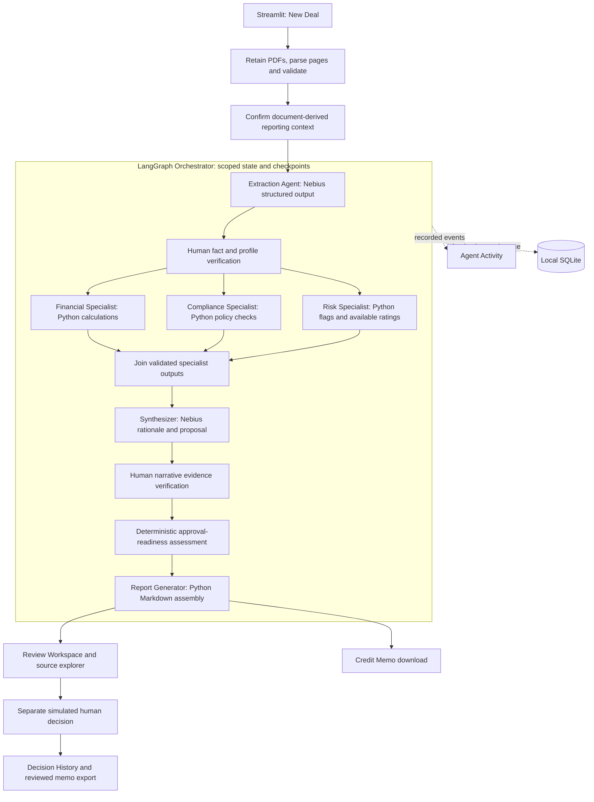

# Deal or No Deal AI
## Project 3B — Multi-Agent Deal Review Pipeline

**Weekly submission report — Draft**  
**Reporting date:** October 25, 2026, Pacific Time  
**Tagline:** Every deal has a story. Our agents find the plot holes.  
**Scope:** Local educational prototype using fictional commercial-loan documents.

### 1. Executive summary

**Deal or No Deal AI** is a multi-agent financial deal review assistant that turns
commercial lending documents into structured, explainable, evidence-backed review
findings. Its purpose is to help an analyst understand a deal and identify what
still needs human attention.

Traditional credit reviews require analysts to reconcile financial statements,
loan agreements, collateral evidence and policy requirements manually. A single
AI-generated recommendation can hide calculation errors, unsupported assumptions
or unresolved exceptions. We designed around a different principle: **AI should
accelerate financial analysis without removing transparency or human accountability.**

Using LangGraph, the application coordinates extraction, financial, compliance and
risk responsibilities. Nebius powers structured extraction and synthesis; Python
calculates ratios, evaluates configured policies and assesses decision readiness.

Our demonstration centers on a fictional **USD1.2 million equipment loan**. Despite
DSCR of **1.50x**, LTV of **60%** and an illustrative **Low** risk score, the system
retains **Pending Review** because the annual-reporting covenant remains unresolved.
This is the central design insight: **a financially attractive deal is not
necessarily ready for approval.**

A live uploaded Standard Deal has completed the analysis and memo workflow,
including browser source inspection and report download. The expanded general-
upload path adds parallel specialist execution and human-review checkpoints;
one complete fresh live walkthrough of that newest path remains the highest-
priority verification task.

The project demonstrates purposeful specialization, reproducible calculations,
structured handoffs and reviewable exceptions. It is an educational decision-
support prototype using fictional deals and simulated roles.

### 2. Assignment alignment

| Assignment requirement | Implemented responsibility | Evidence and boundary |
|---|---|---|
| Agent 1 extracts key terms | Extraction Agent | Live structured Nebius output with source handles; saved examples remain separately labeled |
| Agent 2 checks compliance | Compliance Agent | Deterministic configured sample-policy checks; no claim of regulatory certification |
| Agent 3 flags risks and summarizes | Risk and Summary Agent role | Python risk stage followed by live synthesis; distinct internal nodes |
| Orchestrator coordinates the pipeline | LangGraph Orchestrator Agent | State, dependencies, conditional routing, checkpoints and explicit continuation |
| Three or more specialist roles | Extraction, Compliance, Risk/Summary; financial support | Two normal LLM stages, not three independent LLM agents |
| Agent communication | Structured shared-state artifacts | Source-linked panel outputs and recorded handoffs; no fabricated agent chat |
| Sample review output | Source-linked Markdown credit memo | Actual completed uploaded Standard Deal evidence retained |
| Recording and repository links | Submission artifacts | **[NOT VERIFIED]** Links still need to be supplied |

### 3. Business problem and opportunity

A commercial-loan review combines contracts, financial schedules, collateral
information and policy requirements. A reviewer must reconcile reporting periods,
calculate ratios, identify missing evidence and prepare a defensible explanation.
Fragmented documents make those tasks repetitive and make inconsistencies harder
to notice.

A single free-form model response can mix extraction, arithmetic and judgment
without exposing which step failed. This prototype separates those responsibilities
and makes intermediate results visible before a human records a decision.

The intended business opportunity is less document transcription and memo assembly,
more consistent application of explicit rules, and earlier identification of
unresolved issues. These benefits are proposed; analyst time savings and lending
outcomes have not been measured.

### 4. Product vision and target users

The product moves the analyst from assembling a review to challenging a prepared,
source-linked analysis. Human judgment remains necessary at both stages.

| Before: manual review | After: assisted review |
|---|---|
| Read across documents and copy terms into a working file | Inspect structured terms beside their source references |
| Re-enter numbers and calculate ratios separately | Check reproducible Python calculations and their inputs |
| Compare figures with policy limits manually | Review explicit applicability, rule results and exceptions |
| Track missing information in disconnected notes | Inspect unresolved requirements and permitted next actions |
| Assemble a memo and record the decision separately | Review a generated draft, then record a separate human action |

This demonstrates fewer manual transfers within the application. It does not
establish a measured reduction in analyst time or eliminate evidence review.

| User | Job to be done | Product support |
|---|---|---|
| Credit analyst / loan officer | Prepare a coherent deal review | Upload inspection, extracted terms, calculations and draft memo |
| Underwriter / Risk Manager | Challenge repayment assumptions and missing inputs | Source evidence, ratio definitions, risk drivers and evidence-review controls |
| Compliance Officer | Review applicable controls and policy findings | Explicit applicability, exceptions and policy-linked evidence |
| Credit officer / committee member | Understand the recommendation and decide what happens next | Readiness, unresolved issues, comments and role-controlled human actions |

Roles are simulated. The application assists decisions; it does not originate,
fund or authorize a real loan. Insurance and separate equity-investment reviews
are possible future applications, not implemented MVP workflows. The investment
perspective in this MVP concerns the same loan as a debt investment.

### 5. Product features and user experience

| Screen | User objective and capabilities | Backend involvement and output |
|---|---|---|
| Deal Dashboard | Find deals needing attention | Scoped stored review states, readiness and human status; navigable deal summaries |
| New Deal | Start a sample or upload one fictional deal package | Parse/validate PDFs, show page evidence, prefill editable reporting context and explicitly start analysis |
| Review Workspace | Understand and challenge findings | Extracted terms, financial metrics, policy results, risks, evidence explorer and human-review controls |
| Agent Activity | See what executed and where work paused | Recorded stage events, specialist outputs, handoffs and failures; no invented execution history |
| Credit Memo | Read and export a consolidated review | Python-generated Markdown with findings, conditions, limitations and supporting references |
| Decision History | Review who did what and why | Separately recorded comments, status changes, timestamps and analysis snapshots |

The reporting-context form uses document-derived suggestions where text is clear.
It retains editable dates, annual actual/projection type and policy applicability;
comparative dates are optional. Suggestions are not verification. Unrecognized or
conflicting fields remain blank; policy applicability remains Unknown unless
explicitly declared. Review date may default to the upload's UTC date, visibly
identified as a default rather than a contractual date.

All downstream screens use the same scoped Deal ID, review identity, source
binding and stored artifacts. Saving reporting metadata does not execute AI.

### 6. Multi-agent architecture diagram

Three mechanisms have distinct jobs: **LLM agents** interpret documents and
explain findings; **deterministic specialist nodes** calculate and apply explicit
rules; the **LangGraph orchestrator** manages dependencies, state and checkpoints.
No additional planning LLM is needed to decide the prescribed next step.

The diagram below describes the **new uploaded-review path**. Registered sample
and historical reviews retain their recorded sequential or demo-draft behavior.



### 7. Agent responsibilities and orchestration

#### Specialist independence and execution mechanisms

This is a **hybrid specialist workflow**: each specialist owns a bounded
responsibility, consumes a defined contract and produces a separately validated
output. Independence does not mean every specialist chooses its own goals or
uses an LLM. Confirm this interpretation with the examiner if the rubric requires
three autonomous LLM agents; that interpretation has not been verified.

| Specialist | Independent responsibility | Execution mechanism | Output |
|---|---|---|---|
| Extraction | Identify deal terms and source evidence | Nebius LLM in `extractor`; Pydantic validation | Validated `DealTermsWire`, then scoped domain inputs |
| Financial | Calculate applicable metrics with consistent periods and units | Python specialist node `financial_analyst` | Financial results, validity states and calculation references |
| Compliance | Evaluate policy applicability and exceptions | Python specialist node `compliance_check` | Policy findings, unresolved applicability and exceptions |
| Risk | Aggregate risk drivers and available factors | Python specialist node `risk_quantifier` | Risk assessment, missing factors and risk flags |
| Synthesis | Combine three specialist results | Nebius LLM in `synthesizer`; structured-output checks | Structured recommendation, observations, rationale and conditions |
| Orchestrator | Coordinate routing, state and checkpoints | LangGraph outer graph and specialist subgraph | Recorded workflow state, artifacts and handoff events |

Deterministic specialists suit arithmetic and explicit rules because identical
valid inputs should produce identical results. Adding an autonomous model solely
to increase the agent count would add cost and another source of inconsistency.
The design demonstrates coordinated specialization; it does not claim autonomous
reasoning at every node.

The report generator is a Python service, not an additional model call. Similarly,
policy validation is part of the Compliance responsibility; it is not a duplicated
policy LLM agent.

New uploads use a real three-branch LangGraph subgraph after fact verification.
Branches return disjoint results and independently recompute inexpensive inputs.
The parent joins and persists them, avoiding concurrent SQLite mutations. Synthesis
does not start until the three panels are available.

#### Implemented graph execution and shared-state contracts

These node names reflect the implementation in `graph.py` and `live_worker.py`.
This topology is **not** a claim that a fresh live execution has completed:

```text
pdf_input -> extractor -> fact_review [human interrupt]
  -> specialist_panel
       |-> financial_analyst --|
       |-> compliance_check --|-> specialist_join
       |-> risk_quantifier ---|
  -> synthesizer -> evidence_review [human interrupt]
  -> route_review -> report_generator
```

Conditional routing may stop for missing information, invalid output,
configuration or recovery, or add credit-review steps. A stop is not a completed
stage. Registered samples and historical reviews retain their recorded topology.

| Contract | Implementation and proof to show |
|---|---|
| Shared identity | `context.scope`: workspace, deal, review, run, thread and input revision |
| Model handoff | Validated extraction retains `value`, `refs` and `basis_id`; synthesis consumes current panels |
| Parallel fan-out | `run_specialist_branches` connects START to three specialist nodes; maximum concurrency three |
| Disjoint outputs | `PanelState.panels` merges branch-specific results; duplicate specialist output is rejected |
| Fan-in | `specialist_join` waits for all three branches; the parent persists their artifacts before synthesis |
| Recorded execution | Current-run events, artifact digests, execution-group and input-digest fields identify actual outputs |
| Human checkpoints | Fact/profile and narrative support records precede explicit graph continuation |

An offline three-party threading-barrier test establishes actual fan-out. The
fresh live recording must also show its events and joined results. Event insertion
order alone does not establish parallel timing or a measured latency benefit.

SQLite-backed LangGraph checkpoints support pause/resume. Human evidence review
uses interrupts and explicit continuation. Missing facts, invalid structured
outputs or unresolved provider outcomes stop progression without substituting
saved answers. Local checkpoints and audit records are retained, but are not
claimed to be immutable or tamper-proof storage.

### 8. Critical design decisions and trade-offs

| Problem and alternatives | Decision and rationale | Trade-off and mitigation |
|---|---|---|
| One large LLM prompt versus bounded specialists | Separate extraction, Python analysis, synthesis and routing so results can be inspected independently | More state/contracts to maintain; strict schemas and scoped artifacts limit error propagation |
| Model-generated ratios versus ordinary code | Calculate ratios and thresholds with Decimal | Less flexibility for unusual financial definitions; missing/unsupported bases are disclosed rather than guessed |
| Free-running supervisor versus a stateful graph | Use explicit LangGraph nodes, dependencies and human interrupts | Less autonomous planning; predictable progression suits the narrow demo |
| Sequential analysis versus parallel specialists | New uploads fan out Financial/Compliance/Risk and join; sample/historical behavior is preserved | Small repeated calculations; parent-only writes avoid state races. No measured speedup is claimed |
| Generate a memo immediately versus show intermediate review | Keep Workspace, source navigation and checkpoint reviews | More reviewer interactions; users can identify an incorrect period or unsupported claim before relying on the memo |
| Large retrieval infrastructure versus bounded document context | Use current deal's eligible cited pages directly for the MVP | Limited document size; benchmark retrieval separately before changing the runtime path |
| Treat AI Approve as final versus maintain separate decisions | Preserve AI proposal, deterministic readiness and human decision separately | More statuses; consistent labels explain why a positive proposal may still be Pending Review |
| Add many formats versus finish a narrow supported path | Keep the verified runtime intake to text PDFs | CSV, XLSX, DOCX and OCR remain unsupported in this intake until parser integration is validated |

These choices are documented in the project specifications and implementation.
The claim that specialist separation improves maintainability at larger scale is
**[DESIGN RATIONALE — INFERRED]**, not a measured scalability result.

### 9. Implementation in brief

The application uses Python and Streamlit for the review experience, LangGraph
for stateful coordination, Nebius for two normal generation stages, and Pydantic
for structured contracts. Decimal calculations and policy rules remain in Python;
SQLite retains scoped review records and checkpoints. pypdf supplies parsed text
and page references.

Runtime grounding uses the current deal's bounded cited pages. It is not presented
as a deployed vector-RAG system. Retrieval benchmarks and saved-answer evaluation
are separate from the runtime review. The verified dependency inventory, code
boundaries and retrieval limitations are collected in Appendix B.

### 10. Financial risk and compliance methodology

The calculations answer reviewer questions, not just populate a dashboard:

| Finding | Meaning for the reviewer | What still needs judgment |
|---|---|---|
| DSCR1.50x | Supplied annual cash exceeds the documented annual debt service | Validate forecast assumptions and cash-flow evidence; full-term repayment remains unassessed |
| LTV60% | Supplied exposure is below the sample collateral threshold | Verify eligible value and lien premises; this is not a legal collateral opinion |
| Debt / EBITDA3.00x | Leverage is below the configured sample exception level | Assess the reliability of debt and earnings inputs |
| Projected revenue growth10% | The supplied forecast rises between the two periods | Recognize this as a projection comparison, not observed historical growth |
| Low illustrative risk | Available authored factors aggregate to a low modeled score | Do not interpret it as a default probability or policy clearance |
| Covenant evaluation incomplete | Readiness remains Pending Review | Establish applicability, contractual timing, evidence and compliance status |

The practical next action is to complete the unresolved review, not to approve
because the numerical indicators look favorable. Definitions follow so another
reviewer can reproduce and challenge each calculation.

The following definitions are implemented in Python. Inputs must refer to the
same borrower, applicable period, currency and units. Definitions and thresholds
are educational choices, not universal lending standards.

| Metric / rule | Definition and required evidence | Standard Deal result / configured check |
|---|---|---|
| EBIT | Net income + interest expense + income-tax expense; annual schedule | USD900,000 |
| EBITDA | EBIT + depreciation + amortization; no discretionary addbacks | USD1,100,000 |
| Funded debt | Existing funded debt + proposed borrowing − documented repayment | USD3,300,000 |
| DSCR | Annual cash available for debt service ÷ (annual principal + annual interest) | 900,000 / 600,000 = 1.50x; sample exception below 1.25x |
| Debt / EBITDA | Funded debt ÷ annual EBITDA | 3.00x; sample exception above 4.00x |
| LTV | (Secured exposure + prior-ranking liens) ÷ eligible equipment value × 100 | 60.00%; sample exception above 80% when equipment policy applies |
| Revenue growth | (Current revenue − comparative revenue) ÷ comparative revenue × 100 | 10.00%, comparing supplied projections |
| Current ratio | Current assets ÷ current liabilities | 2.00x |
| Interest coverage | EBIT ÷ annual interest expense | 9.00x |
| Debt-to-equity | Requires an approved equity-based definition and inputs | **Not implemented**; Debt / EBITDA must not be relabeled as debt-to-equity |
| Repayment capacity | Annual CFADS and documented annual debt service | Annual coverage only; balloon/refinancing/full-term adequacy not established |
| Covenant readiness | Applicability, timing, due date, evidence and compliance status | Annual financial-statement obligation remains incomplete without supported evaluation |

Financial schedules supply the income statement, annual debt service and pro-forma
balance sheet. Collateral pages supply value, exposure and lien premises. The loan
agreement supplies terms and the annual-reporting covenant. Configured sample
policy also includes term, amount and confidence-based review controls. Threshold
breaches identify exceptions; they do not automatically mean Reject.

The illustrative composite score weights repayment capacity 30%, leverage 20%,
collateral 20%, credit profile 20%, and business/industry 10%. It aggregates
authored factor ratings, not a trained default model. The Standard Deal's supplied
ratings produce **21/100, Low**; this is not a 21% default probability. New generic
uploads do not inherit these authored ratings and remain unscored when factors
are unavailable.

Facts, arithmetic, policy findings, AI interpretations, missing evidence and human
decisions remain distinguishable. Presence of a citation is not proof that its
claim is supported. Future reporting obligations are not automatically breaches.

**Educational approval exception:** completed uploaded reviews with exclusively
PENDING blockers may receive an explicitly acknowledged, reasoned human approval
override from a simulated NORMAL Authorized Approver. The AI readiness remains
Pending Review and the unresolved requirements remain recorded. Missing/stale
evidence, material policy exceptions, recovery errors and outstanding information
requests are not covered. This demonstration exception is not a real lending
authorization or a model-generated waiver.

### 11. End-to-end demo walkthrough

#### Highest-priority proof: one fresh continuous walkthrough

**Status: [NOT VERIFIED] for the newest general-upload live path.** Historical
live Standard Deal evidence and newer offline regressions establish different
things. This report update adds a proof requirement; it does not execute a review.

Use a previously unused synthetic package with its own borrower and financial
values. Retain one continuous recording; do not show saved Standard Deal results
as if they came from the new upload.

| Step | Required demonstration | Evidence to retain |
|---|---|---|
| 1 | Upload a previously unused synthetic deal package | Original package, filenames, file hashes and new Deal ID |
| 2 | Display parsing, reporting periods and extracted source evidence | Parsed pages, reporting declarations and cited preview |
| 3 | Trigger live Nebius extraction and inspect Pydantic output | Provider provenance, validated fields, source references and actual usage |
| 4 | Demonstrate human fact verification | Paused graph plus genuine reviewer assessments, including withheld support |
| 5 | Resume Financial, Compliance and Risk branches | Fan-out/join artifacts and stage events with one shared scope |
| 6 | Show merged findings and live synthesis | Three panels, structured recommendation, rationale and evidence |
| 7 | Complete narrative verification and readiness evaluation | Reviewer actions, continuation, unresolved requirements and readiness |
| 8 | Open Workspace, Activity, Memo and Decision History | Same Deal ID/review version, memo download and history without new inference |

Retain an evidence manifest with Deal ID, run/thread identities, package digest,
model and prompt/configuration versions, policy version, checkpoint/reviewer
timestamps, provider usage and memo identity. A history page with no human credit
decision is valid; do not fabricate approval. If a decision is demonstrated, show
its separate role, comments, timestamp and any educational-override label.

Completion requires evidence of all applicable stages and human checkpoints for
that one review, with consistent results across screens. Report a partial run as
partial, including its blocker. Unknown usage is not zero cost. A model or test
helper must not manufacture human support for the actual demonstration.

**Reviewer expectation:** one continuous, reproducible execution is more persuasive
than disconnected results from different versions.

**Case:** Example Equipment LLC, fictional USD1.2 million equipment term loan,
48-month term, supplied 2027 annual projections and 2026 comparative projections.

| Demo step | User action | Agent / backend behavior | Evidence and result |
|---|---|---|---|
| Upload | Select the agreement, financials and collateral/assessment PDFs | Retain and parse one package | Original files, page text, validation and citation handles |
| Context | Review prefilled borrower, periods and applicability; confirm and save | Save an explicitly unverified reporting profile | Source suggestions and one upload-derived Deal ID |
| Start | Click Run once | Live Extraction Agent emits structured facts | Uploaded values and page references, not saved responses |
| Verify | Complete required checks in the indicated reviewer roles | LangGraph pauses/resumes for new upload evidence review | Recorded support or withholding, never automatic Pass |
| Analyze | Continue | Financial, Compliance and Risk branches join | DSCR, LTV, policy results, missing factors and risk flags |
| Synthesize | Continue after applicable checks | Live synthesis proposes a referenced explanation | Original AI proposal plus separate effective readiness |
| Review | Inspect Workspace and Agent Activity | Read the same deal's stored artifacts | Financial inputs, rule traces, source explorer and handoffs |
| Memo | Open Credit Memo and download | Python assembles upstream outputs | Findings, proposed conditions, limits and supporting sources |
| Decide | Authorized simulated reviewer records an action and comments | Separate version-checked human event | Decision History with UTC timestamp and retained analysis snapshot |

The memorable result is **Low illustrative risk, zero numerical policy exceptions,
but Pending Review**. The annual-statements covenant still needs its contractual
timing and requirements evaluated. A Low score cannot complete that review.

Historical uploaded Standard Deal runs completed under the earlier unverified
demo-draft policy. The new uploaded path adds mandatory fact and narrative
checkpoints; do not present a historical draft as proof those newer human steps
were performed. A missing-data case pauses or produces an explicitly partial
review rather than inventing values or displaying a fabricated low score.

### 12. Evidence: what has been demonstrated

The evidence falls into four categories. Results from different checkpoints are
not a single fresh full-suite run; overlapping test counts must not be added.

#### A. Actual live-model evidence

An uploaded Standard Deal completed a browser walkthrough with actual Nebius
extraction and synthesis, source inspection, same-deal navigation and memo download.
That review recorded **two generation requests**, **4,018 input tokens**, **1,109
output tokens**, and **USD0.0007345 generation cost at configured rates**. It remained
an unverified educational draft with Pending Review readiness, not a credit approval.

This proves a bounded uploaded Standard Deal journey under its recorded policy.
It does not prove completion of the newer general-profile human-checkpoint path.
No fresh model call was made while revising this submission.

#### B. Deterministic and offline integration tests

| Recorded test group | Observed result | What it establishes |
|---|---|---|
| Upload acceptance regression | 57 tests and 55 subtests passed | Calculations, sample compatibility, citations, permissions and navigation under provider mocks |
| General-upload module | 11 tests passed, including inherited cases | Different borrower/values, actual fan-out, checkpoint/resume, missing score and same-ID screens |
| Reporting-context save fix | Six focused tests passed | Metadata can save without clearing or depending on an unrelated execution lock |
| Educational approval override | Four focused tests passed; separate UI regression passed | Explicit authorized exception, unchanged readiness, role checks and visible controls |
| Recovery regressions | Ten tests passed | Scoped isolation retains unknown cost/history and fences replay |

These results demonstrate software behavior; they are not model-accuracy scores.
An independently read completed live record also contained the expected nine
financial values and Pending Review readiness. References to the dated artifacts
are in the evidence index.

#### C. Saved-answer evaluations and advisory judging

| Assessment | Recorded result | Interpretation boundary |
|---|---|---|
| Native RAGAS on a saved Standard Deal answer | Faithfulness0.8; Response Relevancy approximately0.5363; Context Recall0.8 | Not scores for a newly uploaded live answer |
| Native Context Precision | Not Applicable for that unranked DIRECT context | Do not invent a score |
| Separate custom five-dimension rubric | 5/5 per dimension | Different scale and method; not interchangeable with native RAGAS |
| Fact-level judge | 31 accepted citation checks; five flags among36 targets | Advisory citation assessment, not a validated extraction-accuracy percentage or human verification |

The disagreement between custom perfect scores and lower native response
relevancy deserves investigation. Different definitions, context, references or
judge behavior may contribute; the cause is not established by those scores.

#### D. Future live-quality and business measurements

**Not yet measured for the newest live path:** field-level extraction quality,
supported-claim rates, risk recall and false-positive counts, recommendation
consistency, live-answer RAGAS, stage/end-to-end latency and repeat-run reliability.
Phase 2 remains deferred until separately authorized. The proposed methodology
and required references appear in Appendix D.

Analyst time savings, general accuracy percentages and parallel speedup are also
unmeasured. A future user study should compare manual transcription, ratio
preparation, policy lookup, evidence checking and memo preparation separately.
Historical runtime troubleshooting is in Appendix C.

### 13. Business value and differentiation

The application reduces the need to transfer the same information between
disconnected working files. Its intended contribution can be described precisely:

| Manual task | Application contribution | Human work retained |
|---|---|---|
| Transcribe loan and financial terms | Produces source-linked structured fields | Check extraction, periods and document meaning |
| Recalculate financial ratios | Runs reproducible formulas on current inputs | Validate assumptions and economic interpretation |
| Look up sample policy limits | Displays predicates, observed values and outcomes | Determine applicability and resolve exceptions |
| Assemble a draft memo | Combines recorded findings and references | Review conclusions and unresolved issues |
| Reconstruct decision context later | Retains comments, timestamps and analysis snapshots | Own and explain the simulated decision |

These are demonstrated workflow contributions, not measured productivity gains.

The demonstrated value is a connected review record: documents become cited
facts, facts become reproducible calculations, calculations feed explicit rules,
and findings become a reviewable memo and separate human action history.

Potential institutional benefits include reduced transcription, consistent
application of approved rules, quicker draft preparation and clearer ownership
of unresolved issues. These remain hypotheses for a future user study, not
validated productivity or financial-return claims.

Differentiation is visible in concrete behavior: a two-call generation design
avoids spending tokens on arithmetic; current-period/source scope prevents
unrelated-deal leakage; partial information is exposed; and original AI proposals
are retained even when effective readiness disagrees. Those are useful product
and engineering demonstrations without claiming enterprise readiness.

### 14. MVP limitations and prioritized roadmap

**First priority:** complete and record the newest general-upload workflow with
genuine fact and narrative verification. This closes the largest submission-
evidence gap before expanding formats, agent count or retrieval infrastructure.

| Priority | Next work / limitation | Value, complexity and risk |
|---|---|---|
| P0 | Finish one newly uploaded general-profile live walkthrough with genuine human evidence review | High demo value; moderate effort; closes the gap between offline generalization tests and live use |
| P0 | Stabilize one documented app launch and improve provider diagnostics | High usability/reliability value; low-to-moderate effort; prevents confusing old-server and unknown-request states |
| P0 | Reconcile historical uncertain provider usage when matching records are available | Cost transparency; external evidence dependency; no invented usage |
| P1 | Phase 2 live-answer evaluation on held-out synthetic cases | High trust value; moderate effort; measure unsupported claims and excessive risk flags |
| P1 | Test unfamiliar financial layouts, year-column alignment and cut-off passages | High error-reduction value; moderate effort; maintain explicit unsupported states |
| P1 | Benchmark DIRECT, KEYWORD, VECTOR and HYBRID on identical questions | Determine retrieval value before adding complexity; do not assume vector search is better |
| P2 | Additional formats, OCR and larger document packs | **[FUTURE ENHANCEMENT]** High breadth, higher parsing/context risk |
| P2 | Real identity/authorization, institutional policy governance and protected audit infrastructure | **[FUTURE ENHANCEMENT]** Required before considering real financial-service deployment |

Current intake is bounded to up to three synthetic text PDFs, ten pages and 10MB,
USD whole units and annual analysis. Separate statistical default prediction,
calibrated PD/LGD/EAD, real bureau/KYC integrations, portfolio concentration
validation, multi-user load testing and production security are not established.
The notebook artifact does not have a verified fresh Jupyter-kernel run; optional
notebook installation was deferred. No public deployment is claimed.

### 15. Deliverables and links

| Deliverable | Submission status |
|---|---|
| Application and specialized graph | Implemented locally; see architecture and limitations above |
| Sample memo and live evidence | Retained locally; select an approved synthetic artifact for submission |
| Specification-driven documents | PRD, HLD, feature specs, execution plan, evaluation and traceability files |
| GitHub | **[INSERT GITHUB LINK — NOT VERIFIED]** |
| Demo recording | **[INSERT VIDEO LINK — NOT VERIFIED]** |
| Public application | **[NOT DEPLOYED]** Local instance is not a shareable hosting link |

Suggested recording: show one package, inspect a source page, run the graph,
explain a financial calculation, open its supporting evidence, demonstrate why
Pending Review differs from Reject, and download the same deal's memo. Clearly
label any educational human override and any saved response used in a fallback
presentation; do not represent saved output as a new live call.

### 16. Conclusion

Deal or No Deal AI demonstrates a financial review workflow whose reasoning is
inspectable at each handoff. Its strongest example is not an automatic approval:
it is the ability to explain why apparently healthy financial metrics still leave
an unresolved contractual review. The combination of bounded specialization,
deterministic controls, source navigation and separately recorded human judgment
makes the project a useful educational multi-agent implementation.

### Evidence index

- Product requirements: [PRD](product/prd.md).
- Architecture: [HLD](architecture/hld.md), [uploaded fan-out decision](architecture/decisions/uploaded-parallel-review.md).
- Upload behavior: [general upload contract](specs/general-upload-acceptance.md), [human decisions](specs/uploaded-human-decisions.md).
- Actual live/browser evidence: [uploaded live results](evaluation/upload-live-demo-results.md).
- Functional regression: [acceptance fixes](evaluation/upload-acceptance-fixes-results.md).
- Earlier evaluator evidence: [answer-quality results](evaluation/live-answer-quality-results.md).
- Runtime diagnosis: [network context](evaluation/network-context-diagnosis.md).
- Code: `graph.py`, `live_worker.py`, `finance.py`, `policy.py`, `risk.py`,
  `readiness.py`, `uploaded_decisions.py`, `memo.py` under `src/deal_or_no_deal_ai/`.

Some referenced documents retain historical status sections. Current code and
explicitly dated execution evidence take precedence over an older status sentence.


### Appendix A — Detailed specialist input and output contracts

| Component | Receives | Produces and validates | Handoff |
|---|---|---|---|
| Extraction Agent | Current deal's parsed pages, source handles, reporting bases and strict schema | DealTermsWire: terms, financial inputs, evidence references and conflicts; Pydantic and source/basis checks | Human fact/profile verification |
| Financial Specialist | Extracted values with units, periods and scope | Reproducible Decimal calculations; missing or invalid inputs remain explicit | Joined financial panel |
| Compliance Agent | Extracted facts, independently derived metrics and configured sample policy | Applicability-aware rule results, missing controls and exceptions | Joined compliance panel |
| Risk Agent | Current deal's facts, derived metrics and policy findings | Risk flags; weighted score only when supported authored factors exist | Joined risk panel |
| Synthesizer | The three recorded panels and allowed source references | Structured proposal, confidence, rationale, conditions and referenced observations | Human narrative verification and readiness routing |
| Orchestrator Agent | Shared state and explicit user commands | Ordered dependencies, fan-out/join where enabled, validation, budgets and conditional stops | Next permitted node or checkpoint |
| Credit Memo / Report Generator | Recorded upstream outputs and readiness | Deterministic Markdown report with evidence and audit references | Existing review screens and download |

### Appendix B — Detailed technology inventory and implementation boundaries

| Verified technology | Role and fit | Limitation / trade-off |
|---|---|---|
| Python 3.12 | Application, calculations, policies and report services | Local runtime and dependency setup required |
| Streamlit | Six-screen Python review interface | Rerun/session behavior needs careful identity handling |
| LangGraph | Stateful coordination, conditional routing and specialist subgraph | More explicit graph/state code than a linear script |
| langchain-core | Selected framework primitives | Does not imply every agent uses an autonomous LangChain executor |
| Nebius Token Factory | Live generation with Qwen/Qwen3-30B-A3B-Instruct-2507 | Requires credentials, network access, token fit and available allowance |
| Pydantic | Strict extraction, synthesis and action contracts | Valid JSON does not prove factual correctness |
| pypdf | Local text-PDF parsing and page references | No OCR or guarantee of complex table/year-column fidelity |
| Decimal | Exact arithmetic and deterministic comparisons | Does not verify the economic meaning of an input |
| SQLite / LangGraph SQLite checkpointer | Scoped records, retained sources, checkpoints and action history | Local persistence; no enterprise access isolation or tamper-proof audit claim |
| pytest / Streamlit AppTest | Financial, graph, authorization and UI regressions | Mocked provider tests do not establish live model quality |
| Optional RAGAS 0.4.3 evaluation code | Separate answer-quality evaluation | Completed saved-answer evidence must not be presented as current live-answer evaluation |

Core boundaries are implemented under `src/deal_or_no_deal_ai/`: upload intake and
profiles; live context/worker; graph; finance/policy/risk services; readiness;
uploaded decisions; memo; and shared UI projections. Prompts and specialist
contracts are versioned under `docs/agents/`; model configuration is under
`config/`. API credentials remain local and must not be committed or shown.

**Retrieval clarification:** runtime upload analysis uses bounded, cited document
context. Parsing and placing pages in a prompt is not a vector RAG pipeline.
Separate benchmark code implements DIRECT, keyword, vector and hybrid retrieval
mechanics; hosted embedding capability has been checked. Those components do not
establish a deployed hybrid retrieval path for every uploaded review. No Pinecone
or other hosted vector database is required by the current workflow.

### Appendix C — Historical runtime diagnostics

One operational lesson was directly observed: the earlier sandboxed runtime could
not reach Nebius, while an approved read-only check outside it returned HTTP200
and confirmed the selected model. A network-capable local app was subsequently
started. Credentials, network access and generation correctness are separate
checks. Unknown request costs remain reserved rather than inferred from rounded
aggregate bills.

This operational history explains reliability work; it is not the main demonstration or evidence of model accuracy. Local server addresses are session-specific, not public deployment links.

### Appendix D — Proposed live-evaluation methodology

**Status: proposed, not executed for this report.** Freeze the final live review before evaluation; keep scores and test results separate.

Freeze the fresh review's actual extraction, context, calculations and synthesis
before scoring. Establish expected facts independently from that package, checking
borrower, year columns, units and qualifications. Do not reuse a saved reference
answer for a different borrower.

| Objective | Measurement on the frozen live review | Evidence boundary |
|---|---|---|
| Extraction | Correct expected fields, omissions and unsupported additions; counts and denominators | New live case not yet scored |
| Financial correctness | Independently expected Decimal results and missing/invalid-input behavior | Rule tests do not prove live extraction correctness |
| Policy correctness | Expected applicability, observed values and outcomes against the case-specific sample policy | No universal bank-compliance claim |
| Citation support | Source text supports the claim and correct period/borrower; count unsupported claims | Matching a source ID alone is insufficient |
| Risk identification | Expected risk recall and false-positive counts, reported separately | One demonstration is not broad accuracy evidence |
| Recommendation consistency | Readiness, unresolved requirements and next action agree | Original AI proposal remains distinct |
| Native RAGAS | Actual live answer/context/reference; metric version, raw score and status | Saved-answer scores are not live scores; unrun stays unrun |
| Custom rubric | Separate 1–5 scores and examples for faithfulness, relevance, completeness, attribution and coherence | Do not average or convert into native scores |
| Operations | Completion/stops, stage/total latency, tokens, known cost and unknown reservations | One run is descriptive, not a load benchmark |

Investigate the existing custom 5/5 results alongside native response relevancy
of approximately 0.5363. Different definitions, context, references and judge
behavior may contribute; the cause is not established by the numbers. Similarly,
31 accepted citation checks from 36 fact targets are not a validated extraction
accuracy percentage. Preserve disagreement and failures instead of selecting
only favorable results.
